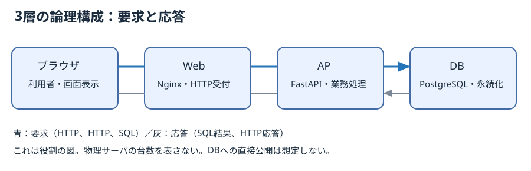
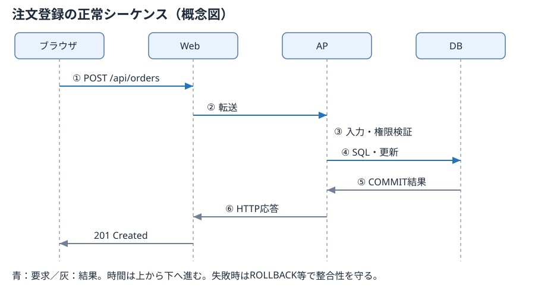

# 第3講 Web・AP・DBの3層アーキテクチャ

## 到達目標
Web・AP・DBの3層それぞれの役割、HTTP要求からSQL更新までの正常な流れ、障害時のエラーの現れ方、ログ・設定を用いた切り分けを説明できる。層の分離と物理的な冗長化の違いを理解し、構成を選ぶ根拠を述べられる。

## 資料・重要度・学習上の前提
2026-11-21に運用マスターv1.2、正式カリキュラム、進捗をGitHubから確認。以下のコマンド・設定・ログはNginx、FastAPI、PostgreSQLを想定した架空の学習環境例であり、実行していない。公式製品マニュアルの該当箇所は本講では未照合。A必須：役割分担・正常処理・障害切り分け。B理解補助：設定・ログの読み方。C発展：分離・冗長化・タイムアウトの設計。

## 1. なぜ3層に分けるのか
単一プログラムが画面表示、注文計算、データ保存をすべて担うと、変更の影響が広がりやすく、負荷の集中箇所を特定しづらい。3層構成は責務を「HTTPの入口」「業務処理」「データ管理」に分ける設計である。層を分けることは、サーバを必ず3台にすることではない。1台のホストに3サービスを置くことも、Webを2台・APを3台・DBを冗長構成にすることもある。

## 2. 3層の構成と通信

図の青矢印は要求方向、灰色の矢印は応答方向。例では利用者のブラウザからWeb層のNginxへHTTP(S)要求が入り、Web層がAP層のFastAPIへ転送する。AP層はPostgreSQLへSQLを送り、DBは検索結果や更新結果を返す。ブラウザからDBへの直接接続は想定しない。Webは公開入口、APとDBは内部ネットワークに置くのが一般的な選択肢である。

| 層 | 主な責務 | 入力・出力 | 典型的な障害の兆候 |
|---|---|---|---|
| Web | HTTPS受付、静的配信、リバースプロキシ | HTTP要求／HTTP応答 | 接続不可、502、504 |
| AP | 認証・検証、業務ルール、DB呼出 | HTTP要求／SQL・HTTP応答 | 500、処理遅延、接続枯渇 |
| DB | SQL実行、トランザクション、永続化 | SQL／行・更新結果 | 接続拒否、ロック待ち、書込失敗 |

Web層は業務データの正しさを保証せず、DB層は利用者向けの画面を組み立てる役割ではない。実際には認証基盤やキャッシュ、メッセージキューが加わることもあり、3層は全システムを網羅する厳密な台数分類ではない。

## 3. 正常処理をシーケンスで追う

注文登録を例にする。①ブラウザがPOST /api/ordersをWebへ送る。②Webは要求をAPへ転送する。③APは入力と権限を検証する。④APはDBにトランザクションを開始し、在庫確認と注文の登録を依頼する。⑤DBは整合性を確認してCOMMITし、結果を返す。⑥APは結果に応じたHTTP応答をWeb経由で返す。
「COMMIT」とはトランザクション内の変更を確定する操作である。失敗時にはROLLBACKして中途半端な更新を残さない設計が必要。ただし業務要件や実装によって複数のトランザクションに分かれる場合もある。
ブラウザで画面が開くことはWebの静的配信が動くことを示すにすぎず、APの注文処理やDBの書き込み成功までは保証しない。

## 4. 設定から通信の向きを読む
以下は説明用の簡略化したNginx設定例。実環境ではTLS終端、ヘッダー、接続制限、認証、ログ、タイムアウト等を別途設計する。
```nginx
server {
    listen 8080;
    location /api/ {
        proxy_pass http://ap:8000;
    }
}
```
`listen 8080`はWebが8080番ポートで受け付ける設定、`proxy_pass`は/api/への要求をAPの8000番へ転送する指定である。名前`ap`が解決できること、APが8000番で待ち受けること、経路のFWが許可することが前提になる。設定に書かれた転送先が間違っていれば、APが正常でも転送できない。
AP側のDB接続先の概念例：
```text
DB_HOST=db
DB_PORT=5432
DB_NAME=orders
```
これは環境変数の例であり、パスワードは掲載しない。APがDBへ接続するには名前解決、ポート、認証情報、DBの待受、接続上限などが整合している必要がある。

## 5. 正常ログと障害ログを読む
次はすべて架空のログである。各層に共通のrequest_idを付けると同一要求を追いやすい。
```text
10:00:00 web request_id=R100 POST /api/orders status=201 upstream=ap:8000
10:00:00 ap  request_id=R100 validated=true db_commit=ok duration_ms=42
10:00:00 db  tx=TX50 COMMIT result=success
```
Webの201はHTTPとして注文作成成功を表す例、APのdb_commit=okはDB更新が確定したことを示す架空のアプリログである。実際のログ項目は設定や実装に依存する。
```text
10:15:00 web request_id=R101 POST /api/orders status=502 upstream=ap:8000
10:15:00 web error connect() failed (111: Connection refused) while connecting to upstream
```
この例ではWebからAPへのTCP接続が拒否されている。APプロセス停止、待受ポートの不一致、接続先の誤りなどを調べる。502だけで原因をAP停止と断定してはいけない。
```text
10:20:00 web request_id=R102 POST /api/orders status=504 upstream=ap:8000
10:20:00 ap  request_id=R102 db_wait_ms=30000 result=timeout
```
この例はAPがDB待ちで遅延したケース。504はWeb等のゲートウェイが上流から時間内に応答を得られなかったことを示すが、どの層が遅いかは関連ログを照合する必要がある。APの遅延にはDBロック待ち以外にも外部API待ちやCPU高負荷があり得る。

## 6. 状態・通信・業務を段階的に確認する
Linuxの検証環境での読み取り中心の確認例：
```bash
ss -lnt
curl -i --max-time 5 http://127.0.0.1:8080/api/health
docker compose ps
docker compose logs --tail=50 web ap db
```
`ss`はポートの待受、`curl`はWeb入口から見たHTTP応答、`docker compose ps`はコンテナの状態、`logs`は各サービスの直近ログを見る。Docker Composeを使用しない環境では最後の2コマンドは使えない。コマンドは実行していない。
確認は「プロセス稼働→ポート待受→ネットワーク到達→HTTP応答→DB接続→業務操作」の順に深める。各段階が成功しても次段階の成功は保証しない。例えば/healthが200でも、注文登録の書き込みトランザクションは失敗することがある。

## 7. 障害シナリオと切り分け
**Web停止**：利用者は入口に接続できない。DNSやFWも原因候補なので、Webプロセス・ポート・入口の経路を確認する。
**AP停止**：Webの静的画面は開くがAPIが502などになる場合がある。Webの転送ログとAP待受、APの起動ログを確認する。
**DB停止**：APがDBへ接続できず、業務APIが500や503等を返す場合がある。APログとDBの起動・接続ログを確認する。HTTPコードはアプリのエラー処理次第で異なる。
**DBロック待ち**：DBは起動していても特定の更新が遅延する。処理時間、待機イベント、該当SQL、トランザクションの競合を調べる。安易なDB再起動は他の正常処理も停止させる。
**ストレージ容量不足**：DBが参照可能でも書き込みに失敗することがある。DBログ、ファイルシステム容量、書き込みエラーを照合する。DBファイルの削除は行わず承認済み手順で対応する。
障害の切り分けでは「最後に正常だった境界」と「最初に異常になった境界」を探す。Webログに転送先への接続拒否があればWeb→AP境界を、APログにDB接続エラーがあればAP→DB境界を優先して調べる。

## 8. 設計判断：分離、冗長化、タイムアウト
**同一ホスト集約**は安価で構築が簡単だが、ホスト故障で3層とも停止し得る。**層ごとのホスト分離**は障害範囲を小さくしやすい一方、ネットワーク設定や運用対象が増える。**複数台冗長化**は単一ノード故障への耐性を高めるが、共通ストレージやDB、認証、LBが単一障害点になっていないか確認が必要。
Webの上流タイムアウトを短くすると利用者への応答は早く失敗するが、正常でも長い業務処理を途中で打ち切る可能性がある。長くすると処理完了を待てるが、障害時に待ち時間と接続資源の占有が増える。AP・DBのタイムアウトやリトライも整合させる。注文登録を無条件で再試行すると二重登録の危険があるため、冪等性キー等の設計を検討する。
可用性、性能、セキュリティ、費用、運用負荷を比較し、RTO・RPOと業務要件から選ぶ。

## 9. 実務製品への対応
NginxはWeb層の例、FastAPIはAPを実装するフレームワークの例、PostgreSQLやOracle DatabaseはDBMSの例である。Oracle RACはDB層の可用性・拡張性を考える際の製品技術、JP1/AJSはオンライン処理の後続バッチを管理する製品技術として後続講で扱う。これらの製品固有の設定・バージョン差は本講では未照合。

## 10. 要点
3層は台数ではなく役割の分離である。正常処理はブラウザ→Web→AP→DBと進み、結果が逆方向に戻る。HTTPステータス、プロセス状態、ポート、通信、DBログ、業務結果を一段ずつ照合する。冗長化しても共通依存や二重実行の危険は残る。

## 次講
第4講「オンライン処理・バッチ処理・外部システム連携」。理解度チェックは別途、四択10問・15点満点で実施する。
