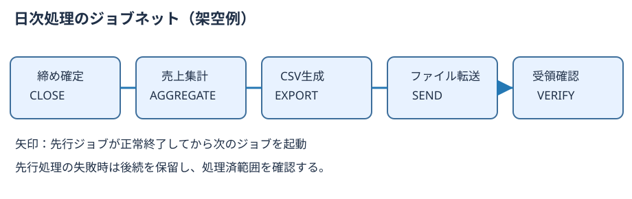
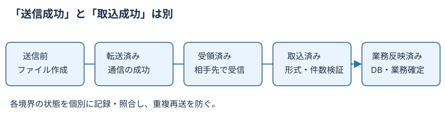

# 第4講 オンライン処理・バッチ処理・外部システム連携

## 到達目標
オンライン処理・バッチ処理・外部連携の目的、起動契機、処理単位、失敗時の回復方法を区別する。日次締め処理を例に、オンライン停止、バッチの依存関係、ファイル連携、再実行時の二重処理を説明し、ログと状態から安全な初動を判断できる。

## 資料・前提・重要度
2026-11-21にGitHubの運用マスターv1.2、正式カリキュラム、進捗を確認した。公式のJP1/AJS、Oracle、転送製品マニュアルは本講では未照合であり、以下のコマンド・ログ・業務時刻はすべて架空の学習例である。A必須：処理方式・依存関係・再実行判断。B理解補助：ログ・ジョブネット・連携方式。C発展：冪等性・整合性・設計判断。

## 1. 3種類の処理を分ける理由
企業システムは、利用者の操作にすぐ答える処理だけで動いていない。昼間に受け付けた取引を夜間に集計し、翌朝に別システムへ渡す業務もある。即時性を重視するオンライン処理、まとまった件数を計画的に扱うバッチ処理、システム境界を越えてデータを渡す外部連携は、起動契機と障害の見え方が異なる。

| 観点 | オンライン処理 | バッチ処理 | 外部システム連携 |
|---|---|---|---|
| 起動契機 | 利用者操作・API要求 | 時刻・先行ジョブ完了・手動 | API呼出・イベント・ファイル到着 |
| 処理単位 | 一要求・一取引など | 多数の対象レコード | システム間のメッセージ・ファイル |
| 重視点 | 応答時間・同時接続 | 完了期限・処理量・再実行性 | 相手先との契約・整合性・到達確認 |
| 障害の現れ方 | 画面エラー・タイムアウト | 異常終了・未実行・遅延 | 未着・重複・形式不一致・応答不能 |
| 回復の基本 | 原因除去と個別要求の扱い | 実行状態・処理済範囲を確認して再開 | 送受信の照合・重複防止・再送 |

「オンライン＝昼間」「バッチ＝夜間」とは限らない。オンラインは24時間稼働することも、バッチは5分ごとに動くこともある。また外部連携はオンラインAPIにもバッチのファイル転送にも組み込まれる。分類の軸が完全に排他的なわけではない。

## 2. オンライン処理：要求に対して結果を返す
例として利用者が口座振替を登録する。ブラウザ→Web→AP→DBの経路で、APは入力と権限を検証し、DBに登録してHTTP応答を返す。利用者は通常、その応答を待って操作の成功・失敗を判断する。
重要なのは「応答が返らない」と「DBが更新されなかった」は同義ではないこと。DBのCOMMIT後にネットワークが切れれば、利用者には失敗に見えても登録が済んでいる可能性がある。再送前に取引IDを照会する、冪等性キーで重複を防ぐといった設計が必要となる。
オンラインの監視では、HTTPエラー率、応答時間、AP接続数、DB待機時間、業務処理成功率を組み合わせる。HTTP 200だけでは業務の正常完了を保証しない。

## 3. バッチ処理：まとめて確定・集計・配信する
バッチは対象データを一括・分割して処理する方式である。日次売上集計では、締め対象を確定し、明細を集計し、帳票を生成し、他システム向けファイルを作る。各段階に順序と完了条件がある。

図の矢印は「先行処理の成功を後続処理の開始条件とする」依存関係を表す。オンライン受付終了は単なる時刻ではなく、当日対象の確定という業務上の境界である。締めが未完了なのに集計を開始すると、対象件数の欠落や二重計上が起こり得る。集計が失敗すれば帳票・連携ファイル生成は原則保留し、原因と処理済範囲を確認する。
「ジョブ」はコマンドやプログラムなどの実行単位、「ジョブネット」は複数ジョブの順序・分岐・待ち合わせを定義する単位である。スケジューラは起動条件や実行結果を管理するが、業務データの正しさまで自動的に保証するわけではない。

## 4. バッチの正常系を時系列で追う
架空のECシステムでは22:00に当日分の受注を締め、22:05に集計、22:20にCSVを作成、22:30に取引先へ送信し、受信確認をもって日次処理を完了とする。
①締め処理が対象期間と締め済みフラグを確定する。②集計ジョブが締め済みデータを読み、日次集計テーブルを更新する。③ファイル作成ジョブが決められた形式・文字コード・項目順でCSVを生成する。④転送処理が相手先へ送る。⑤相手先の受領通知または照合結果を確認し、連携完了とする。
ここで「ファイル送信コマンドが終了コード0」は、通常、転送プログラムが成功と判断したことを示すだけであり、相手先の業務システムが内容を取り込んだことまでは意味しない。受領、取込、業務反映を別々に監視する必要がある。

## 5. 外部連携の3方式とトレードオフ
| 方式 | 正常な流れ | 長所 | 主な注意点 |
|---|---|---|---|
| 同期API | 要求→相手処理→応答 | 即時に結果を確認しやすい | 相手停止が呼出側の待ち時間に波及 |
| 非同期メッセージ | キュー投入→受信側が後で処理 | 負荷平準化・一時障害への耐性 | 重複配送、順序、滞留、再試行 |
| ファイル連携 | ファイル生成→転送→取込 | 大量データ・既存システムに適する | 締め時点、形式、欠落・重複、完了確認 |

API連携ではタイムアウト、HTTPコード、認証、有効期限、レート制限を監視する。非同期連携ではキューの滞留件数と最古メッセージの待機時間を監視する。ファイル連携ではファイル名、件数、サイズ、チェックサム、送受信時刻、取込結果を照合する。チェックサムは内容が一致するか確認するための値だが、件数や業務上の妥当性を単独では保証しない。

## 6. 設定とログでジョブを読む
架空のジョブ定義を次に示す。特定製品の実際の構文ではない。
```text
JOB CLOSE_ORDERS  starts=22:00
JOB AGGREGATE     after=CLOSE_ORDERS:success
JOB EXPORT_CSV    after=AGGREGATE:success
JOB SEND_FILE     after=EXPORT_CSV:success
JOB VERIFY_ACK    after=SEND_FILE:success
```
`after=...:success`は先行ジョブが正常終了した場合だけ起動する概念的な表記である。時刻だけで後続ジョブを起動すると、先行処理の遅延・失敗時に不整合が生じる。
```text
22:00:01 CLOSE_ORDERS START run_id=D20261121
22:03:10 CLOSE_ORDERS END code=0 rows=12840
22:03:11 AGGREGATE START run_id=D20261121
22:14:52 AGGREGATE END code=0 rows=12840
22:14:53 EXPORT_CSV START run_id=D20261121
22:15:20 EXPORT_CSV END code=0 file=orders_20261121.csv rows=12840
22:15:21 SEND_FILE START run_id=D20261121
22:16:02 SEND_FILE END code=0 transfer_id=T451
22:19:05 VERIFY_ACK END code=0 accepted_rows=12840
```
ここではrun_idで同じ日次処理を追跡できる。各段階の行数が一致するのは例示であり、集計で明細がまとまる業務なら行数は一致しない。比較する件数の意味と期待値を先に定義することが重要である。終了コード0も各プログラムの仕様に従って解釈する。

## 7. 障害例：集計ジョブが異常終了した
```text
22:03:11 AGGREGATE START run_id=D20261121
22:06:40 AGGREGATE ERROR sqlstate=23505 duplicate key
22:06:40 AGGREGATE END code=12 processed=6000/12840
22:06:41 EXPORT_CSV WAIT predecessor_not_success
```
架空のPostgreSQL系エラーコード23505は一意制約違反を表す。処理済6000件というログだけでは、その6000件がCOMMIT済みかROLLBACKされたか分からない。再実行前にトランザクション境界、処理済みキー、出力済みファイル、後続ジョブの状態を確認する。
原因が重複キーなら、入力データの重複、前回の部分実行結果、集計ロジックのキー設計などを調べる。安易にジョブを「正常終了扱い」に変更すると、不完全な集計結果を後続へ流す危険がある。再実行は運用手順と承認に従い、対象範囲と影響を記録する。

## 8. 障害例：ファイル送信は成功、相手の取込が失敗
```text
22:16:02 SEND_FILE END code=0 transfer_id=T451
22:19:05 VERIFY_ACK ERROR accepted_rows=0 reason=invalid_header
```
転送は成功しても、相手の取込は失敗している。送信側だけ再実行すると同名ファイルの上書きや重複取込が起き得る。まず送信ファイルの版、ハッシュ、相手の受領・取込状態、再送時のファイル名規則を確認する。原因がヘッダー形式なら仕様に合わせて修正し、送信側と受信側で同じ連携IDを用いて照合する。

図の境界ごとに、送信前、転送済み、受領済み、取込済み、業務反映済みを分けて考える。「どこまで成功したか」が再送可否の判断を左右する。

## 9. 再実行とリカバリの設計
バッチの再実行には「全件やり直し」「失敗した範囲だけ再開」「補正データで差分反映」がある。全件やり直しは単純だが、すでに確定したデータを二重登録する危険がある。差分再開は効率的だが、チェックポイント（最後に正常完了した処理位置）と整合性管理が必要になる。
冪等性とは、同じ操作を複数回実行しても結果が意図せず重複しない性質である。日付＋取引IDを一意キーにする、取込済み連携IDを記録する、ステージング表で検証してから本表へ反映するなどの手段がある。どの方式でもDBのトランザクション境界、外部副作用、後続ジョブとの関係を確認する。
再実行前の最低限の判断は「原因が除去されたか」「前回どこまで確定したか」「後続が動いていないか」「再送・再登録で重複しないか」「締切に間に合うか」である。

## 10. 運用監視と設計判断
バッチの監視は単なる異常終了通知だけでは不足する。未起動、実行中のまま停止、終了予定時刻超過、出力件数の異常、連携先の受領遅延も監視対象となる。ジョブネット全体の終了期限をSLAや業務開始時刻から逆算する。
オンライン優先のシステムでは、大量集計SQLが日中のオンラインDBを圧迫しないよう実行時間帯や参照先を分ける設計がある。一方、夜間停止時間を確保できない24時間サービスでは、データをスナップショット的に切り出す、変更分を順次処理するなど別の工夫が必要となる。
RTO（復旧時間目標）とRPO（許容データ損失量）は可用性・復旧設計の指標であり、バッチの完了期限やデータ連携の鮮度目標とは関連するが同義ではない。重要な締め時刻、受領期限、遅延時の代替運用を業務側と合意する。

## 11. 製品との対応
JP1/AJSはジョブやジョブネットの起動条件、順序、監視、結果確認などを扱う運用製品の例である。ただしジョブの保留解除や再実行操作の意味、実行世代の扱いは製品バージョン・定義・運用ルールに依存するため、本講の概念例をそのまま実操作手順としない。
Oracle DatabaseやPostgreSQLはオンライン処理・バッチ処理の双方から利用され得る。DB側ではSQL、ロック、トランザクション、接続資源を観察する。NetBackupやShadowImageはデータ保護の仕組みであり、日次業務バッチの正常完了や連携先の取込成功を保証するものではない。

## 12. 要点
オンラインは要求ごとの応答、バッチはまとまった処理の完了、外部連携はシステム間の到達と取込を重視する。処理方式は重なり得る。ジョブネットは先行処理の成功条件で後続を制御し、転送成功と取込成功を区別する。障害時は処理済み範囲とトランザクション境界を確認し、二重処理を防いでから再実行する。

## 次講
第5講「物理構成・論理構成・システム構成図の読み方」。理解度チェックは別途、四択10問・15点満点で実施する。
