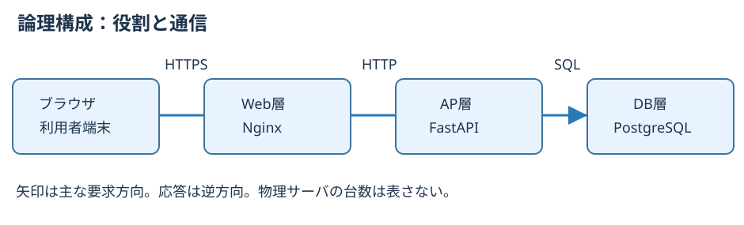
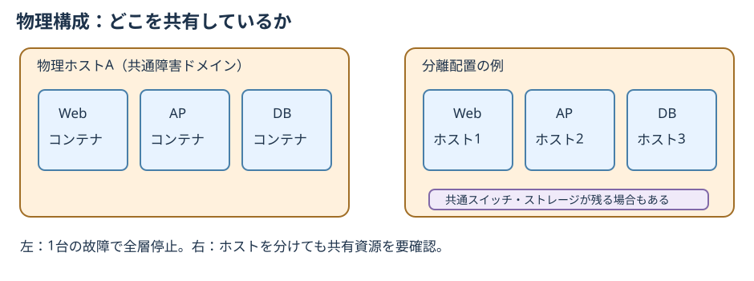

# 第5講 物理構成・論理構成・システム構成図の読み方

## 到達目標
物理構成図と論理構成図の目的と違いを説明し、サーバ・ネットワーク・ストレージ・仮想基盤・アプリケーションの対応を読み取る。構成図から通信経路、単一障害点（SPOF）、障害ドメイン、運用上の確認箇所を特定し、設計判断を説明できる。

## 資料・前提・重要度
2026-11-21にGitHubの運用マスターv1.2、正式カリキュラム、進捗を確認した。本講のIPアドレス、構成、ログ、設定は架空の学習用例である。A必須：物理・論理の区別、経路と障害ドメイン。B実務：構成図・ログ照合。C発展：冗長化と設計判断。

## 1. 構成図は何を表すのか
構成図はシステムの部品と関係を省略して示す地図である。ただし地図には種類がある。物理構成図は「実体がどこにあり、何につながるか」、論理構成図は「どんな役割があり、どんな通信・依存関係で動くか」を示す。どちらも正しいが、答えられる問いが違う。

| 観点 | 物理構成図 | 論理構成図 |
|---|---|---|
| 主な要素 | サーバ筐体、ラック、スイッチ、ストレージ、ケーブル、拠点 | Web/AP/DB、サービス、ネットワークセグメント、通信、データの流れ |
| 答える問い | 同じホストか、どのポートか、電源や回線を共有するか | 誰が誰に接続し、何を処理するか |
| 障害対応 | 電源、NIC、スイッチ、ホスト、SAN経路の故障範囲 | HTTP、API、SQL、名前解決、認証、依存サービスの切り分け |
| 落とし穴 | 物理接続が分かっても業務処理は分からない | 論理的に別でも同一物理装置上かもしれない |

構成図を読むときは、図の題名、作成日、対象環境（本番/検証）、凡例、IPやホスト名の表記規則を最初に確認する。古い構成図だけで障害箇所を断定しない。

## 2. まず論理構成を読む
3層Webシステムの例を考える。利用者のブラウザはWebサーバへHTTPSで接続する。Webサーバ（Nginxなど）はAPサーバ（FastAPIなど）へ要求を転送し、APはDB（PostgreSQLなど）にSQLを発行する。DBは原則ブラウザから直接アクセスさせない。

図の矢印は主な要求方向を示し、応答は逆方向に返る。HTTPS、HTTP、DBプロトコルは異なる。通信が成立するには名前解決、宛先IP、ポート、経路、ファイアウォール、待受プロセス、認証など複数条件がそろう必要がある。
「Web/AP/DBの3層」は3台の物理サーバを意味しない。コンテナ3個が1台のMac上にあっても論理3層である。

## 3. 次に物理構成へ対応づける
同じ論理3層を、物理ホスト1台に載せることも、別ホスト3台に分散することもできる。前者は学習・小規模用途に適する場合があるが、ホスト故障で3層すべてが停止する。後者では一台の故障の影響を分離できる可能性があるが、共有スイッチ・共有ストレージ・共通電源があれば、その部分が単一障害点になり得る。

仮想マシンやコンテナの名前が別でも、どのハイパーバイザー、物理ホスト、ストレージ、スイッチ、電源を共有するかを確認する。論理的な分離は通信制御や管理の独立性に役立つが、物理障害からの独立性を自動的には与えない。

## 4. 構成図の記号と線の意味
四角形はサーバや機能、円柱はDB、雲は外部ネットワーク、線は通信・接続を示すことが多い。ただし記号の意味は組織ごとに違うので凡例を優先する。実線と破線が「本番/待機」「物理/論理」「同期/非同期」のどれを示すかを推測で決めない。
図の線は単に通信可能性を示す場合もあれば、実際の配線や片方向の業務フローを示す場合もある。矢印が片方向でもTCP応答は逆方向に返る。線が描かれていないからといって絶対に通信できないとは限らない。ネットワークACL、ルーティング表、FWルール、実際の接続試験で裏づける。

## 5. IPアドレス、セグメント、ポートを読む
架空の例として、Web側ネットワークを192.0.2.0/24、AP/DB側ネットワークを198.51.100.0/24とする。これらは説明用に予約されたアドレス帯であり、実環境の設定値ではない。
```text
Browser -> web.example.test:443 -> Web:443
Web     -> AP:8000
AP      -> DB:5432
```
WebとAPの間、APとDBの間に通信制御がある場合、許可すべき通信元・宛先・プロトコル・ポートを読み取る。NATやロードバランサがあると利用者が見ているIPとバックエンドのIPが違うことがある。DNS名から解決されるIP、LBのVIP、実サーバのIPを混同しない。
VLANはL2の論理的な分割、サブネットはIPのネットワーク範囲、ルーティングは異なるIPネットワーク間の転送判断である。これらは関連するが同一概念ではない。

## 6. 通信の正常系を構成図と照合する
利用者がタスク一覧を開く例では、①ブラウザが名前解決し、②Webの443/TCPへ接続、③WebがAPへ転送、④APがDBに問い合わせ、⑤結果が逆方向に戻る。
観測点は、クライアントのDNS結果、Webアクセスログ、Web→APの接続、APアプリケーションログ、DBの接続とSQL、FWの許可/拒否ログである。全層の時刻を同期し、request_idやtrace_idで一つの要求を追えるようにすると調査しやすい。
```text
12:00:01 web access request_id=R100 GET /api/tasks status=502
12:00:01 nginx error request_id=R100 connect() failed (111: Connection refused) upstream=ap:8000
12:00:01 ap service state=stopped
```
これは架空のログである。Webは要求を受けたがAPへの接続が拒否されている。DB故障と即断せず、APプロセス、待受ポート、宛先名の解決、コンテナ状態を確認する。502は上流応答の問題を示すが、原因は設定やネットワークにもあり得る。

## 7. 障害例：構成図上は冗長なのに全停止
Web1とWeb2があり、LBで振り分けていても、両者が同一物理ホストに存在すればホスト故障で同時停止する。別ホストでも、単一スイッチ、単一電源系統、単一共有ストレージを使っていれば共通障害が残る。
```text
14:22:10 LB health Web1=DOWN Web2=DOWN
14:22:12 hypervisor host-A=unreachable
14:22:15 storage-path=unavailable
```
まず共通依存を疑い、ホスト配置、ネットワーク経路、ストレージパス、電源系統を物理構成図で確認する。「サーバが2台ある＝高可用性」とは言えない。故障ドメインを分け、切替が機能するか試験することが必要である。

## 8. 障害例：DBに接続できない
APログに `connection timed out to db:5432` が出たとする。タイムアウトは通信が途中で遮断・破棄された、経路がない、相手が応答しない等の可能性がある。一方 `connection refused` は到達先が明示的に接続を拒否した状況を示すことが多い。どちらも単独で原因を確定できない。
調査順序は、①影響範囲と変更履歴、②名前解決と宛先、③IP経路・FW/ACL、④DBホストの稼働と5432待受、⑤DB接続数・認証・DBログ、⑥アプリケーション側プール設定である。接続成功後のSQL遅延ならロック、実行計画、I/Oなどを調べる。接続できない問題とSQLが遅い問題を区別する。

## 9. ストレージ構成図の読み方
DBサーバがSAN経由で共有ストレージのLUNを使う構成では、DBプロセス→OSファイルシステム→論理ボリューム→LUN→ストレージ装置の対応を追う。ストレージ上のRAIDやShadowImageのS-VOLはOSのファイルパスと1対1とは限らない。WWPN、ホストグループ、LUN ID、マルチパス、ボリューム対応表が重要になる。
同一装置内のShadowImageはローカル複製、TrueCopyは遠隔コピーの例だが、製品設定や構成によって保護範囲が変わる。バックアップや遠隔コピーがあるからといってオンラインDBの稼働継続や業務整合性を自動保証するわけではない。設計時には復旧先と切替手順も確認する。

## 10. 構成図から障害影響範囲を推定する
障害箇所を一つ選び、そこから依存する機能をたどる。例えばAP/DB間のFWで5432/TCPが拒否された場合、Webページ自体は表示されてもDBを使うAPIは失敗する可能性がある。APのヘルスチェックが単純な生存確認なら200を返し続ける場合もある。
一方、Web入口のLBが停止するとWeb/AP/DBが内部的に正常でも利用者はアクセスできない。DBのストレージが故障すると参照・更新が影響を受けるが、キャッシュから返す一部画面だけは動く可能性もある。構成図は影響範囲の仮説を作る材料であり、実際のログ・監視・疎通で検証する。

## 11. 設計判断：物理分離・論理分離・冗長化
単一ホストの3層コンテナ構成は低コストで学習しやすい。運用負荷を抑えられる一方、ホスト障害で全停止する。可用性が重要ならホストやAZを分ける、LBを冗長化する、DBレプリケーションやバックアップを設計する選択肢がある。ただし冗長化には費用、運用複雑性、データ整合性、切替試験の負担がある。
構成図に「どこが冗長か」「何を共有するか」「何が単一障害点か」を書き込むと設計レビューの質が上がる。RTO/RPO、許容停止時間、データ損失許容、予算を踏まえて判断する。

## 12. 現場での構成図チェックリスト
1. 本番・検証・DRのどの環境か、図の更新日と管理者は誰か。
2. Web/AP/DB、LB、FW、DNS、ジョブ、ストレージの対応が追えるか。
3. IP、サブネット、VIP、ポート、通信方向、名前解決の対応は明記されているか。
4. VM・コンテナがどの物理ホストに載り、何を共有するか。
5. 電源、スイッチ、SAN、ストレージ、認証基盤などの共通障害点はどこか。
6. 障害時に確認するログ、監視、切替・復旧手順の参照先はあるか。
7. 実機・設定・台帳と図の内容は一致しているか。

## 13. まとめ
論理構成図は「処理・通信・依存関係」、物理構成図は「実体・配線・共有資源」を見るためのもの。両者を対応づけると、通信経路と故障ドメインを理解できる。冗長化の有無は台数だけでなく、共有ホスト・電源・スイッチ・ストレージ・切替機能を確認して判断する。障害時は構成図から仮説を立て、ログと疎通で検証する。

## 次講
第6講「可用性・性能・拡張性・セキュリティの基本概念」。理解度チェックは四択10問・15点満点で行い、回答前に正解は提示しない。
