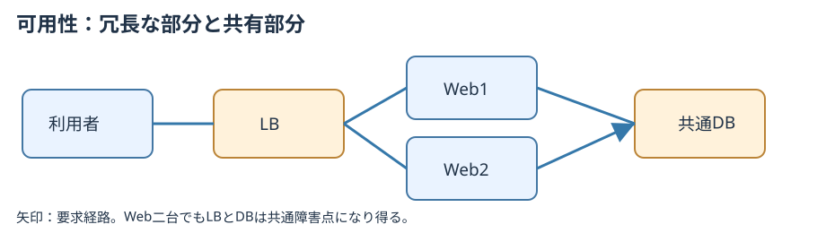
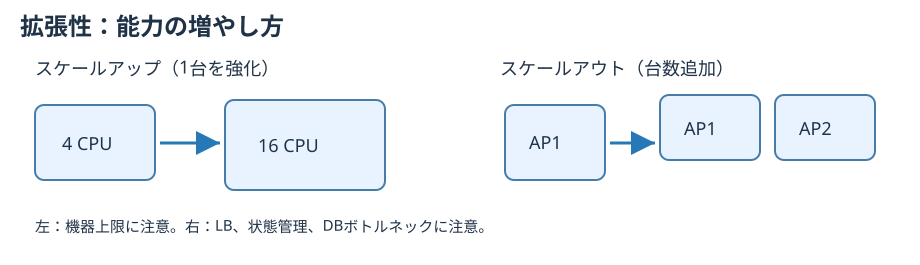

# 第6講 可用性・性能・拡張性・セキュリティの基本概念

## 到達目標
可用性・性能・拡張性・セキュリティの意味と測定指標を区別し、Web/AP/DBシステムで正常時・障害時に何を観測し、どの設計案を選ぶか説明できる。4つの品質特性のトレードオフを理解し、障害ログから原因と影響を推定する。

## 資料・重要度・前提
2026-11-21、GitHubの運用マスターv1.2、カリキュラム全224講、進捗（第1～5講修了）を確認した。参考資料としてGoogle SRE Bookのサービスレベル指標（SLI）・目標（SLO）、NIST SP 800-53のセキュリティ管理策、AWS Well-Architected Frameworkの信頼性・パフォーマンス効率・セキュリティの各柱を参照対象として挙げる。ただし今回、これらの公式文書の本文・版・該当箇所は実照合していないため、以下は汎用原理と明記した架空例による説明であり、特定製品の仕様を断定しない。
A必須：4特性の定義、主要指標、原因と対策。B実務：監視、ログ、キャパシティ、認証・権限。C発展：SLO、トレードオフ、設計判断。

## 1. なぜ4つを別々に考えるのか
システムが「動いている」だけでは利用者が使えるとは限らない。Webが応答しても30秒かかれば業務に支障が出る。高速でも一度に10人しか使えなければ繁忙期に耐えられない。高速・安定していても、権限のない人が顧客データを読めるなら重大な問題である。
可用性は必要なときに使えること、性能は要求にどれだけ速く・多く応えられるか、拡張性は負荷やデータ量の増加に合わせて能力を増やせること、セキュリティは情報と機能を不正な利用・変更・漏えい等から守ることである。

| 特性 | 代表的な問い | 指標の例 | 典型的な対策 |
|---|---|---|---|
| 可用性 | 使いたいときに使えるか | 成功率、稼働率、停止時間 | 冗長化、監視、切替、復旧手順 |
| 性能 | どれだけ速く処理できるか | 応答時間、スループット、待ち時間 | 計測、索引、キャッシュ、負荷分散 |
| 拡張性 | 利用増に追随できるか | 負荷増に対する処理量・遅延の変化 | スケールアウト/アップ、分割 |
| セキュリティ | 誰が何をでき、何を守るか | 認証失敗、脆弱性、監査記録 | 最小権限、暗号化、更新、監査 |

この4つは独立していない。例えば認証処理を追加すれば処理時間が増えることがあるが、必要な防御を省いて高速化するのは適切ではない。冗長化は可用性に役立つが、構成が複雑になると運用ミスの余地も増える。

## 2. 可用性：要求が成功する状態を維持する
可用性（Availability）は利用者が必要なときにサービスを利用できる度合いである。「サーバの電源が入っている」ことと「利用者の業務が成功する」ことは違う。Webのヘルスチェックが200でも、DB接続が切れて注文登録が失敗すれば、その業務の可用性は低下している。
稼働率の単純な時間比は、稼働時間÷対象時間で表せる。例えば30日（720時間）の測定期間に43.2分停止した場合、停止割合は43.2÷43200=0.001、稼働率は99.9%となる。ただし実際のSLAやSLOでは「何を停止と数えるか」「計画停止を含むか」「部分障害をどう数えるか」の定義が必要である。

図ではLBの背後にWeb1とWeb2があり、一台の停止でも他方が処理できる。ただしLB、共通DB、共有スイッチが単一障害点なら全体は止まり得る。冗長化とは単に台数を増やすことではなく、障害ドメインの分離と正常な切替の検証まで含む。

### 2.1 MTBF、MTTR、RTO、RPO
MTBFは平均故障間隔、MTTRは平均修復時間を指すことが多い。修理可能な機器の単純な定常モデルでは可用度≈MTBF÷(MTBF+MTTR)と表せるが、業務サービスの可用性をこの式だけで算出できるわけではない。故障の独立性、共通原因、計画停止、ソフトウェア障害を考慮する必要がある。
RTOは障害発生からどれくらいの時間内に復旧するかの目標、RPOは復旧時にどこまでのデータ損失を許容するかの目標である。RTO=1時間・RPO=5分なら「1時間以内に復旧し、失うデータは最大5分相当を目標」と読む。バックアップの取得頻度だけではRTOを保証できない。

## 3. 性能：速さと処理量は別の指標
性能（Performance）は要求への応答速度、一定時間に処理できる量、資源の使われ方などで評価する。レイテンシは一要求が完了するまでの時間、スループットは単位時間当たりの完了件数である。CPU使用率やメモリ使用率は原因調査の材料だが、それ自体が利用者の体感性能ではない。
平均応答時間だけを見ると、一部利用者の極端な遅延を見逃す。p95=800msとは測定された要求の95%が概ね800ms以下だったことを意味する。p99などのパーセンタイルも合わせて見る。エラーを除外して速い要求だけ集計すると実態を誤認するので、測定対象の定義が重要である。
Web→AP→DBの応答時間は、ネットワーク待機、APの処理、DB接続待ち、SQL実行、ロック待機、応答転送などの積み重ねで決まる。全体が遅いからといってWebサーバのCPUが原因とは限らない。
```text
12:01:00 request_id=R20 GET /api/tasks status=200 duration_ms=1850
12:01:00 ap request_id=R20 db_pool_wait_ms=1200 sql_ms=520 app_ms=80
12:01:00 db active_connections=100 max_connections=100
```
架空のログではAPがDB接続プールを長く待っている。DBの最大接続数に達している可能性があるため、接続のリーク、長時間トランザクション、プール設定、DB負荷を確認する。むやみに最大接続数だけ増やすとDBのメモリや競合を悪化させることがある。

## 4. 拡張性：利用増に追随できる設計
拡張性（Scalability）は利用者数、要求数、データ量が増えた際に必要な能力を増やせる性質である。スケールアップは一台のCPU・メモリ等を強化する方法、スケールアウトは処理ノードの台数を増やす方法である。

左のスケールアップは構成が比較的単純だが、機器上限や停止を伴う変更が課題となる。右のスケールアウトは台数追加に向くが、LB、セッション管理、データ共有、分散障害への対処が必要となる。
Web/AP層は状態を外部化して複数台にしやすいことが多い。一方、DBの書き込みはデータ整合性、ロック、レプリケーション遅延の制約があり、単純に台数を倍にして書き込み性能も倍になるとは限らない。
キャパシティプランニングでは現在のピーク要求数、CPU、メモリ、DB接続数、ストレージI/O、増加率を測り、何が先に上限に達するかを見積もる。ピーク時の余力と増設所要時間も重要である。

## 5. セキュリティ：CIAとアクセス制御
セキュリティは機密性（Confidentiality）、完全性（Integrity）、可用性（Availability）のCIAを基本として考える。機密性は許可された人だけが情報を見られること、完全性は不正・意図しない改ざんを防ぎ正しさを維持すること、可用性は必要な人が使えることを意味する。可用性はサービス品質の可用性と重なるが、セキュリティでは攻撃や不正行為から守る観点を含む。
認証は「誰かを確認する」、認可は「何をしてよいか決める」。認証に成功した一般利用者が管理者用APIを実行できるなら認可不備である。最小権限は必要な権限だけを付与する原則である。
通信経路のTLS、保存データの暗号化、秘密情報の安全な保管、パッチ適用、監査ログ、ネットワーク分離、多要素認証は、守る対象と脅威に応じて組み合わせる。暗号化していても過大なDB権限や盗まれた認証情報によるアクセスは別途対策が必要である。
```text
13:40:10 auth user=guest result=success
13:40:11 api user=guest action=DELETE /admin/users/42 result=403
```
架空のログでは認証は成功したが、管理者操作は認可により拒否された。403が正しい防御の結果なのか、権限設定の誤りによる業務障害なのかは、ユーザーの本来の役割とアクセス制御ポリシーを確認して判断する。

## 6. 4特性を一つの3層システムで追う
学習用のブラウザ→Nginx→FastAPI→PostgreSQLを例にする。正常時、利用者はNginxの入口から要求し、APがDBを読み書きし、結果を返す。可用性は成功率、性能は応答時間と処理量、拡張性は要求増加時の余力、セキュリティはアクセス権・通信経路・秘密情報の扱いで観察する。
障害①AP停止：Nginxが502を返す可能性があり、可用性が低下する。APの再起動だけでなく原因、監視、冗長化の必要性を評価する。
障害②DBのSQL遅延：HTTP 200が返っても応答時間が長くなり性能問題となる。タイムアウトが増えれば可用性にも波及する。
障害③利用者増：APのCPUが飽和し、キューが積み上がる。AP増設を検討するが、DB接続や書き込みが新たなボトルネックになるか確認する。
障害④権限設定ミス：管理者以外が機密情報を取得できるなら、サービスが高速で稼働していても重大なセキュリティ事故である。

## 7. 監視設計：何を測り、どこで警報を出すか
監視は「サーバが起動しているか」だけでなく、利用者視点の成功率、p95応答時間、スループット、DB接続待ち、エラー率、ディスク残量、証明書期限、認証失敗、監査ログなどを対象とする。
SLIは実際に測定する指標、SLOはその指標の目標値、SLAは提供者と利用者の間で合意するサービス水準で、未達時の取り決めを含むことがある。例えば「直近30日の有効なAPI要求の99.9%以上が成功」はSLOの一例である。測定対象、成功の定義、除外条件、測定期間を決めなければ数字だけでは運用できない。
```text
ALERT api_success_rate_5m=97.2% threshold=99.0%
ALERT api_p95_ms=2100 threshold=1000
INFO  db_pool_wait_p95_ms=1400
```
架空の監視例では成功率と応答時間が悪化し、DB接続待ちが関連する可能性がある。アラートを見たら、影響範囲、発生時刻、直近変更、Web/AP/DBのログを突き合わせる。閾値超過は原因の確定ではない。

## 8. 設計判断のトレードオフ
| 課題 | 案A | 案B | 判断材料 |
|---|---|---|---|
| Web単一障害点 | 単一Webを維持 | Webを複数台＋LB | 許容停止、コスト、共通障害点 |
| 応答遅延 | APのCPU増強 | SQL・接続待ちを計測し改善 | ボトルネック、改善効果 |
| 負荷増 | スケールアップ | スケールアウト | 状態管理、上限、運用複雑性 |
| 機密DB保護 | APから広い権限 | 最小権限と分離 | 必要操作、事故影響、運用負荷 |

例えば「性能が悪いからAPを増やす」は、DB接続プール待ちが原因なら逆効果になり得る。まず計測し、どの資源が律速しているかを特定する。また、冗長化を追加しても切替訓練がなければ復旧時間を見積もれない。設計では目標、観測方法、故障時の挙動、運用負荷、コストを一緒に決める。

## 9. 実務製品との関係
Oracle DatabaseではSQL実行時間、待機イベント、接続数、ロック、ストレージI/Oなどが性能・可用性調査の観点になる。RACはDBの複数インスタンス構成に関係するが、構成すればすべての障害や性能問題が解決するわけではない。
JP1/AJSのジョブネットでは異常終了・未起動・遅延を監視し、翌朝の業務開始に間に合うかという可用性を評価する。NetBackup、ShadowImage、TrueCopyは復旧やデータ保護に関係するが、復旧試験、バックアップの整合性、RTO/RPOの検証が別途必要である。製品固有のコマンド・設定値は公式マニュアル未照合のため示さない。

## 10. 運用者の初動チェック
1. 何が失敗しているか：利用者の業務成功率、エラー、遅延、情報漏えい疑いを分ける。
2. いつから、誰に影響するか：発生時刻、対象機能、全体か一部かを把握する。
3. 直近変更は何か：リリース、設定、権限、証明書、バッチ、負荷増を確認する。
4. どこが律速・故障しているか：Web/AP/DB、LB、DNS、FW、ストレージを順に照合する。
5. 暫定対策は安全か：再起動、増設、切替、アクセス遮断の副作用を確認する。
6. 恒久対策は何か：監視追加、冗長化、SQL改善、最小権限、運用手順見直しを検討する。

## 11. 要点
可用性は「使えるか」、性能は「速く・多く処理できるか」、拡張性は「増加に追随できるか」、セキュリティは「不正利用・漏えい・改ざん等から守れるか」。CPU使用率だけでは利用者体感を示せず、サーバが生存していても業務は失敗し得る。冗長化は障害ドメインを確認し、増設はボトルネックを測って判断し、権限は最小限にする。

## 次講
第7講「開発・構築・運用保守・移行のライフサイクル」。理解度チェックは別枠で四択10問・15点満点。回答前に正解を示さない。
