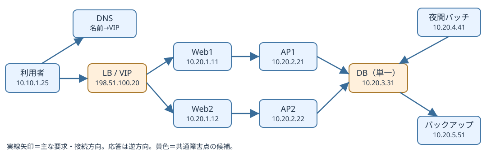
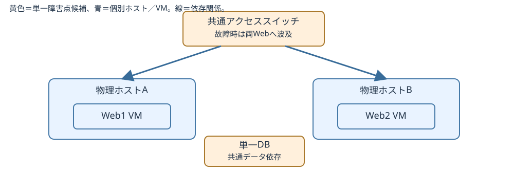
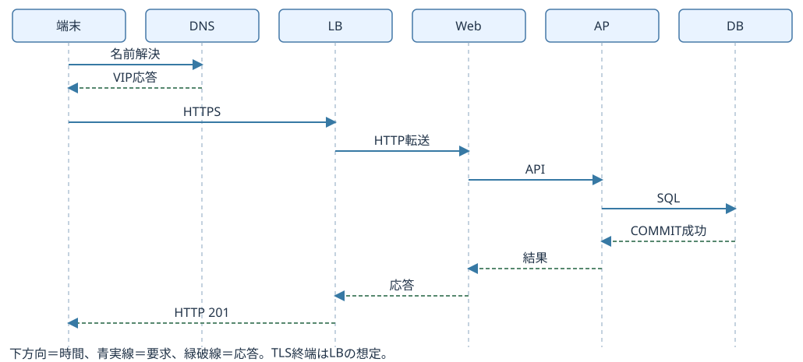

# 第8講 総合演習：企業システムの構成図と処理経路を読み解く

## 到達目標
企業システムの論理構成図・物理構成図・通信要件表・ログを読み、①利用者要求の正常な往復経路、②IP・DNS・LB・DBの役割、③障害の影響範囲と切り分け順序、④冗長化と共通障害点、⑤バッチ・バックアップ・移行への影響を根拠付きで説明できる。正解を暗記する講ではなく、図・数値・証跡から判断する総合演習である。

## 資料・前提・重要度
2026-11-21、GitHub運用マスターv1.2（難易度・選択肢品質の追記を含む）、全18編224講のカリキュラム、第1〜7講修了の進捗を確認した。本講の企業システム、IPアドレス、ログ、監視値、ジョブ名はすべて学習用の架空例。IPは説明用アドレス帯（198.51.100.0/24、192.0.2.0/24）とプライベートアドレスを用いる。企業の実環境を示さない。製品固有の振る舞い・公式資料の版は今回未照合。一般的なHTTP/TCP、DNS、LB、DB、ネットワークの仕組みを説明する。A必須：通信経路と障害切り分け。B実務：監視・ログ・バッチ・バックアップ。C発展：設計トレードオフと移行判定。

## 1. 演習対象：架空の企業受注システム
会社「北星商事」の社内利用者が注文を登録し、夜間に受注集計を実行する。通常のWeb画面はHTTPSで利用する。夜間バッチはJP1/AJS相当のスケジューラから起動し、DBに集計結果を保存する。バックアップはDBの論理バックアップとストレージ複製を組み合わせる想定だが、復旧保証は別途検証する。



図中の矢印は代表的な要求・接続の向きであり、戻りの応答も同じセッション上を逆向きに流れる。DNSは通信を中継せず、名前から宛先IPを取得する役割を持つ。LBのVIPは利用者から見えるサービス入口、Web/AP/DBのIPは各サーバの通信先を表す。Webを2台にしてもLB・AP・DBなどの共通部分は障害点となり得る。

| 要素 | 名前・アドレス（架空） | 主な役割 |
|---|---|---|
| 利用者 | 社内端末 10.10.1.25 | ブラウザで注文操作 |
| DNS | dns.corp.example | app.corp.exampleをVIPへ名前解決 |
| LB | VIP 198.51.100.20 | HTTPS入口、Web1/2へ振り分け |
| Web1 / Web2 | 10.20.1.11 / 10.20.1.12 | リバースプロキシ |
| AP1 / AP2 | 10.20.2.21 / 10.20.2.22 | 注文API、業務ロジック |
| DB | 10.20.3.31 | 注文データの永続化 |
| バッチ | 10.20.4.41 | スケジューラ・集計処理 |
| バックアップ | 10.20.5.51 | バックアップ保存・管理 |

この表のIPは役割の理解を目的とする。社内端末が198.51.100.20へ実際に到達できるようにするには、適切なルーティング・FW・NAT等の環境設計が必要であり、図だけで通信可能とは限らない。

## 2. 論理構成と物理構成を分ける
論理構成図は「どの機能が何と通信するか」を表す。物理構成図は「どのホスト、スイッチ、ストレージ、ラック、電源、故障ドメインに載るか」を表す。同じ論理構成でも、Web1とWeb2が同じ物理ホスト上のVMならホスト故障で同時停止する。別ホストでも同じスイッチ・電源に依存すれば共通障害は残る。



この物理図ではWeb1/2は別ホストに配置する一方、共通のアクセススイッチと単一DBを利用している。ホストA単独故障ではWeb2が残るが、共通スイッチ故障では両Webへの経路が失われる可能性がある。DB停止ではWebが稼働していても注文登録が失敗する。図は説明用で、実際の冗長化設計はLB・AP・DB・ストレージ・ネットワーク・電源の全経路を確認する。

## 3. 正常な処理経路を時系列で追う
利用者が `https://app.corp.example/orders` を開き注文を登録する例を考える。
1. 端末はDNSへ `app.corp.example` を問い合わせ、VIP `198.51.100.20` を得る。キャッシュ済みなら問い合わせを省く場合がある。
2. 端末はVIP宛にTCP接続し、TLSを確立する。TLS終端は今回LBとする。実環境では終端位置は構成による。
3. LBは健全と判断したWeb1（10.20.1.11）へHTTP要求を転送する。送信元IP・転送ヘッダーはLB設定によって変わる。
4. Web1は `/api/orders` をAP1（10.20.2.21）へ転送する。WebとAPの間の通信方式は本例ではHTTPとし、本番の暗号化要件は別途設計する。
5. AP1は認証・認可・入力検証を行い、DB（10.20.3.31）へSQLを発行する。DBがCOMMITに成功して初めて注文の永続化が確定する。
6. DB→AP→Web→LB→端末の順に結果が返る。APIが201を返しても、利用者に届く前に通信が切れた場合、端末からは失敗に見える一方でDB更新済みという事態がある。注文ID・冪等キーで重複を防ぐ設計が重要になる。



シーケンス図では左から右へ処理主体が並び、下方向が時間の経過を示す。矢印は呼び出し、破線は応答である。DNS解決とLBの転送は別の処理であり、「DNSがWeb1を選ぶ」とは限らない。正常な注文登録には通信成功だけでなく、APの業務判定とDBのCOMMITが必要である。

## 4. 通信要件表を読み、どこで止まるか予測する
| 送信元 | 宛先 | プロトコル/ポート | 目的 | 確認する証跡 |
|---|---|---|---|---|
| 社内端末 | LB VIP | TCP/443 | HTTPS | DNS結果、端末接続、LBアクセスログ |
| LB | Web1/2 | TCP/8080 | Web転送 | LBヘルス、Webアクセスログ |
| Web1/2 | AP1/2 | TCP/8000 | API | Webエラーログ、APアクセスログ |
| AP1/2 | DB | TCP/5432 | SQL | AP接続ログ、DBセッション |
| バッチ | DB | TCP/5432 | 集計 | ジョブ履歴、DB接続・SQLログ |
| バックアップ | DB/保存先 | 設計による | 保護 | ジョブ結果、保存先、復元試験 |

ポートが開いていることはアプリの正常動作を保証しない。TCP接続成功後もTLS、HTTP、認証、SQL、COMMITで失敗し得る。一方、HTTP 502を見た場合はWebが上流APへ接続できなかった等の可能性を検討するが、502という数字だけで原因を断定しない。

## 5. 正常時の監視値をベースラインとして残す
| 指標 | 平常時の例 | 注意点 |
|---|---|---|
| API成功率 | 99.95% / 30日 | 成功定義と除外条件が必要 |
| API p95 | 240ms | エラー要求を除外するか明示 |
| LB健全Web数 | 2/2 | LB自体の健全性とは別 |
| AP CPU | 30〜45% | CPUが低くてもDB待機は起きる |
| DB接続使用数 | 40/120 | プール待機とDB上限は区別 |
| 夜間集計 | 03:00までに完了 | 翌朝業務開始までの余裕が必要 |

監視は平常時の分布とピーク値を把握してこそ有効になる。単発のCPU80%が直ちに障害を意味するとは限らず、API成功率・待機時間・業務処理の遅延と関連付けて判断する。

## 6. ケースA：一部の利用者だけ名前解決できない
架空の観測：
```text
Client-A: nslookup app.corp.example -> 198.51.100.20
Client-B: nslookup app.corp.example -> NXDOMAIN
LB: healthy_web=2/2, incoming_requests_from_B=0
```
Client-BのDNS参照先、検索ドメイン、キャッシュ、レコードの有無、DNS経路を確認する。LBが健全であってもClient-BはVIPに接続する段階へ進めない。逆にDNSが正しいVIPを返したとしても、FW・ルーティング・TLSが正しいとは限らない。
初動ではClient-Bの `nslookup` 結果と参照DNSサーバを採取し、Client-Aと比較する。DNS設定変更を直ちに全社展開するのではなく、影響範囲を限定する。

## 7. ケースB：LBはWeb1を切り離したが注文登録は成功
```text
10:14:00 LB web1 health=DOWN web2 health=UP
10:14:03 LB selected_backend=web2 status=201 duration_ms=310
10:14:04 WEB2 upstream=ap1 status=201
```
Web1故障をLBが検知してWeb2に振り分け、注文登録が継続できた例である。これはWeb層の単一ノード故障に対する冗長性を示すが、LB自体、AP、DB、共通スイッチの可用性までは証明しない。既存セッションの切断、再送、Web1への固定セッションがある場合の影響も別途確認する。
設計判断は「Web1を復旧すればよい」だけではない。故障原因、Web2の処理余力、両Webの共通障害点、復旧後の再参加条件を確認する。

## 8. ケースC：Webが502を返し、APの接続拒否が出る
```text
11:02:10 WEB1 GET /api/orders -> 502 upstream=10.20.2.21:8000
11:02:10 WEB1 connect() failed (111: Connection refused)
11:02:11 AP1 service=stopped
11:02:12 AP2 service=running ready=true
```
この例ではWeb1がAP1へ接続を試みた際、TCP接続を拒否された。AP1プロセス停止、待受アドレス・ポート不一致、接続先設定の誤りなどが候補である。AP2が健全でもWeb側の転送先設定がAP1固定なら自動的には救済されない。
最初にWeb1のupstream設定とAP1/2のヘルス・待受を照合する。FWによるドロップなら通常はタイムアウトになりやすく、拒否応答とは観測が異なるが、ネットワーク機器の挙動によって例外がある。設定変更前に直近のデプロイ・障害時刻を突合する。

## 9. ケースD：HTTP 200だが遅い
```text
12:10:00 LB status=200 duration_ms=2650
12:10:00 AP1 cpu=38% db_pool_wait_ms=1700 sql_ms=710
12:10:00 DB active_sessions=115 max_sessions=120
12:10:00 DB wait_event=lock_wait high
```
応答は成功しているが利用者体感は悪化している。APのCPUは高くない。DB接続待ちとロック待機が大きく、DBの競合が原因候補となる。DBセッション上限近接だけで接続枯渇と断定せず、プール上限、長時間トランザクション、ロック保持SQL、SQL実行計画を調べる。
AP増設は同時接続を増やしDB側の競合を悪化させる場合がある。優先順位は、リクエストIDで遅延箇所を特定し、DB待機と接続管理を調査し、効果を検証すること。性能と可用性は連動し、遅延がタイムアウトへ波及すれば成功率も低下する。

## 10. ケースE：DB停止とバッチ異常の波及
```text
02:20:10 DB host=10.20.3.31 connection_timeout
02:20:11 AP1 POST /api/orders -> 503
02:20:12 JP1 JOB=ORDER_AGG result=ABEND rc=12
02:20:13 JP1 successor=DAILY_REPORT state=WAIT
```
同じDBをオンラインAPIと夜間バッチが共有するため、DB障害が両方に波及する。Web・APが稼働していても業務全体の可用性は低下する。ジョブの再実行前には、DB復旧だけでなく、集計の途中COMMIT、入力ファイルの受信、後続の保留状態、再実行の冪等性を確認する。
バックアップやストレージ複製は復旧手段の候補だが、複製があれば即時に業務を再開できるとは限らない。アプリ整合性、RTO/RPO、DB復旧、接続先切替、再試験が必要である。

## 11. 障害の影響範囲を図から見積もる
| 故障対象 | 注文画面 | 注文登録 | 夜間集計 | 根拠 |
|---|---|---|---|---|
| Web1のみ | 継続可能性あり | 継続可能性あり | 原則影響なし | LBがWeb2へ切替可能なら |
| LB単一装置 | 到達不可の可能性 | 到達不可の可能性 | 原則影響なし | 利用者入口が単一 |
| AP1のみ | 静的画面は表示可能な場合あり | AP2への転送次第 | 原則影響なし | API転送方式による |
| DB単一装置 | 画面構成による | 失敗する | 失敗する | 両業務がDBに依存 |
| 共通スイッチ | Webへの到達が失われ得る | 失敗し得る | 配線次第 | 物理経路の共通依存 |

「影響なし」と書けるのは依存経路が分離されていると確認できた場合だけである。論理構成図だけでは共通電源、スイッチ、ストレージの障害ドメインを見落とすため、物理構成図と構成管理台帳を突き合わせる。

## 12. 運用手順：障害発生から暫定復旧まで
1. **事実を固定する。** 発生時刻、利用者影響、成功率、エラーコード、直近変更を記録する。
2. **入口から処理経路を分解する。** DNS→VIP→LB→Web→AP→DBを順に確認する。ただし明白なDBアラートがあれば並行してDBを調べる。
3. **正常な系と比較する。** Web1とWeb2、AP1とAP2、正常利用者と異常利用者の差分を見る。
4. **ログを関連付ける。** 同一時刻・リクエストIDでWeb/AP/DBを照合し、どの境界で失敗したか特定する。
5. **対処の副作用を評価する。** 切替、再起動、再実行がデータ整合性や処理の重複を招かないか確認する。
6. **復旧を業務で検証する。** HTTPステータスだけでなく注文登録・参照・集計結果・監視復帰を確認する。
7. **恒久対策へ戻す。** 監視追加、設定修正、冗長化、変更管理、手順・設計書更新を行う。

## 13. 設計演習：冗長化の予算が限られている場合
仮に「Web1/2は別ホスト、AP1/2も別ホスト、DBは単一、LBは単一、ネットワークスイッチは共通」とする。Webをさらに2台増やしても、LB・DB・スイッチ障害による全停止リスクは大きく変わらない。まず障害頻度、復旧時間、業務影響、構成上の共通依存を定量化し、どの単一障害点を解消するか選ぶ。
DB冗長化には同期方式・切替・データ整合性・運用複雑性が伴う。LB冗長化にもVIP引継ぎ・経路・ヘルスチェック・状態管理が必要。対策の優先順位は「台数の少ない順」ではなく、SLO・RTO/RPOと障害ドメインに基づく。

## 14. 移行演習：新環境へ切り替えるとき
DNS名が同じでもVIPを新環境へ変更する場合、TTLや端末キャッシュにより旧VIPへ向かう利用者が残り得る。LBの経路切替、APの接続先、DBの正本、バッチの停止・再開、外部連携の送信先、監視・バックアップの対象を一覧化する。
切替後に新DBへ注文が登録されたなら、旧DBへ戻す際の差分データをどう扱うかが重要。単にDNSを戻すだけではデータ整合性を守れない。Go/No-Go判定は通信疎通、重要業務の正常性、データ整合性、停止時間、切戻し期限を確認して行う。

## 15. 総合演習の読み方
図からすぐに「原因はDB」と決めず、①観測事実、②候補原因、③追加で必要な証拠、④影響範囲、⑤安全な初動を分けて説明する。502はWeb/AP境界、NXDOMAINは名前解決、200だが遅いなら性能、DB障害はオンラインとバッチ双方、というように異なる症状を区別する。
選択式問題では、一見妥当な対処が複数登場する。最も適切な選択肢は問題に書かれた目的・時点・制約・ログに基づいて選ぶ。極端な語句の消去法ではなく、各案の適用条件を比較する。

## 16. 要点整理
DNSは名前解決、VIPはサービス入口、実サーバIPは処理ノードの宛先。論理構成図は機能と通信、物理構成図はホストと共通障害点を表す。正常系ではDNS→LB→Web→AP→DB→応答の流れとCOMMITを追う。障害時はログ・監視・設定・経路を照合し、原因と影響を区別する。冗長化・移行・バッチ再実行はデータ整合性と運用条件まで確認する。

## 次講
第9講「コンピュータの基本構造と命令実行の仕組み」。理解度チェックは別枠で四択10問・15点満点。回答前に正解を示さない。
