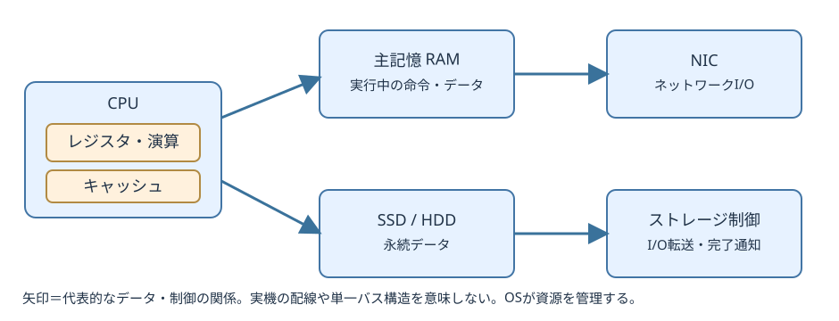
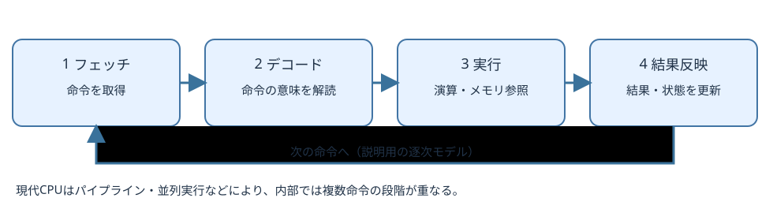
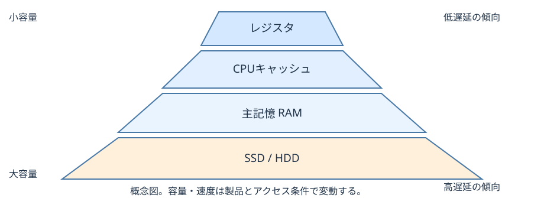

# 第9講 コンピュータの基本構造と命令実行の仕組み

## 到達目標
CPU・主記憶・ストレージ・入出力装置の役割を区別し、プログラムの命令が「取り出し→解読→実行→結果反映」される過程を説明できる。さらに、CPU使用率が低いのに応答が遅い理由、I/O待ち・ページフォルト・割込みの影響、構成変更時の設計判断を観測値に基づいて説明できる。

## 資料・前提・重要度
2026-11-21時点でGitHub運用マスターv1.2、カリキュラム全18編224講、進捗（第1〜8講修了）を確認。ハードウェアの汎用原理を扱う。公式CPUベンダー・OSマニュアルの版と該当節は今回未照合であり、具体的な製品仕様を保証しない。ログ・設定値・性能数値は学習用の架空例。A必須：構成と命令実行、B実務：待機・観測・切り分け、C発展：性能設計とトレードオフ。

## 1. なぜインフラ担当者が命令実行を学ぶのか
「サーバのCPU使用率は20%なのに業務が遅い」「メモリが空いているのにDBが遅い」という障害では、CPU・メモリ・ストレージがどう協調して処理するかを理解しないと誤った増強を選ぶ。アプリの処理時間はCPU計算時間だけではなく、メモリ参照、ストレージI/O、ネットワーク、ロック・キュー待機などの合計である。Web→AP→DBの各層でどこに時間を費やしたかを測る必要がある。

## 2. コンピュータの基本構成


CPU（中央処理装置）は命令を実行し、主記憶（RAM）は実行中の命令やデータを保持する。SSD/HDDなどの補助記憶はプログラムや永続データを保存する。NICはネットワーク通信、ストレージコントローラはI/Oの処理を担う。OSは各装置とアプリケーションの間で資源を管理する。

電源断で通常のRAMの内容は失われる一方、SSDの永続データは残る。ただしDBの書込み完了はアプリ、OSキャッシュ、デバイス、同期設定の段階によって意味が異なる。DBのCOMMITと耐障害性の保証はDB製品と設定の仕様確認が必要。

「バス」は部品間のデータ転送経路の総称で、実機ではメモリバス、PCIeなど用途の異なる接続がある。図は理解用の論理モデルであり、すべての装置が単一バスでつながるという意味ではない。

## 3. CPUの中身：制御・演算・レジスタ
CPU内部には、命令の実行を制御する回路、整数・論理演算などを行う実行ユニット、非常に高速な小容量記憶であるレジスタがある。PC（プログラムカウンタ）は次に実行する命令の位置を示す状態を保持する。命令レジスタやデコーダは命令の解読に関わる。現代CPUはパイプライン、投機実行、アウトオブオーダ実行などを行うため、実際の内部実行順序は単純な逐次モデルと一致しない場合がある。

CPUコアは命令実行資源の単位。物理コア数とOSから見える論理CPU数は、同時マルチスレッディング（SMT）により異なることがある。論理CPUが2倍でも演算能力が必ず2倍になるわけではない。詳細は次講で扱う。

## 4. 命令の実行サイクル


1. **フェッチ**：PCが示す位置の命令を、キャッシュや主記憶の階層から取り出す。
2. **デコード**：命令が何を要求するか（演算、読込み、分岐など）を解読する。
3. **実行**：レジスタ値の加算、比較、アドレス計算、メモリへのアクセス要求などを行う。
4. **結果反映**：演算結果や状態を、命令の意味に従ってレジスタ・メモリなどへ反映し、次の命令へ進む。

たとえば `total = price + tax` は、コンパイラや実行環境が生成した機械語命令の組合せで実現される。変数がレジスタにあるかメモリにあるか、キャッシュにヒットするかで必要時間は変わる。高水準言語の1行がCPU命令1個に対応するとは限らない。

### 4.1 パイプラインのイメージ
複数命令のフェッチ・デコード・実行を重ねると、各命令の完了までの遅延が同じでも単位時間の処理量（スループット）が増えることがある。一方、分岐予測の失敗やデータ依存、キャッシュミスがあるとパイプラインが停止・やり直しとなり、理想的な性能には届かない。周波数だけでCPUの実性能を比較できない理由の一つである。

## 5. メモリ階層と「近いデータほど速い」の意味


一般にレジスタ→CPUキャッシュ（L1/L2/L3など）→RAM→SSD/HDDの順で容量は大きくなりやすく、アクセス遅延も増えやすい。ただし各階層の実数値はCPU世代、アクセスパターン、装置、負荷で変動する。ここでは固定のナノ秒値を暗記しない。

CPUが必要なデータをキャッシュに持っていれば短時間で使える（キャッシュヒット）。なければ下位階層へ取りに行く（キャッシュミス）。同じ演算量でもデータの配置や参照局所性が違えば性能差が生じる。キャッシュは高速化の仕組みであり、永続データのバックアップではない。

## 6. プログラムの起動：ストレージからRAMへ
実行ファイルは通常ストレージ上に保存される。OSがプロセスを生成し、仮想アドレス空間を用意し、必要な命令・データをメモリへ読み込めるようにする。すべての内容を起動時に一括読込みするとは限らず、必要に応じてページを読み込む方式がある。

CPUは基本的に命令をキャッシュ・主記憶の階層から取得して実行する。SSD上のバイト列をCPUが通常の機械語命令として直接実行しているわけではない。ページフォルトは、必要なページが物理メモリにない、またはアクセス条件に合わないときなどに発生する例外である。すべてのページフォルトがディスクI/Oを伴うわけではない。ディスク読込みを要する重大なページフォルトが多発すれば応答遅延が増える。

## 7. OS・プロセス・スレッド・コンテキストスイッチ
プロセスはOSが管理する実行中プログラムの資源・アドレス空間の単位、スレッドはその中で命令を実行する流れの単位。OSスケジューラは実行可能なスレッドにCPU時間を割り当てる。スレッドがI/O待ちに入ると、別の実行可能スレッドを動かせる。

コンテキストスイッチは実行主体の切替に伴う状態の保存・復元などで、オーバーヘッドを持つ。ただし「切替回数が多い＝障害」とは限らず、実行可能キュー長、CPU利用率、応答時間と合わせて判断する。

## 8. 割込みとDMA：I/Oを待つ間のCPU
NICやストレージ装置はCPUにイベントを通知する仕組み（割込み）を利用する。DMA（Direct Memory Access）は対応する装置・コントローラがCPUの逐次コピーを介さずメモリとのデータ転送を進める仕組み。CPUは転送の設定や完了処理を担当するが、転送の全バイトをCPU命令でコピーする必要がない場合がある。

典型的なストレージ読込みでは、アプリがread等を要求→OSがI/Oを発行→装置がデータを準備・転送→完了通知→待機スレッドが再開、という流れになる。非同期I/Oなら要求スレッドが別の仕事を続ける場合もある。CPUが低使用率でもI/Oの待機時間が長ければアプリは遅くなる。

## 9. ケースA：CPU使用率20%なのにAPIが3秒かかる
学習用の架空ログ：
```text
AP api_duration_ms=3050 cpu_percent=20
AP db_query_ms=2800 db_pool_wait_ms=60
DB storage_read_p95_ms=35 cache_hit_ratio=0.62
DB cpu_percent=28 active_sessions=34
```
3,050msのうち2,800msがDB照会であり、APのCPU増強を最優先にする根拠は弱い。DBのストレージ読込み遅延やキャッシュヒット率低下は原因候補だが、35msという単発指標だけでストレージが根本原因と断定しない。実行計画、物理読込み量、SQL待機イベント、ストレージのキュー長・レイテンシ、過去の平常値を突合する。

### 初動と対策
まず同じリクエストIDでAP→DBの時間を分解する。DBが大量の行を走査しているなら索引やSQLを見直す。ストレージI/O待ちが主因なら読込み量、キャッシュ、ストレージ性能・競合を調べる。CPU増設はCPUがボトルネックだと示された場合の選択肢であり、今回の観測だけでは優先しない。

## 10. ケースB：CPU100%でもアプリが速いことはある
```text
batch_worker cpu_percent=98
batch throughput_rows_per_sec=42000
batch queue_depth=0
batch elapsed_sec=410 (SLO <= 600)
```
CPUを高く使っていても処理量・待ち行列・業務SLOを満たすなら直ちに障害ではない。CPUを効率的に使うバッチでは高使用率が正常な場合がある。ただしピーク時の余力や他業務への影響は別途確認する。CPU使用率は「忙しさ」の指標であり、利用者が感じる性能の代用にはならない。

## 11. ケースC：メモリ不足とページング
```text
AP available_memory_mb=120
AP major_page_faults_per_sec=240
AP swap_in_mb_per_sec=65
AP request_p95_ms=3900
```
利用可能メモリが少なく、重大ページフォルトとswap-inが増え、応答が悪化している。メモリ圧迫によるディスクI/Oが性能を落としている可能性が高い。プロセス別RSS、メモリリークの兆候、コンテナメモリ制限、ページキャッシュ、スワップ使用量、OOMイベントを確認する。

スワップを無効にすれば常に改善するわけではなく、メモリ不足でプロセスが強制終了されるリスクがある。増設、アプリのメモリ使用削減、同時実行数制限などを影響評価して選ぶ。

## 12. ケースD：ディスクが速くてもDBのCOMMITが遅い
```text
DB commit_p95_ms=1200
DB cpu_percent=22
DB log_flush_wait_ms=980
storage device_write_p95_ms=12
```
COMMITの遅延の大部分はログのフラッシュ待ちとして観測される。ただし装置単体の書込みp95が12msでも、同期回数、書込みキュー、レプリケーション待ち、DBのログバッファやグループコミットなどの影響がある。OS・DB・ストレージのどの境界で待っているかを測る。COMMITの安全性を犠牲にする設定変更は、耐障害性とデータ損失リスクを理解せずに行わない。

## 13. 設計判断：CPU・RAM・SSDのどれを増やすか
| 観測事実 | 第一候補の調査 | 増強が効く条件 | 増強だけでは解決しにくい例 |
|---|---|---|---|
| CPU飽和、実行待ち増 | コア別CPU、run queue | CPU計算が律速 | DBロック・I/O待ち |
| 重大ページフォルトとswap増 | RSS、制限、OOM、ページング | メモリ容量不足が律速 | メモリリーク未対処 |
| ストレージ待機とキュー増 | IOPS、帯域、遅延、SQL読込み量 | 装置性能が律速 | 不適切なSQL全表走査 |
| API遅延、CPU低負荷 | トレース、依存先待機 | 律速資源が判明した場合 | APだけの増設 |

「CPUコア数を2倍にすれば応答時間が半分」とは限らない。逐次処理部分、共有ロック、メモリ帯域、I/O待ちなどが制約になる。性能試験は平均値だけでなくp95/p99、処理量、ピーク時、障害時の縮退運転も確認する。

## 14. Docker・仮想化環境での読み替え
コンテナはホストOSのカーネルを共有し、CPU・メモリの制限や割当てを受ける。コンテナ内のCPU使用率だけでは、ホスト側の競合やCPU quotaによるスロットリングを見落とすことがある。VMでは仮想CPUの実行待ち、ホストのオーバーコミットなどが性能に影響する。

自宅のNginx→FastAPI→PostgreSQLの3層ラボなら、FastAPIの応答時間を「アプリ処理・DB待機」に分け、DB停止時の503とCPU負荷による遅延を区別できる。検証環境でのみ負荷を与え、実運用システムで負荷試験を無断実行しない。

## 15. 運用で使う観測項目と注意
Linuxの一般的な例として `top`、`vmstat 1`、`free -h`、`iostat -xz 1`（通常はsysstatパッケージが必要）などがある。OSやバージョンで表示形式は異なる。実行前に対象ホスト・権限・監視負荷を確認する。コマンドの出力を今回実測したわけではない。

```text
# 学習用の読み方（実測値ではない）
vmstat: r=12, b=0, us=85, sy=10, wa=1  -> CPU実行待ちを疑う
vmstat: r=1,  b=8, us=10, sy=5,  wa=55 -> I/O待機を疑う
```
`r` は実行可能タスク、`b` は割込み不能スリープのタスク数を示す一般的なLinuxのvmstat項目。CPUの`wa`はI/O待ちとして集計されたCPU時間の割合で、ストレージ遅延そのもののミリ秒値ではない。低いwaでもI/O問題を否定できない。原因特定にはアプリ・DB・OS・ストレージの観測を組み合わせる。

## 16. 要点整理
CPUは命令を実行し、RAMは実行中の命令・データを保持し、SSD/HDDは永続データを保存する。命令実行はフェッチ→デコード→実行→結果反映で理解できるが、現代CPU内部は並列・投機的に動く。メモリ階層のヒット・ミス、OSのスケジューリング、割込み、DMA、ページングが処理時間に影響する。CPU使用率は性能そのものではない。どの資源を増強するかは、待機・処理量・SLO・ログから律速箇所を特定して判断する。

## 次講
第10講「CPUの構造・コア・スレッド・キャッシュ」。理解度チェックは別枠の実務判断型四択10問・15点満点とし、回答前に正解を提示しない。
