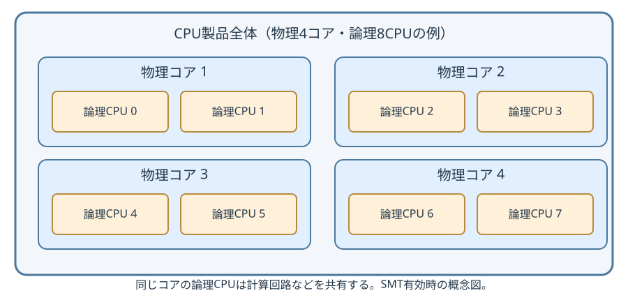
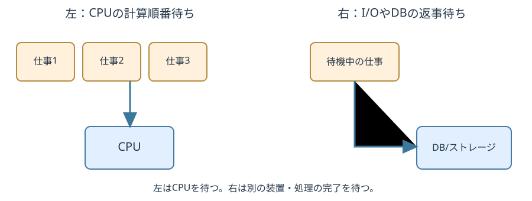
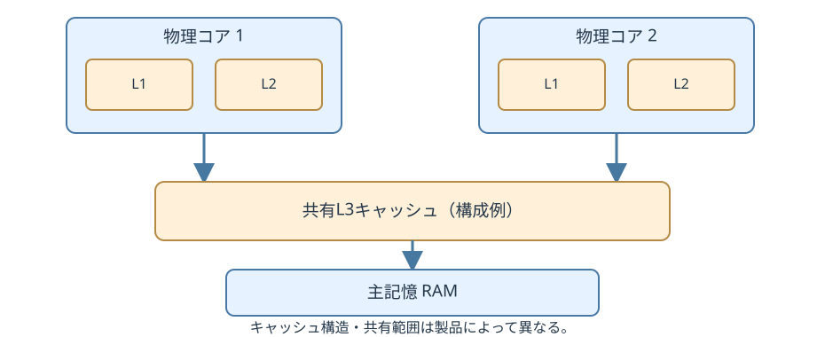

# 第10講 CPUの構造・コア・スレッド・キャッシュ

## 到達目標
CPUの中で計算を行う「コア」、OSから見える「論理CPU」、プログラムの仕事の流れである「スレッド」を区別する。CPUのキャッシュがなぜ速さに影響するかを説明し、CPU使用率・待ち行列・キャッシュ・コンテナ制限を見て、調査と増強の優先順位を決められるようになる。

## 資料・前提・重要度
2026年11月22日、GitHubの運用マスターv1.2（初出専門用語を説明する追記を含む）、正式カリキュラム全18編224講、進捗9講修了を確認した。CPUメーカーやOSの公式文書の版・該当節は今回未照合。数値、ログ、コマンド結果はすべて学習用の架空例であり、製品の保証値ではない。A（必須）：コア・スレッド・キャッシュ。B（実務）：監視と障害調査。C（設計）：CPU増強・配置・制限の判断。

## 1. CPUを増やしたのに遅い、という問題
CPU（中央処理装置）は、プログラムが指定した計算や判断を行う部品である。たとえば注文システムのAP（アプリケーションサーバ）は、注文金額の計算や入力内容の確認をCPUに実行させる。一方、DB（データベース）が応答するのを待つ時間は、APのCPUが計算している時間とは異なる。

サーバが遅いとき、「CPUが忙しくて計算の順番待ちが発生している」のか、「CPUは空いているが別の処理を待っている」のかを見分ける必要がある。本講では、CPUの内部構造からその理由をたどる。

## 2. CPUの内部：コアは計算する作業場所
**コア**とは、CPUの中で命令を実行する中心的な部分である。命令とは「数を足す」「値を比較する」「メモリからデータを読む」といったCPUへの指示である。ひとつのCPU製品に複数のコアを入れたものを、マルチコアCPUと呼ぶ。



図の外枠はCPU製品全体、その中の四つの枠は物理コアである。各コアの中には計算を進める回路がある。図では1コアに二つの論理CPUを示しているが、これは後述するSMTが有効な場合の例であり、すべてのCPUがそうなるわけではない。

CPUにはほかに、計算途中の小さな値を置く**レジスタ**、よく使うデータを一時的に置く**キャッシュ**、メモリとのやり取りを管理する回路などがある。レジスタは非常に小さく高速な記憶場所であり、キャッシュはその次に必要になりそうな命令やデータを近くに置く仕組みである。

## 3. 「物理コア」と「論理CPU」は違う
**物理コア**はCPU内部に実在する計算資源のまとまりである。**論理CPU**はOS（基本ソフト）が「ここに仕事を割り当てられる」と認識する実行先の数である。

**SMT（Simultaneous Multithreading、同時マルチスレッディング）**は、一つの物理コアが複数の命令の流れを並行して扱い、コア内の空いている回路を使いやすくする仕組みである。たとえば物理4コアで各コアが二つの流れを扱う構成なら、OSには8個の論理CPUが見える場合がある。

ただし、二つの論理CPUは同じ物理コアの計算回路やキャッシュなどを共有する。したがって「物理4コア・論理8CPU」と「物理8コア」は同じ処理能力ではない。SMTが役立つかは、実行する仕事がどの回路を使い、どの部分で待つかによる。

## 4. プログラムの「スレッド」とCPUの「スレッド」
**プロセス**はOSが起動したプログラムの実行単位で、メモリなどの資源を持つ。**ソフトウェアのスレッド**は、プロセスの中で順番に命令を実行していく仕事の流れである。一つのプロセスが複数のスレッドを持つこともある。

「CPUが8スレッド」という製品表示は、通常、OSから見える8個の論理CPUを意味する。一方「APの処理スレッドが32本」はアプリ側の仕事の流れが32本あるという意味で、CPUの論理CPUが32個あることではない。

たとえば論理CPUが8個のサーバでAPのスレッドが32本あっても、32本が同時にCPUで計算できるわけではない。OSは実行できるスレッドにCPU時間を割り当て、残りを待たせる。

## 5. OSはどうやってCPUの順番を決めるか
OSの**スケジューラ**は、どのスレッドをどのCPUで実行するか決める仕組みである。CPUで計算できる状態なのに空きを待つ仕事を「実行待ち」と呼ぶ。



図の左側では、計算できる仕事がCPUの空きを待っている。これはCPUの計算能力が足りない場合に増えやすい。右側では、仕事がストレージやDBの返事を待っている。この間、その仕事はCPUを使って計算していないことがある。

**コンテキストスイッチ**とは、OSが実行するスレッドを切り替える際に、途中までの計算状態を保存し、次の仕事の状態を読み戻すこと。切替には多少の手間がかかるが、回数が多いだけで異常とは決められない。

### CPUの利用率だけで判断しない
CPU使用率は、観測期間中にCPUがどれだけ仕事をしていたかを示す割合である。全CPU平均20%でも、ある1コアが100%で残りが空いている場合がある。また、仕事がDBの返事を待っていればCPUは低使用率でも利用者の応答は遅くなる。

## 6. CPUキャッシュ：なぜ同じ計算でも速さが変わるか
CPUが計算するときは、計算に使う数値や命令が必要になる。**RAM（主記憶）**はそれらを保持する場所だが、CPUの計算回路から見るとデータの取得に時間がかかることがある。そこで、よく使うデータをCPUの近くに一時保存する**キャッシュ**を利用する。



一般的なCPUには**L1・L2・L3キャッシュ**という段階がある。L1は小さく高速で各コアに近い。L2はL1より大きいことが多い。L3は複数コアで共有する構成も多いが、実際の階層・容量・共有範囲はCPU製品によって異なる。

必要なデータがキャッシュ内に見つかることを**キャッシュヒット**、見つからず次の階層へ取りに行くことを**キャッシュミス**という。L1で見つからなくてもL2やL3にあれば、RAMまで読みに行かずに済む場合がある。L1ミスは直ちにディスク読込みを意味しない。

## 7. キャッシュの効き方を具体例で考える
たとえば配列という「数値を順番に並べたデータ」を、先頭から順番に合計するとする。CPUは次に近くのデータを使う可能性が高く、まとめて読み込んだキャッシュの内容を再利用しやすい。

一方、大きなデータの離れた場所を飛び回って読むと、キャッシュにないデータを何度も取りに行くことがある。この「近い場所や最近使った場所を再び使いやすい性質」を**局所性**という。

ただし「連続して読む処理が必ず速い」とは限らない。計算方法、データ量、並列実行、メモリ構成によって変わる。キャッシュの大きさだけでCPUの優劣を決めない。

## 8. キャッシュは共有されることもある
同じ物理コア上の論理CPUは、一部の実行回路やキャッシュを共有する。複数コアが共通のL3キャッシュを使う構成もある。共有によってデータの受け渡しが効率化する場合がある一方、別々の仕事が同じ場所を取り合う場合もある。

複数のコアが同じデータを読み書きするとき、古い値を使わないようにする仕組みを**キャッシュコヒーレンシ（一貫性の維持）**という。これは「どのコアも適切なデータの状態を見られるよう調整する仕組み」である。共有データを頻繁に書き換えるプログラムでは、その調整のために時間がかかる場合がある。

## 9. CPUの速さを決める要素は一つではない
**クロック周波数**はCPU内部の動作のテンポを示す値で、GHz（ギガヘルツ）は1秒あたり約10億回を単位とした周波数である。周波数が高いほど同じCPUで同じ条件の処理が速くなる場合があるが、別製品を周波数だけで比較するのは危険である。

CPUは一回の動作で進められる仕事の量が違う。また、メモリ待ちやキャッシュミス、温度・電力制限、コア数、ソフトウェアの並列化によって性能が変わる。

**スループット**は一定時間に処理できる仕事の量、**応答時間**は一つの要求を終えるまでの時間である。両者は関係するが同じではない。CPUを増やして同時処理件数が増えても、単一要求の応答時間があまり改善しない場合がある。

## 10. 障害ケースA：平均CPU25%なのにAPIが遅い
以下は学習用の架空ログである。
```text
host cpu_total_percent=25
cpu0=98 cpu1=12 cpu2=8 cpu3=9
api request_p95_ms=2200
worker runnable_queue=9
```
`cpu_total_percent` はCPU全体の平均使用率、`cpu0`〜`cpu3` は各論理CPUの使用率である。`request_p95_ms=2200` はAPIの要求の95%がおおむね2,200ミリ秒以内に収まるという値（p95：遅い側の状況を見る指標）。`runnable_queue=9` はCPUで実行できる仕事が順番待ちしている数の観測値である。

全体平均は低いがcpu0がほぼ使い切られている。アプリが一つのスレッドで重い計算をしている、特定CPUに仕事を固定している、あるいは観測方法に偏りがある可能性がある。**CPUアフィニティ**は「この仕事を特定のCPUで動かす」という割当て設定のこと。最初にコア別利用率、実行待ち、プロセス・スレッド別CPU時間、アフィニティ設定を確認する。

この情報だけで「CPUを増設すれば解決」とは断定しない。単一スレッドの計算が中心なら、コア数を増やしても一件の処理が速くならない場合がある。

## 11. 障害ケースB：CPU使用率が高いが業務は正常
```text
batch cpu_percent=94
batch elapsed_sec=420
batch target_sec=600
batch queue_wait_ms=0
online request_p95_ms=180
```
`elapsed_sec` はバッチの所要秒数、`target_sec` は目標時間、`queue_wait_ms` は待ち行列で待った時間、`online request_p95_ms` はオンライン要求の95パーセンタイルの応答時間である。

CPUを94%使用していても、バッチが目標の600秒以内に終わり、オンライン業務も平常なら、直ちに障害とは言えない。次に確認すべきはピーク時の余力、別業務の処理遅延、CPU温度や電力制限などである。CPU使用率だけを下げることが運用の目的ではない。

## 12. 障害ケースC：コンテナのCPU制限で遅くなる
**コンテナ**はアプリを必要な実行環境とまとめて動かす仕組みで、Dockerはその代表的な利用方法の一つ。コンテナはホストOSのCPUを共有するが、使えるCPU時間に上限を設定できる。

**CPU quota（CPUクォータ）**は一定期間にコンテナが使えるCPU時間の上限である。上限を使い切ると、一時的にCPU実行を止められることがある。これを**スロットリング**という。
```text
host cpu_total_percent=35
container cpu_quota_cores=1.0
container throttled_periods=780/1000
container request_p95_ms=1750
```
`cpu_quota_cores=1.0` はCPU一個分に相当する時間を上限にしている例、`throttled_periods=780/1000` は観測した1,000期間のうち780期間で制限が働いたことを表す例である。ホスト全体には余裕があっても、コンテナ単位では制限に達している可能性が高い。

初動では制限値、実際のCPU消費、スロットリングの増加と応答悪化の時刻を照合する。制限を引き上げる場合は、同じホストで動くDBやWebへの影響も確認する。

## 13. 障害ケースD：CPUを増やしてもDB待ちが残る
```text
api duration_ms=2400
api cpu_time_ms=140
api db_wait_ms=2070
db lock_wait_ms=1750
```
`duration_ms` は要求全体の所要時間、`cpu_time_ms` はCPUで実際に計算した時間、`db_wait_ms` はDBからの返事を待った時間、`lock_wait_ms` はDBで他の処理がデータを使い終えるのを待った時間である。

**ロック**は、複数の処理が同じデータを同時に変更して矛盾しないよう、データの利用を調整する仕組み。ここではCPUの計算時間140msよりDB待ち2,070msが長い。APのCPUコアを増やしても、DB内のロック待ちが残れば応答はあまり改善しない。

調査ではDBの待機情報、長時間処理、更新順序、SQL（DBに対する検索・更新命令）を確認する。CPU増設は原因を確認した後に検討する。

## 14. 監視で使う指標とコマンド
Linux（サーバで広く使われるOS）の例を示す。実際の出力形式はOSや版によって異なる。

| 項目・コマンド | 何を知るためか | 読むときの注意 |
|---|---|---|
| `top` | プロセス別のCPU使用率など | 一時的なピークと継続負荷を区別 |
| `mpstat -P ALL 1` | CPUごとの使用率 | `sysstat` の導入が必要な場合あり |
| `vmstat 1` | CPU実行待ち・メモリ・I/Oの概況 | `r` は実行可能な仕事の数。CPU数と比較する |
| `pidstat -t 1` | プロセス内のスレッド別のCPU使用状況 | `sysstat` の導入が必要な場合あり |
| `docker stats` | コンテナごとの資源使用量 | CPU制限による停止回数は別途確認 |
| `/sys/fs/cgroup/.../cpu.stat` | LinuxのCPU制限統計 | cgroupの版・配置・実行環境でパスが異なる |

**cgroup（コントロールグループ）**は、Linuxが複数のプロセスをグループとして管理し、CPUやメモリの使用量を制限・計測する仕組み。コンテナの資源制限にも利用される。

まず「どの要求が遅いか」「どのプロセス・スレッドが計算しているか」「実行待ちか、DB・I/O待ちか」を順に確認する。コマンドの実行権限と本番への影響を確認し、実測結果を残す。

## 15. 設計判断：コア数・周波数・キャッシュ・CPU制限
| 状況 | まず考えること | 設計上の注意 |
|---|---|---|
| 多数の独立した要求がCPU待ち | コア数、同時処理数、負荷分散 | DB・メモリ・ネットワークが次の限界になり得る |
| 一つの計算処理が長い | 単一コア性能、処理方法、並列化 | コア数追加だけでは短縮しにくい |
| キャッシュミスが多い | データの読み方、データ量、計測方法 | キャッシュ容量だけで改善を約束できない |
| コンテナがCPU制限で停止 | quota、実測、同居サービスへの影響 | 制限緩和で他サービスを圧迫する可能性 |
| DB待ちが支配的 | DBロック、SQL、ストレージ | AP CPUの増設は優先順位が低い |

**並列化**とは、一つの仕事を分けて複数のコアで同時に進める工夫である。仕事の中に順番どおりにしか実行できない部分が多いと、コアを増やしても改善には限界がある。

運用設計ではCPUの平均使用率だけでなく、利用者の応答時間、時間当たりの処理件数、ピーク時の待ち行列、障害時に一台減った状態での処理能力まで確認する。

## 16. 自宅の3層Webシステムで確認する
Nginx（Webサーバ）→FastAPI（アプリ）→PostgreSQL（DB）という構成なら、FastAPIのCPU計算時間とDBからの返事待ちを区別してみる。CPU負荷をかけた場合、コンテナにCPU制限を設けた場合、DBを停止した場合で症状は異なる。

たとえばDB停止時はAPIのエラーや接続待ちが中心であり、CPU計算能力を増やす対策とは結び付かない。CPU制限による遅延では、ホスト全体のCPU使用率だけでは原因を見落とす。検証はローカルの学習環境に限定し、重要データを保存してから行う。

## 17. まとめ
物理コアは実際の計算資源、論理CPUはOSが仕事を割り当てる実行先、ソフトウェアのスレッドはプログラムの仕事の流れである。SMTでは一つの物理コアの資源を複数の論理CPUが共有する。キャッシュは必要なデータをCPUの近くに置き、RAMから取り直す回数を減らす。

CPUの平均使用率が低くても、一部のコアが混雑したり、コンテナ制限が働いたり、DBの返事待ちが続いたりする。増強前に「何を待っているのか」を調べることが、インフラエンジニアの基本である。

## 次講
第11講「メモリの構造・RAM・ECC・メモリ階層」。理解度チェックは実務判断型の四択10問・15点満点。回答前に正解を示さない。
