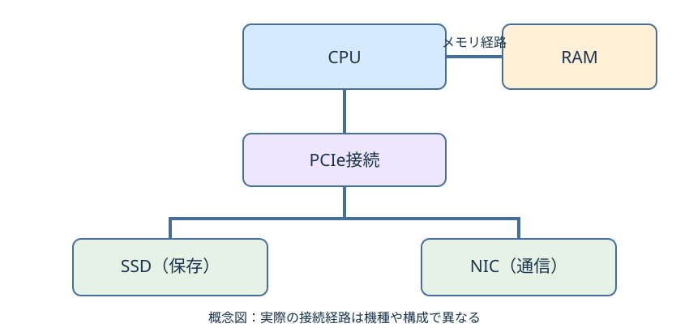
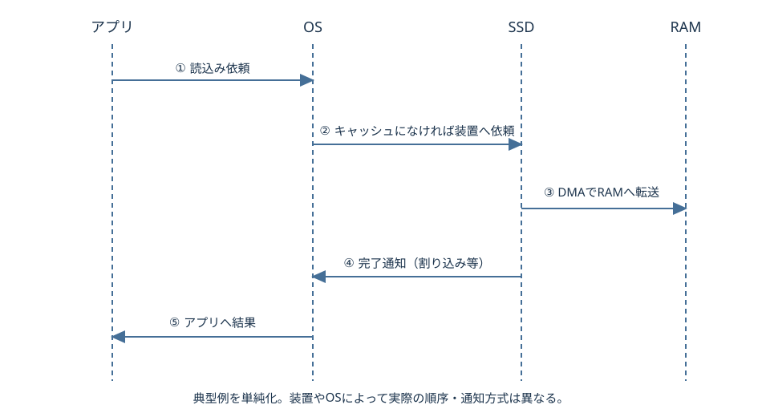

# 第12講 I/O処理・バス・PCIe・DMAの仕組み

## 到達目標
①CPU・RAM・ストレージ・NICの間をデータがどう移動するか説明できる。②I/O待ちとCPU使用率を区別できる。③PCIeのレーン数・世代・共有経路が性能に与える影響を判断できる。④DMA・割り込み・キューを含む正常処理と障害調査を説明できる。

## 資料・重要度・前提
2026年11月22日にGitHubの運用マスターv1.2、カリキュラム18編224講、進捗11講修了を確認。今回、PCI-SIGやLinuxカーネル等の一次資料の該当版・節は**未照合**。具体的な速度・装置の実装は機種やOSにより異なる。数値・ログ・設定例はすべて学習用の架空例であり、コマンドも未実行である。重要度A：I/Oの経路、待機、DMA、割り込み。B：PCIe、キュー、ログ・監視。C：性能設計、製品運用。

## 1. I/Oとは何か：CPU以外との情報のやり取り
**I/O（Input/Output、入出力）**は、コンピュータが外部の装置やほかの部分とデータをやり取りすること。SSDからファイルを読む、NIC（ネットワーク接続装置）で通信を受け取る、バックアップ装置へデータを書くことが例である。

たとえば利用者がWeb画面を開くと、通信はNICから届き、APがDBへ問い合わせ、DBが必要ならストレージからデータを読み、返事を返す。CPUは命令を実行するが、データが届くまで待つ時間も全体の応答時間に含まれる。

**処理時間＝CPUが計算した時間＋データなどを待った時間＋その他の時間**と考える。待ちが長ければCPU使用率が低くても遅くなる。前講の「DBの返事待ち中、通常はCPUをほかの仕事へ渡せる」という知識を、今度は装置とのやり取りに当てはめる。

## 2. データはどこを通るか


図の上側はCPUとRAM。CPUはメモリコントローラを通してRAMにアクセスする。下側はPCIeでつながるSSDやNIC。**PCIe（Peripheral Component Interconnect Express）**は、CPUやチップセット（機器間の接続を助ける回路）と高速な周辺装置を結ぶ通信方式である。

図の線はデータの通り道を表すが、実際にはCPU直結かチップセット経由か、装置の種類、仮想化の有無などで経路が変わる。すべてのSSDやNICが必ず同じ接続方法とは限らない。

**バス**は、装置間で情報をやり取りする通路やその仕組みを指す言葉である。昔ながらの共有バスと異なり、PCIeは基本的に装置間を専用の接続で結ぶ方式を使う。「バス＝一本の線を全装置で共有」と覚えない。

## 3. SSDからファイルを読む正常処理


①アプリがファイルを読むようOSに頼む。②OSはRAM内のページキャッシュにデータがあるかを確認する。③なければストレージ装置へ読込みを依頼する。④装置がデータを準備し、**DMA（Direct Memory Access、直接メモリアクセス）**などでRAMへ転送する。⑤装置からの完了通知を受け、OSがアプリに結果を渡す。

これは理解のために単純化した流れである。実際にはファイルシステム（ファイルを管理する仕組み）、装置ドライバ（OSから装置を操作するためのソフト）、キュー（処理待ちの列）などを通る。キャッシュにデータがあれば装置への読込み依頼自体を省ける場合がある。

重要なのは「CPUがファイルの全バイトを一つずつSSDから運んでいるわけではない」こと。CPUは依頼や完了後の処理を担当し、大量のデータ転送は装置側の機能が助ける。

## 4. DMAはCPUの仕事をどう減らすか
DMAは、対応する装置がCPUに一つずつデータを運んでもらう代わりに、RAMとの間でデータを転送できる仕組みである。CPUは転送先などの準備をし、転送完了後の処理をする。**DMAがある＝CPUが一切不要**ではない。

たとえばNICが受信したデータをRAMへ置く際にもDMAが使われる。CPUは通信内容の確認やアプリへの引渡しを担当する。DMAによってCPUの負担を減らせても、RAMとの通路や装置の性能に限界があれば転送は遅くなる。

**IOMMU（Input-Output Memory Management Unit）**は、装置によるメモリアクセスを制御・変換する仕組みである。装置が勝手にどこへでも書き込める設計では危険なので、仮想化や安全性の観点で重要になる。詳細な設定は機器・OSに依存する。

## 5. 割り込みとは何か
**割り込み（interrupt）**は、装置などがCPUへ「処理が必要になった」と知らせる仕組み。SSDの読込み完了やNICの受信が例である。CPUが装置の状態をずっと確認し続けるより効率的な場合がある。

ただし、高速な装置で毎回細かく割り込みを出すと、その処理自体が負担になる。そこで通知をまとめたり、一定量をまとめて処理したりする仕組みが使われることがある。Linuxのネットワーク処理では、割り込みと後続のまとめ処理を組み合わせる場合がある。

**ポーリング（polling）**は、装置の状態をこちらから繰り返し確認する方法。待ち時間を短くできる場合がある一方、CPUを使いやすい。割り込み方式とポーリング方式は、CPU負荷・応答速度・処理量の条件で選ぶ。すべての待機がCPU使用ゼロとは限らない。

## 6. 同期I/O・非同期I/O・ブロッキングの違い
**同期I/O**は、結果が得られるまでの流れを順番に扱う方式、**非同期I/O**は、依頼後に別の処理を進め、完了を後で受け取れる方式である。**ブロッキング**は、呼び出した仕事が結果待ちで先へ進めない状態をいう。

「同期＝CPUを占有する」「非同期＝必ず速い」とは言えない。同期的な読込みで仕事が待機中でも、OSは別のスレッドをCPUで実行できる。非同期I/Oは同時に複数の依頼を扱いやすくするが、装置自体が混雑していれば完了は遅い。

例：一件の読込みが20msかかる装置で、独立した複数の読込みを重ねて依頼できれば、合計の待ち時間を短くできる場合がある。ただし装置の処理能力を超えると、待ち行列が増えて一件ごとの遅延が悪化する。

## 7. PCIeの世代・レーン数をどう見るか
PCIeの**レーン（lane）**はデータを送受信する通信経路の単位。x1、x4、x8、x16はレーン数の表記である。一般に同じ世代・条件ならレーン数が多いほど転送できるデータ量の上限が大きい。

**世代（Gen）**は通信規格の世代で、新しい世代ほど一レーン当たりの最大転送能力が高くなる傾向がある。ただし、装置・スロット・CPUなどの対応がそろわなければ、期待する速度で動作しない。PCIeの世代・レーン数は**理論上の通路の広さ**であり、アプリの実効速度ではない。

例：高速SSDをx4対応スロットに装着しても、実際にはx1で接続されていれば通路が制限になる可能性がある。一方、SSD内部の処理や小さな読込みの遅延が原因なら、レーンを増やしても効果が小さい場合がある。

## 8. キューと遅延：行列が長くなる仕組み
**キュー（queue）**は処理依頼が順番を待つ列。**キュー深度（queue depth）**は、ある時点で処理中・待機中の依頼数を表す文脈で使われる。どこまでを数えるかは装置・ツールによって異なる。

たとえばSSDが一秒に1,000件の依頼を処理できるとして、毎秒1,200件の依頼が継続的に届けば、列は長くなりやすい。列が長いほど個々の依頼が完了するまでの時間も伸び得る。これが「装置が遅くなった」という体感の原因になることがある。

一方、複数の依頼を同時に処理できる装置では、ある程度の並列実行が性能を高める。**キュー深度を減らせば必ず速い**とも、**増やせば必ず速い**とも言えない。処理件数（スループット）と一件の待ち時間（レイテンシ）の両方を測る。

## 9. IOPS・帯域幅・レイテンシ
**IOPS**は一秒間に完了する読込み・書込みの回数。**帯域幅（throughput）**は一秒間に運ぶデータ量。**レイテンシ（latency）**は一件の依頼が完了するまでの時間である。

例：4KiBの読込みを毎秒10,000回完了すれば、データ量は約39MiB/秒。1MiBの読込みを毎秒1,000回完了すれば、約1,000MiB/秒。IOPSが多い方が、必ず帯域幅も大きいとは限らない。

小さなデータを頻繁に読むDBではIOPSとレイテンシが重要になりやすく、大きなファイルを連続転送するバックアップでは帯域幅が重要になりやすい。実際には読込みと書込みの割合、ランダムか連続か、同時依頼数でも結果が変わる。

## 10. LinuxでI/Oの状態を見る
以下はLinuxの一般的な調査例。ツールのインストール状況・版・表示単位は環境で異なる。

```text
$ iostat -xz 1
Device  r/s   rkB/s  r_await  w/s   wkB/s  w_await  aqu-sz  %util
nvme0n1 320  20480    34.0    90    4096     18.0     9.2   92.0
```

`r/s`は一秒間の読込み件数、`rkB/s`は読込みデータ量、`r_await`は読込み依頼の平均完了時間（通常ms）、`w_await`は書込み依頼の平均完了時間、`aqu-sz`は平均的な未完了I/O数、`%util`は装置がI/Oを処理していた時間割合を示す指標である。

この架空例では読込みの平均が34msで、未完了の依頼も多い。DBの遅延と同じ時刻に増えたなら関連を疑う。ただし`%util=92%`だけで装置の限界とは断定できない。NVMeのように並列処理できる装置では、%utilが高くても処理能力に余裕がある場合がある。

```text
$ vmstat 1
 r  b   si  so   bi    bo   us sy id wa
 1  8    0   0  8000  2500  10  5 25 60
```

`b`は主にI/Oなどを待つ仕事、`wa`はI/O待ちに関連するCPU時間の割合。この例では待ちが目立つが、`wa`が高い理由はストレージ、ファイルシステム、DBのアクセスなど複数考えられる。前講のスワップ不足を疑うなら`si/so`も確認する。ここでは0なので、少なくともこの時点の表示から活発なスワップ転送は見えない。

## 11. 正常なI/O待ちと障害のI/O待ち
I/O待ちはすべて障害ではない。バックアップ中に大量の読込みが発生し、予定時間内に完了してオンライン業務への影響もなければ、装置を有効に使っている可能性がある。

障害を疑うのは、普段より読込み完了時間が増え、処理待ちの列が伸び、業務の応答時間や完了時刻が悪化した場合である。確認の順番は、①業務影響、②どの処理が遅いか、③どの装置で待っているか、④その装置への依頼量やエラー、⑤直前の設定・構成変更、である。

装置の障害だけでなく、アプリが必要以上に多くの読込みを出していることも原因になる。DBのSQL実行計画（どの順番でデータを探すかというDBの処理計画）が変わり、読込み件数が増える場合がある。装置増設だけを先に決めない。

## 12. 障害例A：DBの応答が遅い
```text
time    api_p95_ms  db_query_p95_ms  disk_r_await_ms  disk_aqu_sz  ap_cpu_pct
13:00       180          120              3               0.5          20
13:20      2900         2700             38              11.0          24
```

13:20はAPのCPU使用率が低いのにDB照会とディスク読込みの完了時間が増えている。まずDBのSQLごとの読込み件数、実行計画、待機イベント（DBが何を待ったかの記録）、ストレージ装置のエラーや負荷を確認する。

ただし、この数字だけでは「SSDが故障した」とは言えない。大量の読込み要求による混雑、ほかのバッチとの競合、装置側の異常などを分けて調べる。SQLが原因なら索引や実行計画の見直し、装置が原因なら経路・機器の調査を優先する。

## 13. 障害例B：NIC受信が増えた
```text
time    nic_rx_mbps  rx_drops_per_min  cpu_softirq_pct  api_p95_ms
10:00       250             0               3             180
10:10      840          1800              38            1450
```

`nic_rx_mbps`はNICが受信した通信量、`rx_drops_per_min`は受信できず破棄されたパケット数（ネットワークで送るデータのまとまり）、`cpu_softirq_pct`はLinuxで後回しにして処理する割り込み関連の仕事がCPUを使った割合を表す架空指標である。

受信量と破棄、CPUのネットワーク処理負荷が同時に増えた。NICの速度、ドライバの統計、割り込みのCPUへの割当て、受信キュー、アプリの処理能力を確認する。ネットワーク帯域が限界なのか、CPU側が受信処理に追いつかないのかを分ける。単に回線速度を上げても、CPU処理が限界なら改善しない。

## 14. 障害例C：PCIeの接続条件が変わった
```text
before: SSD negotiated_link = Gen4 x4   sequential_read = 6100 MB/s
after:  SSD negotiated_link = Gen4 x1   sequential_read = 1600 MB/s
```

`negotiated_link`は装置と接続先が実際に合意した通信条件、`sequential_read`は連続したデータを読む速度の例である。SSDの連続読込みが遅くなった時期にレーン数がx4からx1へ変化したなら、PCIe接続条件を調査する価値が高い。

確認項目は、スロットとCPUの対応、ほかの装置とのレーン共有、ファームウェア（装置を制御する内部ソフト）の設定、装置や接続部の異常、変更履歴。**x1になったことが唯一の原因と断定せず**、装置の温度や処理状態も確認する。実際の速度上限は規格世代と構成に依存する。

## 15. 設計判断：どの資源を増やすべきか
| 観測した状況 | 最初に調べること | 対策候補 |
|---|---|---|
| CPUが高くI/O待ちは小さい | CPU別・スレッド別使用量 | 処理改善、CPU増強 |
| CPUが低くストレージ読込み待ちが増加 | I/O件数、遅延、DBの読込み内容 | SQL改善、I/O分散、装置改善 |
| NICの受信破棄が増加 | NIC統計、CPUの割り込み処理、キュー | 処理分散、受信設定、回線増強 |
| SSDの接続レーン数が低下 | 実際のPCIeリンク条件、構成変更 | 接続・スロット・設定の修正 |
| バックアップの大容量転送が遅い | ディスク・PCIe・NICの各帯域幅 | 最も狭い経路の改善 |
| メモリ不足とswap-inが増加 | RAM使用量、スワップ、装置I/O | メモリ使用量削減、RAM増設 |

**ボトルネック**とは、全体の速度を制限している部分。高速なSSDを導入しても、ネットワークやPCIe経路が遅ければ転送速度は上がらない。逆にPCIeを速くしても、DBがロック（同じデータの同時更新を調整する仕組み）を待っているなら効果は小さい。

## 16. 実務製品への接続：Oracle・NetBackup・JP1
Oracle DBでは、SQLの物理読込み（RAMにないデータをストレージから取得する動作）や待機イベントを見ると、CPU計算とI/O待ちを分けて考えやすい。特定の待機名や取得方法はOracleの版によって違うため、ここでは概念を学ぶ。

NetBackupによるバックアップでは、保存元ディスクから読み、ネットワークや接続機器を通して保存先へ書く。LTO（磁気テープに保存する装置）を使う場合、テープへデータを送る速度が十分でないと、書込みが止まったり再開したりして効率が落ちることがある。保存元、通信経路、保存先を順に測る。

JP1/AJSで複数の夜間ジョブを同時起動すると、同じディスクに読込みが集中して待ちが増える場合がある。ジョブの開始時刻や同時実行数を調整することも、ハードウェア増設と並ぶ選択肢である。

## 17. 自宅の3層Webシステムでの安全な確認
Nginx→FastAPI→PostgreSQLのDocker環境では、①APIの応答時間、②DB問い合わせ時間、③ホスト側のI/O、④コンテナのCPUとメモリ使用量を同じ時間帯に記録すると、どこで待っているか考えやすい。

MacBook上のDockerはLinuxコンテナが仮想化された環境で動くため、ホストmacOSとコンテナ内で見える装置名や統計は一致しない場合がある。装置への負荷試験や意図的な障害は、データのバックアップを取った検証環境で行う。今回はコマンド実行や実測をしていない。

## 18. まとめ
I/OはCPUと周辺装置のデータのやり取り。PCIeは高速装置との通路、DMAは装置とRAMのデータ転送を助ける仕組み、割り込みは装置からCPUへの通知、キューは処理待ちの列である。

I/O待ちが長ければCPU使用率が低くても処理は遅い。IOPS（回数）、帯域幅（量）、レイテンシ（時間）、キュー（待ちの数）、業務の応答時間を一緒に見て、最も制限している場所を探す。

## 次講
第13講「HDD・SSD・NVMeの構造と性能特性」。理解度チェックは別掲の四択10問・15点満点。回答前に正解を提示しない。
