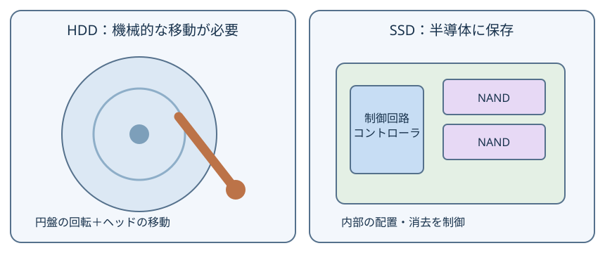
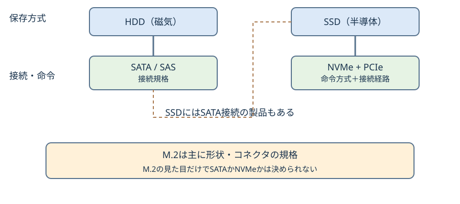
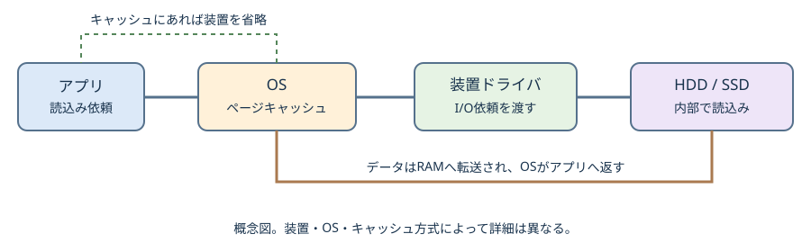

# 第13講 HDD・SSD・NVMeの構造と性能特性

## 到達目標・前提
1. HDDとSSDでデータを保存・読み出す仕組みの違いを説明できる。
2. SATA・SAS・NVMe・PCIeの関係を混同せずに説明できる。
3. IOPS・帯域幅・レイテンシ、ランダム・シーケンシャル、読書き混在の違いから適切な装置を判断できる。
4. SMART・NVMeの健全性情報、OS・DBの待機情報を照合し、故障と負荷集中を区別する。
5. RAID、バックアップ、冗長化、耐久性の限界を踏まえて設計を判断できる。

### 正本と資料の状態
2026-11-23に運用マスターv1.2、正式カリキュラム18編224講、進捗12/224講をGitHubから確認。技術的な説明は汎用原理を中心とする。ATA/SATA、SCSI/SAS、NVM Express、NVMe仕様、メーカーのSMART項目定義、Oracle/NetBackupの製品マニュアルの**特定版・該当節は今回未照合**。装置の型番・ファームウェア・OSで項目や仕様は異なる。下記の性能値・監視ログは説明用の架空例であり、実測やコマンド実行結果ではない。

重要度A：保存方式、読込みの因果関係、性能指標、障害初動。B：接続規格、耐久性、RAID、運用。C：設計比較と実習。

## 1. なぜ保存装置を理解するのか
CPUが速く、RAMが十分でも、必要なデータが保存装置から届かなければ処理は進まない。たとえばDBが大量の小さなデータを読み、ストレージからの返事を待つ間、APのCPU使用率が低いのに利用者の応答時間が長くなる。前講の「I/O待ち」と今回の「保存装置の内部」を結び付ける。

**ストレージ（storage）**はデータを電源断後も保存する装置・仕組み。**揮発性**とは電源が切れると内容を保持できない性質で、一般的なRAMは揮発性、HDDとSSDは不揮発性である。ただし不揮発性でも故障・誤操作・災害でデータを失う可能性がある。

## 2. HDDの構造：円盤と磁気ヘッド


**HDD（Hard Disk Drive、磁気ディスク装置）**は、磁性体を塗った円盤（**プラッタ**）を回転させ、**磁気ヘッド**でデータを読み書きする。ヘッドを目的の位置へ動かす機構が**アーム**である。

読みたいデータが離れた場所にあれば、①ヘッドを目的の位置へ動かす（**シーク**）、②円盤の目的の部分がヘッドの下へ来るまで待つ（**回転待ち**）、③データを転送する。したがって、離れた場所を何度も読むと機械的な移動と回転待ちが積み重なる。

**ランダムI/O**は離れた位置の小さなデータを次々に読む・書く動作。**シーケンシャルI/O**は連続した大きなデータを順に読む・書く動作。HDDは一般に後者が得意で、前者では機械的な待ち時間が目立つ。

例：100件のデータが円盤上の離れた位置にあれば、そのたびに位置合わせが必要になりやすい。一方、連続した1個の大きなファイルなら、位置合わせの回数を抑えやすい。実際の性能はキャッシュ、ファイルの配置、同時処理数にも左右される。

## 3. SSDの構造：電気的に記憶する半導体
**SSD（Solid State Drive、半導体を使う保存装置）**は、一般的に**NANDフラッシュメモリ**という、電源を切ってもデータを保持できる半導体を使う。HDDのような回転円盤と磁気ヘッドを必要としない。

SSD内部には**コントローラ**（データの読み書きや配置を管理する制御回路）があり、OSから来た読書き要求を実際のフラッシュメモリの操作に変換する。装置によっては**DRAMキャッシュ**（管理情報や一時的なデータを保持する高速メモリ）も使う。

SSDは機械的なシークが不要なので、小さなデータへのランダムアクセスでHDDより低い待ち時間を実現しやすい。ただし「SSDならどんな条件でも速い」とは言えない。内部の並列処理能力、接続方式、空き領域、温度、書込み量で性能が変わる。

## 4. SSDはなぜ上書きが難しいのか
NANDフラッシュは、細かい単位の**ページ**で読み書きし、より大きな単位の**ブロック**で消去するという制約を持つ。ここでいうSSD内部のページは、前講のOSのメモリページとは別の単位である。

SSDは使用中のデータを別の場所へ移し、不要になった領域をまとめて消去することがある。これを**ガベージコレクション（GC）**と呼ぶ。**ウェアレベリング**は、書込み・消去が一部の場所へ集中しないよう使用場所を分散させる仕組みである。

**書込み増幅（Write Amplification）**は、OSが要求した書込み量よりも、SSD内部で実際に書く量が増える現象。小さな書込みが多い、空き領域が少ないなどの条件では内部の整理が増える場合がある。書込み量と寿命、性能を考える際に重要である。

**TRIM**は、OSが「この領域のデータはもう不要」とSSDへ知らせる仕組み。SSDは将来の整理に利用できる。ただしTRIMを使えば常に速くなるわけではなく、OS・ファイルシステム・接続経路・装置の対応に依存する。

## 5. SATA・SAS・NVMe・PCIeの関係


**SATA（Serial ATA）**は保存装置を接続する規格の一つで、HDDやSATA SSDに使われる。**SAS（Serial Attached SCSI）**はサーバ向けでよく使われる接続規格で、構成によって複数経路や業務向け機能を備える。**NVMe（Non-Volatile Memory Express）**は不揮発性メモリを高速に扱うためのコマンド・通信の仕組みで、典型的にはPCIe上で使われる。

ここで区別することは3つ。
- HDDかSSDか：**データを記憶する内部方式**。
- SATA・SAS・PCIe：**装置との接続経路・通信規格**。
- NVMe：**SSDなどに命令を伝える仕組み**。典型的なNVMe SSDはPCIe経由で接続するが、NVMe over Fabricsのようにネットワーク越しで使う方式もある。

したがって「SSD＝NVMe」ではない。SATA SSDもある。「NVMe＝必ずM.2」でもない。**M.2**は基板やコネクタの形状に関する規格で、形が似ていても対応する通信方式は製品ごとに違う。

NVMeは複数のI/O要求を並行して扱いやすい設計を持つ。ただし性能はSSD内部の処理能力やPCIeリンク条件にも依存する。前講のPCIe x4からx1への変化は、SSDの中身が同じでも通路の上限を下げ得る例である。

## 6. 読込みの正常処理：どこで時間がかかるか


①アプリがOSへ読込みを依頼する。②OSはRAMのページキャッシュを確認し、あればそれを返せる。③なければファイルシステム・装置ドライバを通じて装置へ依頼する。④SSDならコントローラがフラッシュメモリを読み、HDDならヘッド移動・回転待ち・転送を行う。⑤装置からデータがRAMへ届き、OSがアプリへ結果を渡す。

前講で学んだ**DMA（装置とRAMの間の転送をCPUが一つずつ運ばずに行う仕組み）**や**割り込み（装置が処理完了などをCPUに知らせる仕組み）**もこの経路に関係する。アプリがI/O完了を待っている間、通常OSは別の仕事にCPUを使わせられる。

読み出しが遅いとき、装置内部だけでなく、OSの待ち行列、PCIe経路、DBが発行した読込み件数なども確認する必要がある。

## 7. 性能指標を三つに分ける
**IOPS（Input/Output Operations Per Second）**は一秒間に完了するI/Oの回数。**帯域幅**は一秒間に運ぶデータ量（MB/sなど）。**レイテンシ**は一件の要求が完了するまでの時間（msなど）。

| 処理の例 | 一件の大きさ | 完了回数 | 概算転送量 | 重視する観点 |
|---|---:|---:|---:|---|
| DBの小さな読込み | 4KiB | 10,000 IOPS | 約39MiB/s | IOPSと遅延 |
| バックアップの連続読込み | 1MiB | 1,000 IOPS | 約1,000MiB/s | 帯域幅 |
| 利用者の単発の読込み | 4KiB | 1件 | 少量 | 一件の待ち時間 |

IOPSが大きくても、一件のサイズが小さければ帯域幅は小さい。逆に大きなファイルを順番に読む処理では、IOPSより転送量の上限が重要になりやすい。

**キュー深度**は未完了のI/O依頼数。並列処理できるSSDでは一定の深さが処理量を高めるが、依頼が装置の処理能力を超えると待ち時間が増える。キューを増やすだけで利用者の応答時間が改善するとは限らない。

## 8. HDD・SATA SSD・NVMe SSDを比較する
| 観点 | HDD | SATA SSD | PCIe接続のNVMe SSD |
|---|---|---|---|
| 保存方法 | 回転円盤の磁気 | NANDフラッシュ | 多くはNANDフラッシュ |
| 小さなランダム読込み | 機械的な待ちが大きい | 一般に速い | 並列処理に強い製品が多い |
| 連続転送 | 回転速度等で制限 | SATA接続等で制限 | PCIe世代・レーン等に依存 |
| 主な注意 | 振動、機械故障 | 書込み耐久、GC | 発熱、PCIe条件、耐久 |
| 選定例 | 容量重視の保存 | 一般的なOS・業務 | 高並列のDB・仮想化 |

これは傾向であり、個別製品の保証ではない。安価なNVMe SSDが、耐久性や安定した書込み性能で業務向けSATA SSDを必ず上回るわけではない。

## 9. SSDの書込み耐久性と温度
**TBW（Terabytes Written）**は製品が想定する累積書込み量を示す指標、**DWPD（Drive Writes Per Day）**は保証条件などで想定される、一日に装置全体を書き換える回数の目安。メーカーの定義・保証期間と合わせて読む。

例：容量1TB、DWPD 1、保証期間5年という条件なら、概算の想定書込み量は1TB×1回/日×365日×5年＝1,825TB。これは説明用の計算で、製品の保証条件を表すものではない。TBWやDWPDに達した瞬間に必ず故障するという意味でもない。

**サーマルスロットリング**は、装置が高温になりすぎないよう性能を意図的に下げる制御。長時間の連続書込みで速度が落ちた場合、温度・消費電力・内部キャッシュの状態も確認する。PCIeの帯域幅だけでは説明できない。

業務用SSDでは、電源断時に内部に残った書込みデータを保護する**電源断保護（PLP）**を備える製品がある。ただし保護範囲は製品によって異なる。DB用途では性能だけでなく、電源断時のデータ保護や書込み保証を仕様書で確認する。

## 10. HDDとSSDの故障兆候
**SMART（Self-Monitoring, Analysis and Reporting Technology）**は、装置が自分の状態を記録・報告する仕組み。HDDでは代替処理されたセクタ（データを保存する区画）、読取りエラー、温度など、SSDでは寿命目安、書込み量、エラー、温度などが手掛かりになる。

ただし、SMARTの数値の意味は装置・メーカーで異なる。正常表示でも突然故障する場合があり、異常表示でも即時停止とは限らない。**監視値とエラーログ、業務影響、冗長状態、バックアップの有無を組み合わせる**。

NVMe SSDでは**NVMe SMART / Health Information**などの情報から、温度、使用率目安、重大警告、メディア・データ整合性エラーなどを確認できる場合がある。項目名や値の意味は装置とツールの版に依存する。

## 11. Linuxで何を確認するか
以下はLinuxの代表的なコマンド例。**未実行**であり、環境に応じて権限やツール導入が必要。

```bash
lsblk -o NAME,TYPE,SIZE,MODEL,TRAN
iostat -xz 1
sudo smartctl -a /dev/sda
sudo nvme smart-log /dev/nvme0
journalctl -k --since "1 hour ago"
```

`lsblk`は装置の一覧、`iostat`はI/Oの回数・転送量・待ち時間、`smartctl`は対応装置の健全性情報、`nvme smart-log`は対応NVMe装置の健全性情報、`journalctl -k`はOSのカーネル（装置を管理するOSの中心部分）のログを確認するために使う。

```text
# 架空のiostat例
time  device   r/s   r_await(ms)  aqu-sz  %util
10:00 nvme0n1  180       1.5       0.4     35
10:20 nvme0n1  900      26.0      14.0     97
```

10:20は読込み件数、平均完了時間、未完了I/O数が同時に増えている。**読み取れる事実**は「依頼が増え、完了に時間がかかっている」こと。**まだ分からないこと**は、SQLの読込み増加、別ジョブとの競合、SSDの温度制御、装置・経路の異常のどれが主因かである。

`%util`が97%でも、NVMe装置の能力が限界に達したと単独で断定しない。業務の応答時間と、装置の遅延・処理量・エラーを合わせて判断する。

## 12. 障害例A：DBが遅くなった
```text
時刻   API p95   DB読込み待ちp95   ディスクr_await   読込み件数/秒
14:00   200ms         120ms              2ms            200
14:15  2400ms        2100ms             30ms           1500
```

①業務影響：API応答が悪化。②DB側の待ち時間が増加。③ディスクの読込み件数と完了時間も増加。ここから、DBのI/Oが遅延に関係している可能性が高い。

次にSQLごとの読込み件数、実行計画（DBがデータを探す手順）、バッチ起動履歴、ディスクエラー、温度を照合する。SQLが大量に読み始めたならSQLや索引の見直しが候補。装置エラーが出ているなら機器・経路調査が優先。**この数値だけでSSD故障とは断定しない**。

## 13. 障害例B：バックアップ速度が落ちた
```text
保存元SSD読込み   900 MB/s
ネットワーク転送   110 MB/s
保存先書込み       105 MB/s
バックアップ実効   100 MB/s
```

保存元が900MB/s読めても、通信や保存先が約100MB/sなら全体の速度はそこに制限される。**ボトルネック**とは、全体の処理速度を制限している部分である。

NetBackupでバックアップが遅いときは、保存元、ネットワーク、メディアサーバ、保存先ディスクやLTOの各区間を測る。LTOではデータの供給が途切れるとテープの動作効率が落ちる場合がある。SSDだけを高性能品へ交換しても改善しないことがある。

## 14. 障害例C：SSDの書込みが時間とともに遅くなる
```text
開始5分  書込み 1800 MB/s  温度 48℃
開始40分 書込み  650 MB/s  温度 78℃
エラーログ：新規エラーなし
```

長時間の連続書込みで温度が上昇し速度が低下している。まず温度による制御、内部キャッシュの使い切り、空き領域、書込み量の影響を調べる。エラーがないから正常と決めつけず、逆に速度低下だけで故障と断定もしない。

対策候補は冷却改善、書込み負荷の平準化、継続書込み性能に余裕のある製品選定など。温度閾値や適正な冷却条件はメーカー仕様で確認する。

## 15. RAIDとバックアップを混同しない
**RAID（Redundant Array of Independent Disks）**は、複数のディスクを組み合わせ、性能や故障への耐性を高める構成方式である。

- RAID 0：データを複数台へ分散して性能や容量を活用するが、ディスク故障への冗長性はない。
- RAID 1：同じデータを複数台に複製し、一定のディスク故障に耐える。
- RAID 5：分散したデータと復元用情報を使い、一般的な構成では1台のディスク故障に耐える。
- RAID 6：復元用情報を増やし、一般的な構成では2台のディスク故障に耐える。

ただし、RAIDは誤削除、ランサムウェア、火災、論理的なデータ破損への万能な対策ではない。**バックアップ**は、元のデータが失われても別の保存先や世代から復元できるようにする仕組み。RAIDとバックアップは目的が異なる。

RAID構成中に一台が故障し、交換後にデータを再構成する作業を**リビルド**という。リビルド中はI/O負荷や故障リスクが変化するため、交換手順、残りの冗長性、業務影響を確認する。

## 16. 設計判断：用途に合わせて選ぶ
| 用途 | 優先する指標 | 設計時の注意 |
|---|---|---|
| Oracle DBの小さなランダム読込み | 遅延、IOPS、持続性能 | 書込み耐久、電源断保護、冗長性 |
| 大容量バックアップ | 帯域幅、容量、復元時間 | 保存先とネットワークの経路全体 |
| OS・一般業務 | 応答時間、費用、容量 | 実際の負荷と保守性 |
| 大量のログ書込み | 持続書込み性能、耐久性 | 温度、空き領域、書込み増幅 |
| 長期保管 | 容量単価、保管条件 | 別媒体・別拠点、定期復元試験 |

選定の順番は①業務の目標（何秒以内、何時間以内）②I/Oの種類（小さいか大きいか、読込みか書込みか）③必要な性能④障害時の継続性⑤費用・保守。スペック表の最大転送速度だけで決めない。

## 17. Oracle・JP1・NetBackupと自宅実習
Oracleでは、SQLの物理読込み、待機イベント、DBキャッシュの効き方を確認し、ストレージが原因かSQLが原因かを切り分ける。JP1/AJSで夜間バッチが重なると、同じストレージへのI/O集中が発生し得るため、開始時刻と同時実行数の調整も対策となる。

NetBackupではバックアップ元から保存先までの経路を調べ、容量、速度、復元可能性を分けて評価する。ShadowImageのようなストレージ内コピーはデータ保護の一要素だが、別の障害領域へ保管するバックアップや復元試験とは役割が異なる。

自宅のNginx→FastAPI→PostgreSQLのDocker構成では、APIの応答時間、DB問い合わせ時間、ホスト側のI/Oを同じ時刻で記録する。ただしMac上のDockerは仮想化を利用するため、Linuxコンテナから見える装置統計とmacOSの実SSD統計が一致しないことがある。破壊的な書込み試験や障害注入は、バックアップ済みの検証環境だけで実施する。

## 18. まとめ
HDDは円盤・ヘッドの移動があり、ランダムアクセスで機械的な待ちが生じる。SSDはフラッシュメモリとコントローラで処理し、機械的なシークは不要だが、書込みの整理、耐久性、温度に注意する。

NVMeは保存方式そのものではなく、SSDなどへ命令を伝える仕組み。PCIeは主にその通信経路。性能はIOPS、帯域幅、レイテンシを業務の処理内容と組み合わせて評価する。故障調査ではSMARTなどの健全性情報、OSログ、業務影響、構成変更を照合し、数値一つで断定しない。

次講：第14講「物理サーバの構成・ラック・電源・冷却」。理解度チェックは別掲の実務判断型四択10問・15点満点。回答前に正解を示さない。
