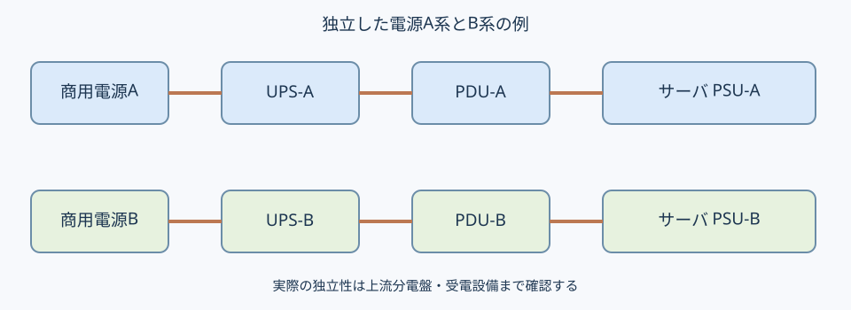
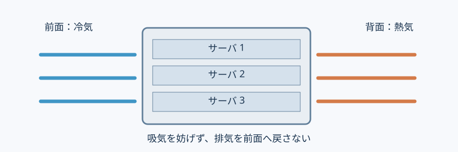

# 第14講 物理サーバの構成・ラック・電源・冷却

## 1. 到達目標と学習の位置付け

この講義では①ラックに収容される物理サーバの構成、②電力の供給経路、③冷却と空気の流れ、④故障時の影響範囲、⑤現場の安全な調査と設計判断を学ぶ。前講までのCPU・RAM・SSDは単体の部品だった。現場ではそれらを筐体（きょうたい：部品を収める箱）に組み込み、電源・ネットワーク・空調と組み合わせて業務を動かす。単一部品が高性能でも、電源系統が止まればシステムは止まる。

## 2. 物理サーバとラックの構造

**物理サーバ**はCPU、メモリ、ストレージ、NIC（ネットワーク接続用の部品）、電源装置、ファンなどを一つの筐体に収めたコンピュータ。**ラック**はサーバやネットワーク装置を縦方向に収納する棚。一般的な19インチラックは機器の取付幅に関する規格であり、ラックの奥行きや耐荷重は製品ごとに確認する。**U（ユニット）**は高さの単位で、1Uは44.45mm。2Uはその約2倍の高さ。高さが合っても奥行き、重量、配線、通気が合わなければ設置できない。

ラックには**レール**（サーバを支えて引き出せるようにする金具）を使う構成がある。引き出すと重心が前へ移動するため、転倒防止、レールの耐荷重、保守スペースを確認する。上段に重い機器を集中させず、重量物の配置と床の耐荷重も考える。

## 3. ラック前面と背面の役割

一般的なサーバは前面から冷たい空気を取り込み、背面へ温かい空気を排出する。ただし製品ごとの吸排気方向を必ず確認する。前面に吸気を妨げる荷物を置いたり、背面の排気を前面へ戻したりすると、室温が正常でも装置の吸気温度が上がることがある。

**ホットアイル**は熱い排気が集まる通路、**コールドアイル**は冷たい空気を供給する通路。両者を分ける配置は、排気が吸気へ回り込むのを抑えるための設計である。未使用のラックの隙間をふさぐ**ブランキングパネル**は、空気の回り込みを減らすために使う。ケーブルが背面の排気をふさがないようにする。

## 4. 電源の経路を追う



**商用電源**は電力会社などから供給される電力。**UPS（無停電電源装置）**は停電や短い電圧低下が起きたときに、蓄電池などで一定時間電力を供給する装置。**PDU（電源分配装置）**はラック内で複数機器へ電力を分ける装置。サーバの**PSU（電源ユニット）**は供給された電力をサーバ内部の部品が使える電圧へ変換する。

正常時は「商用電源→UPS→PDU→PSU→CPU・メモリ・SSDなど」と流れる。UPSは電力を無限に供給する装置ではない。停電時にどれだけ持つかは負荷、蓄電池の状態、機種によって変わる。発電機がある施設でも、発電機の起動までの時間をUPSでつなぐ設計がある。

## 5. 二重化電源の落とし穴

**冗長化**とは、一つが壊れてももう一つで業務を続けられるよう、重要な機能を複数用意すること。サーバにPSUを2台搭載しても、両方を同じPDUに接続していれば、そのPDUの故障で両方止まる。電源A系とB系の独立性を確認する必要がある。

たとえばPSU-A→PDU-A→UPS-A、PSU-B→PDU-B→UPS-Bと分ける。ただし上流の分電盤や建物の受電設備が共通なら、そこが**単一障害点（SPOF：そこ一か所の故障で全体が止まる箇所）**になり得る。二つの経路が見た目だけ別なのか、故障の影響範囲まで独立しているのかを配線図で確認する。

PSUの2台構成には、片方だけで必要な電力をまかなえるものと、両方を使って大きな電力を供給するものがある。**二重化している＝1台故障しても必ず継続できる**とは限らない。片方の容量、電源仕様、冗長モードを確認する。

## 6. 電力の単位と容量計画

**W（ワット）**はその瞬間の消費電力、**Wh（ワット時）**は消費電力量。500Wの負荷を2時間使えば理想化した計算で1,000Whになる。UPSの稼働時間はこの単純計算だけでは決まらず、変換損失、蓄電池の放電特性、経年劣化などを考慮する。

**VA（ボルトアンペア）**は交流電力の見かけ上の大きさ。Wと同じ数値とは限らない。**力率**は有効電力Wと皮相電力VAの比で、装置の仕様を確認する。UPSやPDUの選定ではWとVAの両方の上限を確認する。定常時だけでなく、起動時や片系電源故障時の負荷も考える。

架空例：サーバAが450W、サーバBが400W、スイッチが100Wなら合計950W。ただしUPSを950W定格ぴったりで選んでよいわけではない。余裕、バッテリー稼働時間、増設、片系運転を評価する。

## 7. 停電時に何が起きるか

正常時は電源が供給され、OSとDBはRAMのデータを使いながらストレージへ書き込む。停電時にUPSが給電を維持できれば、短時間は業務を継続したり、安全な停止処理を実行したりできる。

**シャットダウン**はOSやアプリを決められた順序で終了する処理。DBが書込み途中で突然電源を失うと、復旧処理やデータの整合性確認が必要になる場合がある。UPSの残り時間を監視し、業務停止→DB停止→OS停止などの手順を定める。製品や構成によって適切な順番は異なる。

UPSの蓄電池の故障や交換時期、監視通知、停電時の自動停止連携を定期的に確認する。UPSがあるだけで安全停止が保証されるわけではない。

## 8. 冷却の仕組みと温度



CPUやメモリ、SSD、電源は動作中に熱を発する。**ファン**は空気を動かす部品、**ヒートシンク**は部品から熱を受け取って空気へ逃がす金属部品。熱を十分に逃がせないと、CPUやSSDが性能を下げる**サーマルスロットリング**を行う場合がある。さらに高温が続けば装置保護のため停止する場合もある。

ラック内の温度を見る際は、部屋の温度だけでなくサーバの**吸気温度**、CPU温度、ファン回転数、警告履歴を見る。室温25℃でも、背面の熱い空気が前面へ回り込めば吸気温度が高くなることがある。装置の許容温湿度はメーカー仕様を確認する。

## 9. 冷却障害の因果関係

架空の観測例：13:00の吸気温度24℃・CPU温度62℃・CPUクロック3.0GHz・API p95 180ms。13:20には吸気温度35℃・CPU温度92℃・CPUクロック1.6GHz・API p95 1,100ms。ファン警告あり。

読み取れる事実は、温度上昇とクロック低下、応答悪化が同時に起きたこと。疑うべき候補はファン故障、吸気の障害、空調故障、熱気の回り込みなど。温度だけで原因を確定せず、ラックの前後温度、ファンログ、空調警報、他機器への影響を確認する。冷却を確保せずCPUコア数だけ増やしても、発熱が増えて悪化する場合がある。

## 10. BMCとハードウェア監視

**BMC（Baseboard Management Controller）**は、OSとは別にサーバの電源、温度、ファン、電源ユニットなどを監視・管理する専用の制御機能。製品によってiDRAC、iLOなどの名称で提供される。**アウトオブバンド管理**とは、通常の業務ネットワークやOSの動作とは別の管理経路を使う方式。

OSが起動しないときでも、BMCが動作していれば電源状態やハードウェアログを確認できる場合がある。ただしBMCにも電源やネットワークの依存関係がある。管理ネットワークは業務ネットワークから分離し、認証、アクセス制限、更新を行う。BMCの遠隔電源操作は業務停止につながるため、承認・影響確認なしに実施しない。

## 11. ログと監視の読み方

次は架空のハードウェアイベント例。

```text
2026-11-23 13:17 PSU1 AC input lost
2026-11-23 13:17 PSU2 supplying system load
2026-11-23 13:18 Fan 4 speed below threshold
2026-11-23 13:20 CPU thermal throttling active
```

1行目はPSU1の入力電源が失われたという記録。2行目はPSU2が負荷を供給しているという記録。3行目はファン4の回転数が設定値を下回ったという記録。4行目はCPUが熱を抑えるため性能を制限しているという記録。複数の異常が同時に起きても、原因が一つとは限らない。時刻、対象機器、ラック位置、電源経路、温度の推移を照合する。

監視の**しきい値**は警告を出す基準。しきい値を上げて警報を消すだけでは根本対策にならない。メーカーの許容値、平常時の変動、業務影響に基づいて設定する。

## 12. 現場での障害初動

①業務影響を把握する：どのシステムが停止・遅延しているか。②監視・ログを確認する：BMC、OS、UPS、PDU、空調の時刻をそろえる。③影響範囲を特定する：単一サーバか、ラック全体か、同じ電源系統の機器か。④安全と冗長性を確認する：残るPSU、UPSの残時間、冷却能力、バックアップ。⑤承認された手順で対処する：保守窓口への連絡、負荷制限、停止、部品交換など。

特に電源ケーブルの抜き差し、UPS切替、サーバの引出し、ファン交換は事故や停止につながる。現場の資格・手順・保守契約に従い、活線作業（電気が流れた状態での作業）を自己判断で実施しない。

## 13. 障害例A：二重化PSUなのに停止

サーバにPSUが2台ある。両方ともラックPDU-Aに接続していた。PDU-Aが故障すると2台のPSUが同時に給電を失い、サーバが停止した。PSUの個数は2でも、給電経路の単一障害点が残っていたことが原因。

再発防止では、PSU-AとPSU-Bを独立したPDU・UPS系統へ接続できるか確認する。さらに両経路の上流が共通か、片系で必要電力を供給できるかを調べる。切替試験は実業務への影響を評価し、保守手順に従う。

## 14. 障害例B：空調警報とAP応答悪化

ラック前面の吸気温度が上昇し、複数サーバでファン回転数が上がった。APのCPU使用率は高くないが、CPUクロックが下がり、応答が悪化した。まず空調、吸気・排気の障害、ファン、温度ログを確認する。

単一APのプログラム不具合より、同じラック内の複数機器が同時に温度上昇している事実が重要。空調を復旧するまで負荷を減らす、業務を別ラックへ退避させるといった対策も検討する。ただし移行先に処理能力があるか確認する。

## 15. 障害例C：UPSの残り時間が短い

停電でUPSが給電中。監視画面は残り8分を示し、通常のDB停止には6分、OS停止に2分かかる。理論上は合計8分でも、予測誤差や処理遅延があるため余裕がない。優先順位は業務への影響とデータ保護を評価し、定められた停止計画を早期に実行すること。

UPSの残時間は推定値であり、実際の負荷や蓄電池の状態で変わる。発電機が起動する見込みがあっても、確実な切替を確認するまでは残時間を過信しない。

## 16. 設計判断：ラック・電源・冷却の容量

| 項目 | 平常時の確認 | 障害時・増設時の確認 |
|---|---|---|
| ラック | U数、奥行き、重量、保守空間 | 引出し時の転倒、空きスペース |
| 電源 | W・VA、PDUの口数、配線 | 片系故障時の負荷、UPS残時間 |
| 冷却 | 吸気温度、風量、排気方向 | 空調1系統故障、隣接機器の熱 |
| ネットワーク | NIC、配線、管理経路 | スイッチ故障、BMCへの接続 |
| 保守 | 交換部品、契約、手順 | 作業窓、業務影響、復旧時間 |

**N+1**は必要な台数Nに予備1台を加える考え方。たとえば冷却装置が2台必要なら3台用意し、1台故障しても必要な冷却能力を維持する設計。ただし配管や電源などの共通部分が壊れると全台が使えなくなる場合がある。冗長台数だけでなく故障範囲を評価する。

## 17. Oracle・JP1・NetBackupでの影響

Oracle DBは電源断時に整合性回復が必要になる場合があり、ストレージの書込み保証と安全停止手順が重要。JP1/AJSで夜間バッチを実行している最中にサーバが停止すると、再実行可否や途中までの処理を確認する必要がある。NetBackupではバックアップ装置だけでなく、メディアサーバやLTO装置の電源・冷却・接続経路も対象となる。

Oracle RACのような複数ノード構成でも、同じラック・電源・空調へ集中していれば共通障害で同時停止し得る。ノードを分けるだけでなく、電源系統、ラック、ネットワーク、ストレージなどの障害範囲を確認する。

## 18. 自宅3層Webシステムとのつながり

Mac上のNginx→FastAPI→PostgreSQLは一台の物理ホストで動いている。コンテナを3つに分けても、Mac本体の電源・冷却・SSDは共通である。したがってコンテナの数を増やすことは物理障害に対する冗長化ではない。

安全な演習：①ホストのCPU温度やファン状態をOSが提供する範囲で確認する、②Dockerコンテナ停止と物理ホスト停止の影響範囲を紙に書き分ける、③自宅の電源が失われた場合のデータ復旧手段を整理する。故意の電源断、過熱、UPS切替などの危険な試験は行わない。

## 19. まとめと次講

サーバはCPU・RAM・SSDだけで動くのではなく、ラック、電源、冷却、管理ネットワーク、保守体制に支えられている。二重化PSUがあっても給電元が共通なら単一障害点が残る。室温が正常でも熱気の回り込みで吸気温度が上がる。障害調査ではBMC・OS・UPS・PDU・空調のログを時刻で照合し、機器一台だけでなく共通の電源・ラックを確認する。

次講は第15講「BIOS・UEFI・ファームウェア・起動処理」。理解度チェックは実務判断型四択10問・15点満点で、回答前に正解を表示しない。