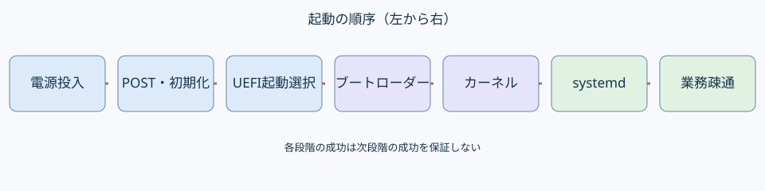
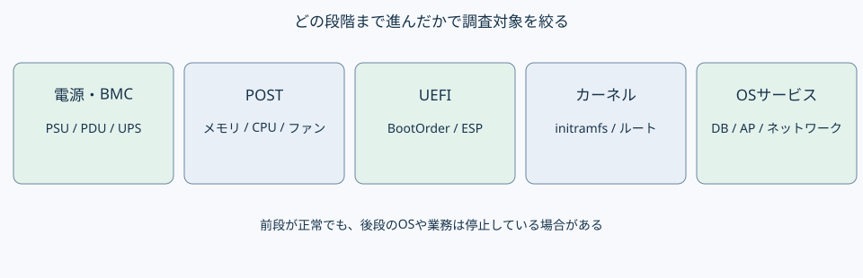

# 第15講 BIOS・UEFI・ファームウェア・起動処理

## 1. 到達目標・資料・重要度

この講義では、電源投入からOSと業務が利用可能になるまでの順序を説明し、起動停止時に故障箇所を切り分ける。A必須：ファームウェア、POST、UEFI、ブートローダー、カーネル、サービス起動。B理解補助：ESP、NVRAM、Secure Boot、ログ。C発展：ファームウェア更新と復旧設計。

参照資料：UEFI Forum『UEFI Specification 2.11』（2024年12月公開）のBoot Manager章、UEFI Forum FAQ、Microsoft Learn『Secure boot』（2026年3月更新）を確認した。Linuxのディストリビューション別の起動コマンドとサーバメーカー固有のPOSTコード・更新手順は公式マニュアル未照合。以下のLinuxコマンドは一般的なsystemd環境の例であり、実機未実行。架空ログは実ログではない。

## 2. OSが起動する前に必要な仕組み

前講ではPSUから電力が供給されることを学んだ。しかし電源が来ても、CPUは最初からLinuxやWindowsの命令を実行できるわけではない。起動直後にハードウェアを準備し、OSのプログラムを探して読み込む役目が必要だ。それが**ファームウェア**である。ファームウェアは機器に組み込まれた制御用プログラムで、一般に不揮発性メモリ（電源を切っても内容が残る記憶領域）に保存される。サーバのUEFI、SSDの制御プログラム、NICの制御プログラムもファームウェアの例である。

**BIOS（Basic Input/Output System）**は従来のPCの起動・入出力初期化を担った仕組み。**UEFI（Unified Extensible Firmware Interface）**は現代のPC・サーバで広く使われるファームウェアとOSの間のインターフェース仕様である。現場で『BIOS設定画面』と呼んでいても実際にはUEFIであることがある。BIOSとUEFIを単なる画面デザインの違いだと考えない。

## 3. 起動全体の流れを図で追う



矢印は処理の順番を表す。①電源投入でCPUがファームウェアの処理を開始する。②ファームウェアがメモリなどの初期化と機器の確認を行う。③UEFIブートマネージャーが起動先を選ぶ。④ブートローダーがOSカーネルなどを読み込む。⑤カーネルがデバイスを初期化し、初期ユーザー空間へ移る。⑥systemdなどの初期化システムがネットワークやDBなどのサービスを起動する。⑦監視と業務疎通を確認して利用可能と判断する。各段階の成功は次段階の成功を保証しない。

## 4. POSTとハードウェア初期化

**POST（Power-On Self-Test）**は電源投入時の自己診断処理の総称。メモリ、CPU、ファン、装置の存在などを初期化・確認するが、検査範囲は製品・設定によって異なる。POSTが成功してもSSDの全領域が正常、OSが正常、DBが正常と証明されるわけではない。

**メモリトレーニング**は、メモリを安定して使うために信号のタイミングなどを調整する初期化処理。大容量メモリを搭載したサーバでは時間がかかる場合がある。画面がしばらく暗いだけで故障と断定しない。BMCのPOST進行状況、メーカーの診断コード、メモリ警告を確認する。

## 5. UEFIが起動先を選ぶ

UEFIの**ブートマネージャー**は、どの起動用プログラムを実行するかを選ぶ機能。**NVRAM（Non-Volatile RAM）**は電源を切っても設定を保持する記憶領域の総称で、UEFIの起動エントリや順序などを保持する。**BootOrder**は通常起動時の優先順序、**Boot####**は個々の起動エントリを表す変数である。UEFIは起動順序に従い、起動用プログラムを探して実行する。<https://uefi.org/specs/UEFI/2.11/03_Boot_Manager.html>

たとえばOS用SSDとネットワーク起動（PXEなど）の両方が登録されていれば、起動順序の変更で別の起動先を試すことがある。意図せずネットワーク起動を優先すると、OS用SSDが正常でも別の画面が出る。故障時は『ディスクが壊れた』と決めつける前に、認識状況とBootOrderを確認する。

## 6. ESPとブートローダー

**ESP（EFI System Partition）**はUEFI環境で起動用ファイルを置くための特別なディスク領域。一般的なx86-64 LinuxではFAT系ファイルシステム上のEFI実行ファイルが使われる。**ブートローダー**はOSカーネルを読み込んで起動へ引き継ぐプログラム。LinuxのGRUBやsystemd-boot、Windows Boot Managerなどが例である。構成によってはUEFIがカーネルを直接起動する場合もあり、必ずGRUBを通るわけではない。

**GPT（GUID Partition Table）**はディスクを複数の領域へ分ける管理方式。GPTとESPは同義ではない。GPTはディスク上の区画の管理方法、ESPは起動用ファイルを格納する区画である。ESPのファイル破損やブートエントリの誤設定では、SSDが見えていてもOSが起動できないことがある。

## 7. Secure Bootが守る範囲

**Secure Boot**は、起動時に実行されるソフトウェアの署名を確認し、許可されたものだけを起動させる仕組み。**デジタル署名**はプログラムが信頼された鍵で署名され、改変されていないことを検証するための情報である。署名を検証するための鍵や許可・拒否情報はUEFI側で管理される。

Secure Bootはマルウェアによる起動経路の改ざんを防ぐ助けになるが、OS上のすべての攻撃を防ぐわけではない。OSやブートローダーを更新した後に署名・鍵の整合が取れないと、起動が拒否されることがある。起動できないからといって、影響評価なしにSecure Bootを無効化しない。公式の署名・鍵・更新手順を確認する。

## 8. カーネル・initramfs・systemd

**カーネル**はCPU、メモリ、ストレージ、ネットワークなどを管理するOSの中核プログラム。**initramfs**はカーネル起動直後に使う一時的なファイル群で、OSの本体が置かれたディスクを使えるようにするためのドライバや設定を含む場合がある。**ルートファイルシステム**はOSのファイル階層の起点（/）である。

起動の例：ブートローダーがカーネルとinitramfsを読み込む→カーネルが動く→initramfs内の処理でディスクや暗号化領域を利用可能にする→本来のルートファイルシステムへ移る→**systemd**などの初期化システムがサービスを起動する。Linuxディストリビューションにより詳細は異なる。ルート領域が見つからない場合、原因はストレージ故障だけでなく、ドライバ不足、UUIDの指定誤り、暗号化解除失敗なども考えられる。

## 9. OS起動と業務開始は別の判定

Linuxのログイン画面が出たことは、Oracle DBやWeb/APが正常であることを意味しない。OS起動後にネットワーク、マウント（ファイルシステムを利用可能にする処理）、DB、アプリ、ジョブ管理サービスが順番に起動する。**依存関係**は『サービスAを使うにはサービスBが先に必要』という関係。DBが起動する前にAPが接続しようとするとエラーになることがある。

たとえばWeb→AP→DBの3層システムでは、OS起動成功→DBの接続受付→APのDB接続成功→WebからのAPI応答成功という順に確認する。`/api/health` のliveが正常でもreadyが異常なら、プロセスは動いていても業務準備が終わっていない可能性がある。

## 10. 起動障害を段階で切り分ける



①電源ランプもBMCも応答しない：PSU、PDU、UPS、給電を確認。②BMCは応答するがPOSTで止まる：メモリ、CPU、ファン、ハードウェアイベントを確認。③UEFI画面は出るがOSの起動先がない：SSD認識、BootOrder、ESP、起動エントリを確認。④カーネルのメッセージが出て止まる：initramfs、ルートファイルシステム、ドライバを確認。⑤ログイン可能だが業務停止：systemdのサービス、DB、AP、ネットワークを確認する。これは初動の優先順位であり、原因が必ず一つの段階に限定されるという意味ではない。

## 11. 架空ログで原因候補を絞る

次は架空のログである。

```text
13:01:02 BMC: Power supply 1 input lost
13:01:15 UEFI: Boot option 0001 not found
13:01:18 UEFI: Attempting network boot
```

1行目はPSU1の入力電源が失われたという事実。2行目は登録された起動エントリが見つからないという事実。3行目はネットワーク起動を試したという事実。これだけではPSU1の異常がSSDを壊したとは断定できない。PSU2で給電できているか、SSDが認識されているか、BootOrderが変わっていないかを別々に確認する。

別の架空ログ：

```text
[  3.201] VFS: Unable to mount root fs on unknown-block(0,0)
[  3.205] Kernel panic - not syncing: VFS
```

これはカーネルがルートファイルシステムを使えず、起動を続けられない状況の例。カーネルは動いているので、POSTやUEFIの初期段階を通過している。調査対象はルート指定、initramfs、ストレージ認識、ドライバ、ファイルシステムなどになる。実際のログは環境によって異なる。

## 12. Linuxでの確認コマンド

一般的なsystemd搭載Linuxでの読み取り中心の例。**実行環境：UEFI起動したLinux、必要な権限あり。ここでは未実行。**

```bash
systemctl --failed
journalctl -b -p warning
systemd-analyze blame
lsblk -f
findmnt /
```

`systemctl --failed` は失敗状態のサービス一覧、`journalctl -b -p warning` は今回の起動で警告以上のログ、`systemd-analyze blame` はサービス初期化にかかった時間の目安、`lsblk -f` はディスクのファイルシステムやUUID、`findmnt /` はルートファイルシステムのマウント情報を確認する。`blame`の時間が長いサービスが、必ずしも全体の起動を遅くしているわけではない。並列起動や依存関係も確認する。

```bash
sudo efibootmgr -v
```

`efibootmgr` はLinuxからUEFIの起動エントリやBootOrderを確認するためのツール。未導入の場合やUEFI以外で起動した場合は利用できない。オプションを使って起動順序を変更することもできるが、ここでは読み取りだけを行う。誤変更は次回起動不能につながる。

## 13. 障害例A：SSD交換後にOSが起動しない

保守作業でOS用SSDを交換し、バックアップからデータを復元した。BMCのハードウェア診断は正常で、UEFIは新SSDを認識している。しかし『No bootable device』と表示される。

原因候補は、ESPを復元していない、UEFI起動エントリが旧ディスクを指している、起動方式が変更された、起動ファイルが破損した、など。最初にディスク認識、ESPの存在、BootOrderと起動エントリ、復元手順を照合する。SSDをさらに交換しても改善しない可能性が高い。復旧操作では起動エントリの変更やESP修復が必要な場合があるが、作業前に復旧媒体・バックアップ・変更記録を確保する。

## 14. 障害例B：OSは起動したがDBが使えない

BMC正常、POST成功、Linuxログイン可能。しかしAPからDB接続が失敗し、業務画面はエラー。`systemctl --failed` にDB関連サービスが表示され、ログにはデータ領域のマウント失敗がある。

ここではUEFIより後段の問題を疑う。まずストレージの認識、ファイルシステムのマウント、DBの起動依存関係、DBログを確認する。DBサービスを繰り返し再起動する前に、データ領域が正しく利用可能かを確認する。Oracle RACの場合はクラスタの起動状態や共有ストレージも関係する。

## 15. 障害例C：ファームウェア更新後に起動停止

保守作業でUEFIファームウェアを更新した後、再起動に時間がかかり、以前と違う起動エントリが選ばれた。ファームウェア更新では設定が初期化・変更される場合がある。更新前後のUEFI設定、BootOrder、Secure Boot設定、ストレージ動作モード、BMCログを比較する。

更新の目的は脆弱性対策、装置の不具合修正、互換性改善など。ただし更新中の電源断や不適合版の適用は起動不能につながる可能性がある。メーカーの対象機種・適用順序・既知の問題・ロールバック可否を確認し、保守窓口と復旧手順を準備する。『最新版だからすぐ適用』ではなく、必要性とリスクを比較する。

## 16. BIOS/UEFI設定と設計判断

| 設定・対象 | 役割 | 変更時の注意 |
|---|---|---|
| BootOrder | 起動先の優先順位 | 意図しないネットワーク起動・起動不能 |
| Secure Boot | 起動プログラムの署名検証 | 更新後の署名・鍵との整合 |
| ストレージ動作モード | 装置の認識・アクセス方法 | OS側のドライバと不整合なら起動不能 |
| 仮想化支援 | CPUの仮想化機能を利用 | ハイパーバイザの要件を確認 |
| ファームウェア版 | ハードウェア制御プログラム | 互換性・脆弱性・更新リスク |

本番サーバでは、設定値を『変更前』『変更後』で記録し、復旧手順と切戻し判断を用意する。**切戻し**は変更後に問題が起きたとき、事前に定めた方法で元の状態へ戻すこと。ファームウェアは旧版へ戻せない製品や条件もあるので、切戻し可否を事前に確認する。

## 17. 運用設計：起動順序と復旧時間

電源復旧後に全機器を同時に起動すると、電力負荷やストレージへのアクセスが集中する場合がある。起動順序は業務の依存関係に合わせる。例：ネットワーク・ストレージ→DB→AP→Web→監視による疎通確認。ただし具体的な順番は製品構成に依存する。

**RTO（Recovery Time Objective）**は障害発生から業務を再開するまでの目標時間。OS起動が5分でもDBの復旧に20分、業務確認に10分かかれば、合計の再開時間は35分以上になる可能性がある。再起動試験では電源投入からログインまでではなく、利用者が業務を再開できるまでを測る。

## 18. 実務製品と自宅ラボへの対応

**Oracle DB**：OS起動後にDBサービス、データ領域、リスナー（DB接続要求を受け付ける仕組み）などを確認する。RACならクラスタ全体の起動順序も確認する。**JP1/AJS**：OSが起動してもスケジューラサービスが停止していればジョブは予定通り動かない可能性がある。**NetBackup/LTO**：メディアサーバ、装置の認識、サービス起動、テープ装置への経路を確認する。

自宅のMac上のDockerでは、Macのファームウェア→macOS→Docker実行基盤→Nginx/FastAPI/PostgreSQLという依存関係になる。コンテナの再起動とMac本体の起動障害は別物。Apple Silicon Macは一般的なx86サーバのUEFI/GRUB起動経路とは異なるため、Linuxサーバ向けの`efibootmgr`やGRUBの説明をMacへそのまま当てはめない。安全な演習は『OSは起動したがDBコンテナだけ停止』を想定した確認手順の作成。

## 19. 要点整理と次講

ファームウェアはOSより前に動き、ハードウェアの初期化と起動先の選択を助ける。POSTはハードウェア初期化の段階、UEFIは起動用プログラムを選び、ブートローダーはOSカーネルへ処理を渡す。カーネルが動いてもDBやAPが起動したとは限らない。障害時は『どの画面・ログまで進んだか』を起点に、電源→POST→UEFI→ブートローダー→カーネル→サービスを順に切り分ける。設定変更やファームウェア更新は起動不能のリスクを伴うため、事前記録と復旧手順を用意する。

次講は第16講『ハードウェア冗長化と故障検知』。理解度チェックは四択10問・15点満点。回答前に正解を提示しない。