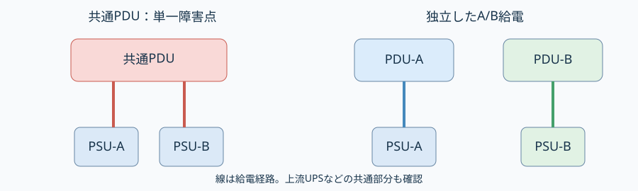
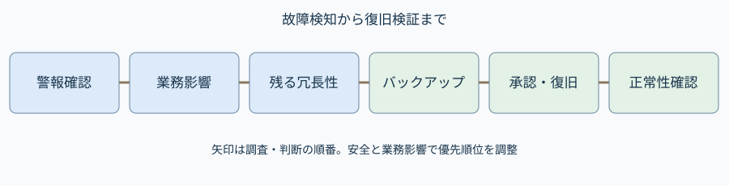

# 第16講 ハードウェア冗長化と故障検知

## 1. 到達目標・資料

冗長化の役割、単一障害点、故障検知、電源・ディスク・NIC・メモリの障害、復旧と設計判断を学ぶ。A必須：冗長化・RAID・監視。B理解補助：ホットスワップ・ECC・障害ドメイン。C発展：RTO・RPO・フェイルオーバー。Dell PowerEdgeとLinux kernel RASの公式資料を確認しようとしたが原文を取得できず、メーカー固有仕様は未照合。以下は一般原理であり、ログと数値は架空、実機コマンドは未実行。

## 2. 冗長化と単一障害点

**冗長化**は、同じ役割の部品や経路を複数用意し、一つが故障しても業務を継続できるようにすること。**可用性**は必要なときに使える性質。**単一障害点（SPOF）**は、そこが壊れるだけで全体が止まる箇所。PSUが2台でも同じPDUにつながればPDUが単一障害点となる。故障確率を下げる信頼性と、故障後も使える可用性は別の概念。高耐久SSD1台より、適切に冗長化された2台構成が単一ディスク故障への耐性を持つ場合がある。ただし冗長化しても誤削除や共通故障は防げない。

## 3. 故障ドメインと共通原因

左はPSU-AとPSU-Bが同じPDUに接続される例。PDUが止まれば両方が給電を失う。右はPSU-A→PDU-A、PSU-B→PDU-Bに分けた例。線は給電経路を示す。右でも上流UPSや受電設備が共通なら単一障害点が残る。**故障ドメイン**は一つの故障で同時に影響を受ける範囲。サーバ、ラック、電源系統、ネットワークスイッチ、拠点の各段階で考える。2台のサーバを同じラックに置けば、ラック冷却障害で同時停止し得る。

## 4. PSUの片系故障

**片系運転**はA/B系の一方だけで稼働している状態。PSU1の入力が失われてもPSU2が必要な電力を供給できれば業務は継続する。しかし次にPSU2が故障すると停止するため、正常な冗長状態ではない。確認点は①残るPSUの容量と状態、②PDU・UPSの給電経路、③業務への影響、④保守手順と交換可能条件。**N+1**は必要な能力Nに予備1を加える考え方で、単にPSUが2台という意味ではない。

## 5. RAID1・RAID5・RAID6

**RAID**は複数ディスクを組み合わせる方式。RAID1は同じデータを複製する。2台のRAID1は通常1台の故障に耐える。RAID5はデータと復元用のパリティを分散し、通常1台の故障に耐える。RAID6は通常2台の故障に耐える。いずれもコントローラー障害や誤削除を防ぐとは限らない。**縮退運転**は本来の冗長性を失った状態で稼働すること。**リビルド**は故障ディスク交換後に残りの情報からデータを再構築すること。リビルド中はI/O負荷が増え、性能低下や追加故障のリスクがある。

## 6. RAIDとバックアップの違い

RAIDは主に物理ディスク故障に耐えるための仕組み。バックアップは過去のデータを復元するための仕組み。RAID1でDBテーブルを誤削除すると、削除は複製先にも反映される。RAIDだけでは過去の状態へ戻せない。**RPO（復旧時点目標）**は、障害前のどの時点まで戻れることを目指すかという目標。バックアップの取得だけでなく復元試験が必要。RAIDが正常でもバックアップは必要。

## 7. NICとネットワーク冗長化

**NIC**はサーバのネットワーク接続部品。2つのNICを同じスイッチに接続した場合、ケーブル1本の断線には耐えてもスイッチ故障には耐えられない。NIC-A→スイッチA、NIC-B→スイッチBと経路を分けることを検討する。**ボンディング／チーミング**は複数NICを論理的にまとめる仕組みで、切替・分散の動作は設定モードとスイッチ構成に依存する。ケーブルを2本挿すだけで自動冗長化が成立するとは限らない。VLAN、上流経路、リンク監視も確認する。

## 8. ECCメモリの故障検知

**ECC（Error Correcting Code）**はメモリの一部のビット誤りを検出・訂正する仕組み。ビットは0か1を表す最小の情報単位。訂正可能なエラーが単発で起きても業務停止とは限らないが、同じDIMM（メモリモジュール）で急増すれば故障兆候を疑う。訂正不能なエラーはOS停止やプロセス異常につながる場合がある。ECCの訂正能力は製品構成によって異なり、あらゆるエラーを直せるわけではない。BMCとOSのイベントでスロット、回数、増加傾向を調べる。

## 9. 監視の種類と組合せ

**BMC**はOSと別にハードウェアを監視する管理機能。PSU・ファン・温度などを監視する。OSのカーネルログではNICリンク断やメモリエラーを確認できる場合がある。RAIDコントローラーではディスクの縮退・再構築状態を確認する。**しきい値監視**は温度やエラー回数が基準を超えたら通知する方式、**状態監視**はPSU故障やリンク断などの状態変化を検知する方式、**疎通監視**はAPIなどが応答するかを確認する方式。業務疎通が正常でも片系故障を見逃さないため、ハードウェア監視と業務監視を併用する。

## 10. 架空ログの読み方

次は架空のイベント。時刻と機器を照合する。

~~~text
02:10:01 BMC PSU1 input lost
02:10:02 BMC PSU2 supplying system load
02:10:03 OS eth0 link down
02:10:05 OS bond0 active slave changed to eth1
02:10:06 MONITOR API response 180ms
~~~

観測できるのはPSU1の給電喪失、PSU2による継続、eth0のリンク断、eth1への切替、API応答である。PSU故障がNIC断の原因と断定はできない。共通PDU、スイッチ、配線、ログ時刻を確認する。

~~~text
03:00:00 RAID Controller: Virtual Disk Degraded
03:00:02 Physical Disk 2: Failed
03:01:00 Backup job: Success (previous run)
~~~

Degradedは縮退、Failedは故障を示す架空表現。前回のバックアップ成功だけでは現在のバックアップや復元可能性を保証しない。

## 11. 障害対応の順番

矢印は左から右への調査・判断順序。①警報対象と時刻を特定、②業務影響を確認、③残る冗長性を評価、④バックアップと追加故障リスクを確認、⑤承認された手順で交換・切替・停止、⑥交換後の正常性を確認する。警報を消すこと自体は復旧ではない。RAIDならリビルド完了、NICなら経路の切替状態、PSUなら両系の給電を検証する。

## 12. 障害例A：RAID5の1台故障

夜間バッチ中にRAID5のディスク1台が故障したがDBは稼働している。まずRAIDの縮退状態、残るディスクのエラー、バックアップの新しさ、バッチの負荷を確認する。**ホットスワップ**は稼働したまま部品を交換できる機能だが、機種と対象部品の対応、作業手順、冗長性を確認する。誤って正常なディスクを抜けば追加障害になる。交換後のリビルド中は負荷が増えるので性能とエラーを監視する。

## 13. 障害例B：NIC片系断

APサーバのNIC-AとNIC-Bが同じスイッチにつながっていた。NIC-Aのケーブル断では通信が継続したが、スイッチ停止で両方通信不能になった。対策はNICの数を増やすだけではなく、接続先スイッチ、上流経路、VLAN、切替設定を確認すること。切替試験は検証環境か承認された保守時間に実施し、APIの応答継続を測る。

## 14. 障害例C：ECCエラー増加

訂正可能なメモリエラーが1日1回から1時間30回に増加した。同じDIMMスロットで起きているなら劣化の兆候が疑われる。BMCとOSのイベントを突き合わせ、回数、増加傾向、スロット、メーカーの交換基準を確認する。単発エラーだけで即交換と決めつけない一方、訂正可能だから無視してよいとも判断しない。

## 15. 設計判断の比較

| 対象 | 冗長化の例 | 残るリスク |
|---|---|---|
| PSU | 2台とA/B給電 | 共通UPS、片系容量不足 |
| ディスク | RAID1/5/6 | 誤削除、コントローラー故障、再構築負荷 |
| NIC | 2ポートと別スイッチ | 共通上流回線、設定ミス |
| サーバ | 複数ノード | 同一ラック・冷却・共有ストレージ |
| 拠点 | 別サイト | 共通運用ミス、同期遅延、費用 |

**フェイルオーバー**は故障側から正常側へ処理を切り替えること。自動切替は停止時間を短くする可能性があるが、誤検知や設定の複雑さが増える。**RTO（復旧時間目標）**は業務を再開するまでの目標時間。短いRTOなら自動切替が有利な場合がある。RPOはデータの復旧時点の目標であり、RTOと異なる。

## 16. Oracle・JP1・NetBackup・ShadowImage

Oracle RACは複数ノードでDBを提供できるが、共有ストレージやネットワーク、電源の共通障害を検討する。JP1/AJSでは実行先サーバが停止したジョブを再実行するとき、途中処理の重複やデータ整合性を確認する。NetBackupではメディアサーバ、LTO装置、ネットワークの故障がバックアップ失敗につながる。ShadowImageの副ボリュームがあっても、同一装置障害や誤操作に備えた別系統バックアップと復元試験が重要。製品固有の切替・保証仕様は今回未照合。

## 17. 自宅3層Webラボとの関係

Mac上のDockerでNginx→FastAPI→PostgreSQLを別コンテナにしても、MacのSSD・電源・ネットワークは共通。コンテナを2個に増やすだけでは物理障害への冗長化にはならない。安全な演習は、紙に単一障害点を描き、AP停止時のNginxの応答、DB停止時のreadyの変化を観測すること。これらはソフトウェア障害の試験であり、物理電源・NICの冗長化試験とは別。故意の電源断やディスク抜去は行わない。

## 18. まとめ・次講

冗長化は故障をなくすのではなく、故障しても業務を続けるための設計。PSU・RAID・NICのどれも共通設備に依存していれば単一障害点が残る。ハードウェア警報と業務監視を併用し、業務が動いている片系故障も検知する。故障時は影響、残る冗長性、バックアップ、作業手順、復旧後検証を順に確認する。次講は第17講「サーバ性能の基本指標とボトルネック」。理解度チェックは四択10問15点満点で回答前に正解を表示しない。