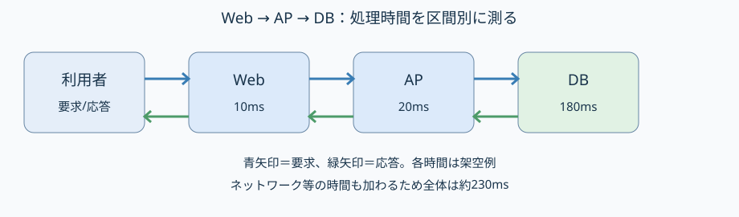
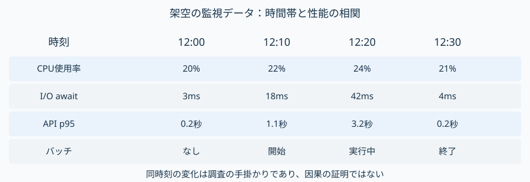

# 第17講 サーバ性能の基本指標とボトルネック

## 1. 到達目標・重要度・確認資料

この講義では、CPU・メモリ・ストレージ・ネットワークの監視値を「業務が遅い」という症状につなげ、最初に調べる場所と対策の副作用を判断する。**A必須**：応答時間、処理量、CPU使用率、メモリ圧迫、IOPS、ディスク待ち、ネットワーク帯域。**B理解補助**：ロードアベレージ、p95、キュー、PSI。**C発展**：同時実行数とスケーリングの限界。

確認資料：Red Hat Enterprise Linux 10『Monitoring and managing system status and performance』のvmstat・iostat節（https://docs.redhat.com/en/documentation/red_hat_enterprise_linux/10/html-single/monitoring_and_managing_system_status_and_performance/index）、Linux Kernel Documentation『PSI - Pressure Stall Information』（https://www.kernel.org/doc/html/v6.1/accounting/psi.html）。前者はvmstatのr/b、si/so、us/sy/id/wa等とiostatの使い方、後者はCPU・メモリ・I/Oの待ち時間を集計する仕組みを確認した。製品固有のOracle/JP1/Citrixのコマンド仕様は未照合。コマンドは一般的なLinuxの読み取り例であり実機未実行、以下の数値・ログは架空である。

## 2. なぜ性能を一つの数値で表せないのか

サーバはCPUだけで動くわけではない。Webから依頼を受けると、APが計算し、DBがメモリやストレージからデータを読み、結果をネットワークで返す。**ボトルネック**は全体の速度を制限している部分。道路で一車線の区間が渋滞を作るように、CPUが速くてもDBのディスク読み込みが遅ければ応答は遅い。

**応答時間（レイテンシ）**は一件の依頼が完了するまでの時間、**スループット**は一定時間に処理できる件数。例えば1件100msでも、同時に100件来ると待ち行列が発生することがある。逆に1秒に100件処理できても、特定の重い問い合わせだけ5秒かかる場合がある。ユーザーの「遅い」はどの画面・時刻・処理かを先に特定する。

## 3. 3層システムの処理経路

左から右へHTTP要求がWeb→AP→DBへ進み、DBの検索結果がAP→Web→利用者へ戻る。図の矢印は処理の依頼と結果の方向を示す。各箱には処理時間がある。例えばWeb 10ms、AP 20ms、DB 180ms、その他ネットワーク等20msなら全体は約230ms。これらは説明用の架空値で、実際には並列処理・接続待ち・キュー待ちなどが加わる。DBが遅い理由も、CPU、メモリ不足、I/O、ロック待ちなどに分かれる。**ロック待ち**は別の処理がデータを変更中などの理由で、順番を待つ状態。DBの遅さをディスク故障と即断しない。

## 4. CPU使用率とCPU待ち

**CPU使用率**は観測期間にCPUがどれだけ仕事をしていたかの割合。一般的なLinuxのtopではus（ユーザー処理）、sy（OS内部処理）、id（アイドル）などが表示される。CPU使用率が高く、実行したい処理がCPUを待っているならCPUが制約かもしれない。

ただし全体平均50%でも、8コアのうち1コアが100%で残りが空いているなら、単一スレッド処理は遅くなる。**コア**はCPU内で命令を実行する単位、**スレッド**はOSが実行を管理する処理の単位。逆にCPUが低くても、I/OやDBロックを待っているため仕事が進んでいない場合がある。CPU使用率だけで増設を決めない。

## 5. ロードアベレージの読み方

Linuxの**ロードアベレージ**は、実行可能な状態でCPUを待つ処理と、通常は割り込み不能な待ち状態の処理を含む負荷の平均値で、一般に1分・5分・15分が表示される。単純なCPU使用率ではない。4論理CPUのサーバでロードが8なら、CPUの実行待ちやI/O待ちが増えている可能性があるが、CPUだけが原因とは限らない。論理CPUはOSから見える実行単位で、物理コア数と一致しないことがある。

確認例：`uptime`でロード値を見た後、`vmstat 1 5`のr（実行待ちを含む実行可能な処理数）やb（主に割り込み不能な待ち状態の処理数）、CPU内訳、ディスクI/Oを照合する。ロードが高くてもCPU使用率が低くbが多いなら、I/Oなどの待ちを優先して調べる。

## 6. メモリ：freeが少ない＝不足とは限らない

Linuxは空きメモリを**ページキャッシュ**（ディスクから読んだデータをメモリに一時保存する仕組み）にも使う。そのためfreeが少ないだけではメモリ不足と断定できない。**available**は、新しい処理へ比較的すぐ回せるメモリ量の目安。**RSS**はプロセスが現在物理メモリ上で使っているページ量の目安で、共有ページを含むため各プロセスのRSSを単純合計しても総使用量と一致しない。

**スワップ**はメモリの内容の一部をディスク側へ退避する仕組み。メモリ圧迫時に**swap-in**（退避したページを読み戻す処理）が増えると応答が悪化する。重大ページフォルト（major page fault）は必要なページをディスクなどから読み込む必要が生じる事象で、必ずしもスワップだけが原因ではない。スワップ無効化はOOM（メモリ不足によるプロセス強制終了）の危険を高める場合がある。

## 7. vmstatでメモリ圧迫を確かめる

一般的なLinuxの読み取り例：

~~~bash
free -h
vmstat 1 5
~~~

`vmstat`のsiはswap-in、soはswap-outを示す（単位は実装・表示に従う）。継続的にsi/soが増え、業務応答も悪化しているならメモリ圧迫の可能性を調べる。ただし初回のvmstat行は起動以来の平均などを示すことがあり、短時間の状態は後続のサンプルを読む。

架空例：

~~~text
r b swpd   free   si   so   us sy id wa
1 3 819200 120000 950  640  12  4 44 40
1 4 819200 110000 1100 720  10  5 40 45
~~~

rはCPUを実行できる状態の処理、bは待ち状態の処理。si/soが継続しwaも高い。メモリ圧迫によるI/Oが疑われるが、ディスクの他の処理も調べる。

## 8. ストレージ：IOPS、帯域幅、待ち時間

**IOPS（Input/Output Operations Per Second）**は1秒あたりのI/O回数。**帯域幅（スループット）**は1秒に転送するデータ量。**I/Oレイテンシ**は一回の読み書きが完了するまでの時間。小さなランダム読み込みが多いDBではIOPSと待ち時間が重要で、大きな連続ファイルを扱うバックアップでは帯域幅が重要になりやすい。

例：4KiBの読み込みを10,000回/秒なら、概算で約39MiB/秒。1MiBの読み込みを200回/秒なら約200MiB/秒。前者はIOPSが多くても転送量は少ない。**キュー**は処理待ちの列。ディスクの処理能力に対して依頼が増えるとキューが長くなり、応答時間が伸びる。

## 9. iostatでディスクを調べる

一般的なLinuxでsysstatパッケージが導入されている場合：

~~~bash
iostat -xz 1 5
~~~

`r/s`と`w/s`は毎秒の読み書き回数、`rkB/s`と`wkB/s`は転送量、`await`はI/O要求の平均待ち時間を含む応答時間（ms）、`aqu-sz`は平均キュー長の目安、`%util`は観測期間に装置へI/Oが発行されていた時間割合を表す。フィールド名はsysstatの版によって異なる。

架空例：

~~~text
Device     r/s   w/s  rkB/s  wkB/s  await  aqu-sz  %util
nvme0n1    800   120  3200   4800   25.0    23.0   99.0
~~~

awaitが25msへ悪化しキューが23程度に増えたなら、I/O待ちが疑われる。ただしNVMeのように並列処理できる装置では%utilが100%近くても即座に性能限界と断定できない。平常時との比較、アプリの応答時間、I/Oサイズ、装置の仕様を合わせて判断する。

## 10. ネットワーク：帯域・遅延・パケット損失

**帯域幅**は一定時間に送れるデータ量の上限、**RTT（Round Trip Time）**は通信先との往復時間、**パケット損失**は送った通信単位が届かないこと。ネットワークが遅い原因は帯域不足だけではない。輻輳（通信が集中して混雑すること）、パケット損失による再送、DNS応答の遅延、TLS接続確立の遅れなどもある。

1GbpsのNICで常時900Mbps以上流れていれば帯域不足を疑うが、1Gbpsに達していなくても小さなパケットの処理負荷、スイッチのキュー、回線品質が制約になる場合がある。サーバ側NICとスイッチ側のエラーカウンタ、ドロップ、再送、通信先別の応答を確認する。

## 11. 平均だけでなくp95を見る

**平均応答時間**は全件の応答時間を足して件数で割った値。**p95（95パーセンタイル）**は応答時間を短い順に並べたとき、およそ95%の要求がその時間以内に完了する境界値。例えば100件中95件が0.1秒、残り5件が5秒なら、平均は約0.345秒だが、遅い5件は非常に不便。計測方法によってp95の値は異なるため、ここでは概念として扱う。

障害調査では平均だけでなくp95やp99、最大値、エラー率、処理件数を併せて確認する。**p99**は約99%が収まる応答時間の境界。短い時間だけ遅いバッチ重複のような問題は、1時間平均のCPU使用率では見逃す。

## 12. PSI：CPU・メモリ・I/Oの待ちを測る

**PSI（Pressure Stall Information）**は、CPU・メモリ・I/Oの資源不足によって処理が待たされた時間を集計するLinuxの仕組み。カーネルの対応状況によって利用可否が異なる。**some**は少なくとも一部の処理が待たされた時間、**full**は対象の実行可能な処理がすべて待ちに入り進めない時間の指標。CPUのシステム全体のfullは意味を持たず、0表示の場合がある。

~~~bash
cat /proc/pressure/cpu
cat /proc/pressure/memory
cat /proc/pressure/io
~~~

例えば`memory some avg10=20.00`なら、直近約10秒で少なくとも一部の処理がメモリ圧迫により待った時間の割合が約20%という意味。単純に『メモリ使用率20%』ではない。CPUが低いのに業務が遅い場合、memoryやioのPSIを見ると原因を絞り込める場合がある。

## 13. 時系列で相関を調べる

図は横軸が時間で、縦の列が各時刻の測定値。通常時12:00から、バッチ開始12:10、応答悪化12:20、終了12:30の架空例。DBのI/O待ちとAPI応答が同時に増え、CPUは大きく増えていない。この観測から『I/Oを優先調査』とは言えるが、『バッチが唯一の原因』とはまだ断定できない。同時刻のSQL実行、バックアップ、ストレージ装置のアラート、ネットワークを照合する。

## 14. 障害例A：CPUが低いのに遅い

APのCPUは15%、DBのCPUも20%。しかしAPI p95が200msから3秒へ悪化。DBサーバのiostatでawaitが3msから40msへ増え、I/Oキューも増加した。まずDBのディスクI/O、実行SQL、バックアップやバッチの同時実行、ストレージの状態を調べる。CPU増設は第一候補ではない。

ただしiostatのawaitは装置のI/O応答時間であり、SQL全体の遅延と同じ値ではない。SQLのロック待ちや接続プールの待ちも別途確認する。

## 15. 障害例B：メモリ圧迫とスワップ

夜間の同時ジョブ増加後、availableが大幅に低下し、vmstatでsi/soが継続。DB検索が遅くなり、ディスク待ちが増加した。メモリ圧迫でページを出し入れしている可能性がある。プロセス別RSS、ページキャッシュ、コンテナ制限、OOMイベント、ジョブ同時実行数を調べる。

対策はメモリ増設、アプリのメモリ使用削減、同時実行数制限など。スワップを無効にするだけでは、メモリ不足でプロセスが強制終了されるリスクがある。

## 16. 障害例C：CPU飽和と単一コア

8論理CPUのAPサーバでCPU全体の平均は35%。特定のスレッドだけ100%で、該当処理の応答が遅い。処理が単一スレッド中心なら、コア数を増やしてもその処理の速度は改善しない場合がある。スレッド別CPU、プログラムの並列化可否、CPU周波数制限、処理のアルゴリズムを調べる。逆に多くのスレッドが実行待ちなら、CPUコア追加や負荷分散を検討する。

## 17. 対策の優先順位と副作用

| 症状と根拠 | 有力な対策 | 注意点 |
|---|---|---|
| CPU実行待ちが継続 | コア増設、処理削減、負荷分散 | 単一スレッドには効かない場合 |
| swap-in/out継続 | メモリ増設、同時実行抑制 | スワップ無効化はOOMリスク |
| I/O await・キュー増加 | SQL/I/O削減、装置・構成改善 | NVMeの%utilだけで飽和断定不可 |
| ネットワークドロップ | 経路・スイッチ・帯域調査 | NIC増設だけでは上流は改善しない |
| DBロック待ち | トランザクションとSQLの見直し | ディスク増設だけでは改善しない |

**スケールアップ**は1台の資源を増やすこと、**スケールアウト**は処理するサーバ台数を増やすこと。負荷を分散できる処理か、共有DBが新たなボトルネックにならないかを評価する。

## 18. Oracle・JP1・NetBackup・Citrixへの応用

**Oracle DB**ではSQL実行時間、待機イベント、ストレージI/O、メモリ使用状況を関連付ける。CPUが低くてもDBのロック待ちやストレージ待ちが主因の場合がある。Oracle固有のビュー名やコマンドは今回は未照合。

**JP1/AJS**ではジョブの開始・終了時刻、同時実行数、実行先サーバのCPU・メモリ・I/Oを突き合わせる。特定時刻のバッチ集中が性能劣化を起こす場合がある。**NetBackup**ではバックアップ対象の読み取り、ネットワーク転送、メディアサーバ、保存先やLTO装置のうち最も遅い区間が全体を制限する。**Citrix**の仮想デスクトップでは利用者の体感遅延が、仮想マシンCPU・メモリだけでなく、プロファイル読込、ストレージ、画面転送ネットワークに左右される。製品固有仕様は未照合。

## 19. 自宅Dockerラボでの安全な観測

MacのDocker上のNginx→FastAPI→PostgreSQL構成では、まず`docker stats`でコンテナ別CPU・メモリ・ネットワークI/O・ブロックI/Oの目安を見る。これはMac本体の物理資源すべてを示すものではなく、Docker Desktopの仮想化基盤の影響もある。APIの応答時間と`/api/health`のlive/readyを記録し、AP・DBのログと照合する。

~~~bash
docker stats --no-stream
docker compose ps
~~~

上記は読み取り中心の例で未実行。意図的に高負荷をかける試験は検証環境・適切な負荷制限のもとで行い、本番サーバや大切なデータには行わない。

## 20. 障害調査の実務手順とまとめ

①遅い業務・時間帯・影響範囲を特定。②応答時間・件数・エラー率を平常時と比較。③Web→AP→DBのどこで時間を使ったか調べる。④CPU、メモリ、ディスク、ネットワークの**同時刻**の監視値を突き合わせる。⑤原因候補を複数挙げ、ログや再現試験で絞る。⑥変更の副作用・切戻し方法を決めて対策する。⑦対策後にp95と処理量、エラー率が改善したか確認する。

一つの数値で原因を断定しない。CPU使用率が低くてもI/O待ちやロック待ちで遅くなる。freeメモリが少なくてもキャッシュ利用かもしれない。RAIDやNVMeの%utilも単独では飽和を証明しない。**性能分析は、利用者の症状から処理経路を追い、同時刻の複数指標で仮説を検証する仕事**である。

次講は第18講「実務演習：サーバ構成とリソース不足を分析する」。理解度チェックは四択10問・15点満点、正解は回答前に示さない。