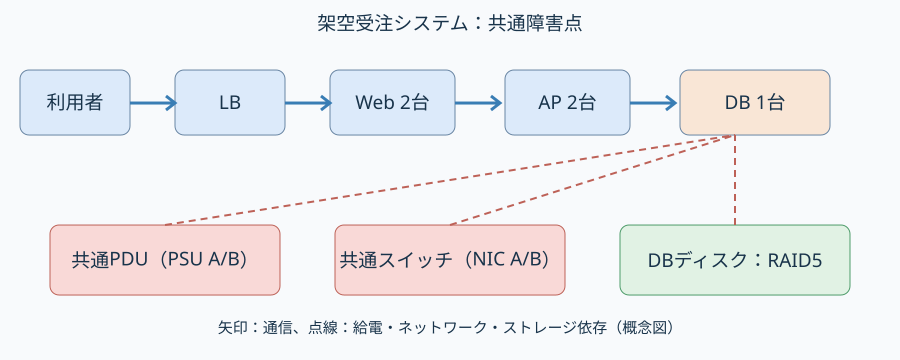
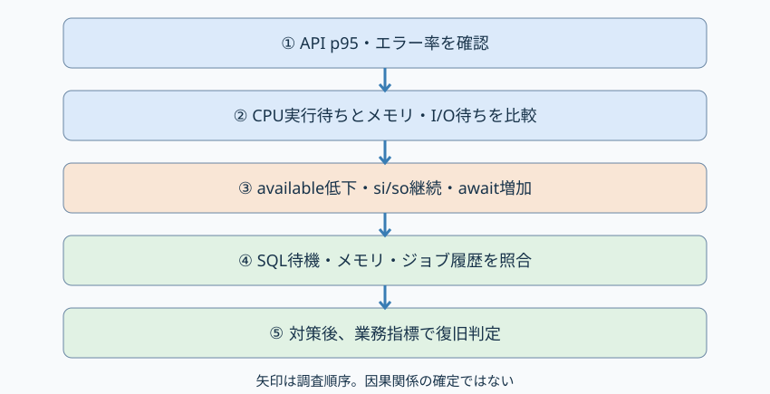

# 第18講 実務演習：サーバ構成とリソース不足を分析する

## 1. 目的と参照資料

本講は第2編の総合演習。CPU・メモリ・I/O・電源・RAID・NICの知識を組み合わせ、①構成の単一障害点、②監視値からの原因仮説、③安全な初動、④対策の副作用と復旧検証を説明できるようにする。A必須：構成・業務影響・時系列・資源・冗長性。B補助：p95、ロード、スワップ、RAID縮退。C発展：RTO/RPO、複合障害。すべて架空の企業システムであり実機操作は行っていない。

確認資料：Linux Kernel Documentation「PSI - Pressure Stall Information」（https://www.kernel.org/doc/html/latest/accounting/psi.html、本文確認）。CPU・メモリ・I/O資源不足による待ち時間と/proc/pressure/の形式を確認。Red Hat Enterprise Linux 10公式ドキュメント（https://docs.redhat.com/en/documentation/red_hat_enterprise_linux/10/、目次確認）を参照したがvmstat・iostatの個別節原文は今回未照合。Oracle RAC・JP1/AJS・NetBackupの製品固有操作も未照合。

## 2. 架空受注システムの構成

利用者→LB（ロードバランサ：要求を複数サーバへ振り分ける装置）→Web→AP→DBの順に処理する。注文をDBへ登録できて初めて受注成功。日次バッチはDBの集計表を更新し、バックアップも同じストレージを読む。

図の青い箱はWeb/AP、橙は単一DB、赤は共通設備。矢印は通信・給電・ストレージへの依存を表す。Web/APは2台ずつだがDBは1台。DBのディスクはRAID5、PSU（電源ユニット）は2台で同じPDU（電源分配装置）に接続。NIC（ネットワーク接続部品）2枚も同じスイッチへ接続している。PDUやスイッチが故障すると二重化した部品が同時に機能を失う。これを単一障害点（SPOF）という。

## 3. 正常時の性能基準とSLO

SLO（サービス水準目標）は運用で守りたい性能の目標。このシステムの受注APIはp95（95%程度の要求が収まる応答時間）800ms以下、エラー率1%未満を目標とする。

| 指標 | 正常値（架空） | 意味 |
|---|---:|---|
| API p95 | 180ms | 利用者の応答時間 |
| APIエラー率 | 0.1% | 失敗した要求の割合 |
| DB CPU | 25% | CPUが働いた時間の割合 |
| メモリavailable | 10GiB | 新しい処理に回せるメモリの目安 |
| vmstat si/so | 0/0 | スワップの読み戻し／退避 |
| ディスクawait | 3ms | I/O要求の平均応答時間 |
| ディスクaqu-sz | 1 | 平均I/Oキュー長の目安 |

p95とエラー率は業務側の症状、CPU・メモリ・I/Oは原因候補を探す手掛かり。単一の閾値だけで原因を断定しない。

## 4. 事象A：夜間バッチ後にAPIが遅い

22:00にJP1/AJSの集計バッチ開始。22:05に受注画面が遅いという問い合わせが発生した。次は同じ監視期間で採取した架空値。

| 時刻 | API p95 | DB CPU | available | si/so | await | aqu-sz |
|---|---:|---:|---:|---:|---:|---:|
| 21:55 | 180ms | 25% | 10GiB | 0/0 | 3ms | 1 |
| 22:05 | 1.8秒 | 28% | 2GiB | 220/160 | 24ms | 16 |
| 22:15 | 3.4秒 | 22% | 0.5GiB | 980/760 | 48ms | 38 |
| 22:35 | 250ms | 26% | 8GiB | 0/0 | 5ms | 2 |

観測できる事実：APIの遅い時間帯にavailableが減り、si/so（メモリ内容のスワップ入出力）とディスク待ちが増えた。CPU使用率は高くない。仮説：バッチでメモリが圧迫され、スワップI/Oが増えてDBのI/OとAPIを遅くした。ただしバッチ自体の大量ディスク読み込みやDBロック待ちも考えられる。開始時刻が一致しただけでは原因を確定できない。

## 5. 障害切り分けの順序

図は上から下への調査順。まずAPI p95とエラー率で業務影響を把握し、CPU実行待ちとメモリ・I/O待ちを比較する。CPUが低くてもavailable低下、si/so増加、await増加があればメモリ・I/Oを優先する。最後にSQL、プロセス、ジョブの記録を照合して対策し、業務の復旧を確認する。矢印は調査の順序であり因果の証明ではない。

## 6. ログの事実と推測を分離する

~~~text
22:00:00 JP1  GROUP_SALES_AGG started
22:04:50 OS   MemAvailable: 2097152 kB
22:05:00 VM   si=220 so=160 wa=36
22:05:02 DISK nvme0n1 await=24.0ms aqu-sz=16
22:05:05 API  POST /api/orders p95=1800ms
22:15:02 DISK nvme0n1 await=48.0ms aqu-sz=38
22:35:00 JP1  GROUP_SALES_AGG ended
~~~

startedは開始、MemAvailableは利用可能メモリの推定値、si/soはスワップI/O、waはCPUのI/O待ち時間割合、awaitはI/O要求の平均応答時間、aqu-szは平均キュー長。これは説明用の架空ログであり実製品の厳密な書式を再現していない。監視サーバと対象サーバの時計がずれていると時系列を誤読するため時刻同期も確認する。

## 7. 事象Aの安全な初動

第一に受注APIのエラー率と注文登録の成否を確認する。遅延だけなのか受注失敗・重複登録があるのかで緊急度が異なる。第二にバッチを停止する前に、停止・再実行の条件を確認する。JP1/AJSジョブがDBを途中まで更新していた場合、再実行で重複登録する危険がある。冪等性（べきとうせい）は同じ処理を繰り返しても結果が変わらない性質。

第三にプロセス別メモリ、仮想マシン・コンテナの制限、SQLの待機、バックアップとの時間重複を確認。暫定策は承認を得たバッチ同時実行数の抑制や時間帯分離。恒久策はSQL改善、省メモリ化、必要なメモリ・ストレージ能力の再設計。スワップを無効にするだけではOOM（メモリ不足による強制終了）を招く場合がある。

## 8. 事象B：RAID5のディスク1台故障

23:10、DBのRAIDコントローラーから架空ログ「Virtual Disk Degraded」「Physical Disk 2 Failed」。DBとAPIは稼働中。Degradedは冗長性が失われた縮退状態。RAID5は通常1台故障に耐えるが、追加故障でデータ喪失の危険がある。まず故障スロット・シリアル、残るディスクのエラー、直近バックアップと復元可能性、業務負荷、交換手順を確認する。

ホットスワップ（稼働中の部品交換）対応でも正常ディスクを誤って抜くと重大障害になる。交換後はリビルド（冗長データの再構築）完了、性能、エラーを確認する。RAIDは誤削除を戻す仕組みではないためバックアップが必要。

## 9. 事象C：電源片系故障と共通PDU

翌朝BMC（OSとは独立してハードウェアを監視する機能）が「PSU1 Input Lost」を通知。PSU2で業務継続しているが片系運転であり正常ではない。さらにPSU1/2が同じPDUに接続され、PDU停止で両方が停止する。PSU2の供給能力、PSU1の入力喪失箇所（PSU・ケーブル・PDU）、上流UPS（停電時の給電装置）の共通性、保守手順を確認する。試験目的でPSU2を抜かない。

改善策は可能ならA/B独立給電。ただしPDUを分けても上流UPSが共通なら単一障害点が残る。

## 10. 事象D：NICが2枚でも通信停止

DBのNIC-A/Bは同じスイッチへ接続。片方のケーブル断には適切なボンディング（複数NICを論理的に扱う仕組み）で耐える場合があるが、スイッチ全体が停止すると両経路が失われる。別スイッチと上流経路の分離、VLAN、切替モードを確認する。フェイルオーバーは障害時に正常な経路へ切り替えること。2本挿すだけでは自動切替は保証されない。

架空ログ「eth0 link down」「bond0 active slave changed」があっても業務が利用可能とは限らない。疎通だけでなくAPI応答とDB接続まで確認する。

## 11. 複合障害：RAID縮退とPSU片系が同時発生

ここが本講の設計判断の核心。RAID5縮退とPSU片系故障が同時に存在してもAPIは正常かもしれない。しかし次の故障への耐性が別々に失われている。いきなり再起動・ディスク抜去・電源抜去をすると停止リスクが増える。

まず業務影響、バックアップの新しさ・復元試験記録、PSU2の安定性、RAID残存ディスクの状態を確認。保守員の交換部品と作業手順、承認された停止可否を確認する。どちらを先に交換するかは残る故障リスク、給電安定性、リビルド負荷、停止可否で判断するため一律には決められない。RTO（業務復旧までの目標時間）とRPO（復元可能なデータ時点の目標）も考慮する。

## 12. 構成改善の比較

| 対象 | 現状 | 改善候補 | 注意点 |
|---|---|---|---|
| DB | 単一ノード | DB冗長化 | データ整合性・共有障害 |
| 電源 | PSU2台・共通PDU | A/B独立給電 | 上流UPS・受電設備 |
| NIC | 2枚・同一スイッチ | 別スイッチと経路分離 | VLAN・切替設定 |
| ディスク | RAID5 | 容量と耐障害性から再選定 | RAID6等でもバックアップ必須 |
| バッチ | 受注と同じDBで集計 | 時刻分離・並列数制限 | 業務締切と処理時間 |
| バックアップ | バッチと時間帯が重なる | 時刻・転送経路を見直す | RPO・復旧試験 |

機器を増やすだけでなく、同じ障害で同時停止する範囲（故障ドメイン）を減らす。二重化には費用・運用複雑性もあるため業務要件で選ぶ。

## 13. 変更管理と復旧判定

記録は①発生時刻、②業務影響、③観測事実、④仮説、⑤追加確認、⑥承認・変更、⑦復旧判定の順に残す。例えば「22:15 API p95 3.4秒、DB await 48ms、si/so継続。バッチと時間的に一致。原因は未確定。SQL待機とプロセス別メモリを追加確認」と書く。

変更前に切戻し条件を決める。交換後は警報が消えただけでは復旧完了とせず、RAIDリビルド完了、PSU両系給電、NIC経路、API p95・エラー率、注文DB整合性を確認する。

## 14. Linuxでの読み取りコマンド

~~~bash
uptime
free -h
vmstat 1 5
iostat -xz 1 5
cat /proc/pressure/memory
ip -s link
journalctl -k -p warning --no-pager
~~~

uptimeはロード、freeはメモリ、vmstatは実行待ち・スワップ・CPU、iostatはI/O、/proc/pressure/memoryはメモリ圧迫による待ち、ipはNIC統計、journalctlはカーネル警告。一般的なLinuxでの読み取り例で未実行。iostatにはsysstat導入が必要な場合がある。初回のvmstat/iostat行は起動以来の統計を含む場合があるため後続サンプルを読む。表示できないときは権限・導入状況・ログ収集設定を調べる。

## 15. Oracle・JP1・NetBackupとの関係

Oracle DBではSQL実行時間・待機イベント・メモリ・ストレージI/Oを照合。CPUが低くてもDBロックやI/O待ちで遅くなる。JP1/AJSではジョブの開始・終了、異常終了、同時実行数、再実行の重複影響を確認。NetBackupではバックアップの読込がDBのI/Oと競合し得るため、時間帯・転送経路・保存先も調べる。製品固有の操作方法と保証仕様は今回未照合。

## 16. 自宅Dockerラボでの安全な実習

MacのDockerでNginx→FastAPI→PostgreSQLを分離してもMacのSSD・電源・メモリは共通。docker statsでコンテナ別CPU・メモリ・I/Oの目安を読み、/api/healthのlive/readyとAPI応答を照合する。Docker Desktopの仮想化基盤があるためコンテナ値をMac本体の物理資源と同一視しない。

~~~bash
docker compose ps
docker stats --no-stream
~~~

コマンドは未実行。構成図で単一障害点を探し、既存ログを読む演習は安全。物理ディスク抜去・電源断・無制限の負荷試験は行わない。

## 17. 障害分析答案の型

事実→仮説→確認→暫定対策→恒久対策→検証の6段階で書く。例：「22:15 API p95が3.4秒、availableが0.5GiB、si/soが継続、awaitが48ms（事実）。バッチと受注のメモリ・I/O競合を疑う（仮説）。ジョブ履歴、SQL待機、プロセス別メモリを照合（確認）。承認の上で同時実行数を抑制（暫定）。SQL・メモリ容量・時間帯を見直す（恒久）。p95、エラー率、si/so、awaitを再比較（検証）。」

「メモリ不足なので増設」だけでは原因が未確定で副作用も不明。判断根拠と代替案を記載する。

## 18. まとめと次講

結論は三つ。①業務遅延はCPUだけでなくメモリ圧迫・I/O・ロック・ネットワークを同時刻で比較。②RAID・PSU・NICが二重化されても共通PDU・共通スイッチ・単一DBは単一障害点。③安全な障害対応は業務影響→事実→仮説→追加確認→承認された変更→業務復旧検証で進める。

次講は第19講「OSの役割・カーネル・ユーザー空間」。理解度チェックは四択10問・15点満点。回答前に正解を示さない。