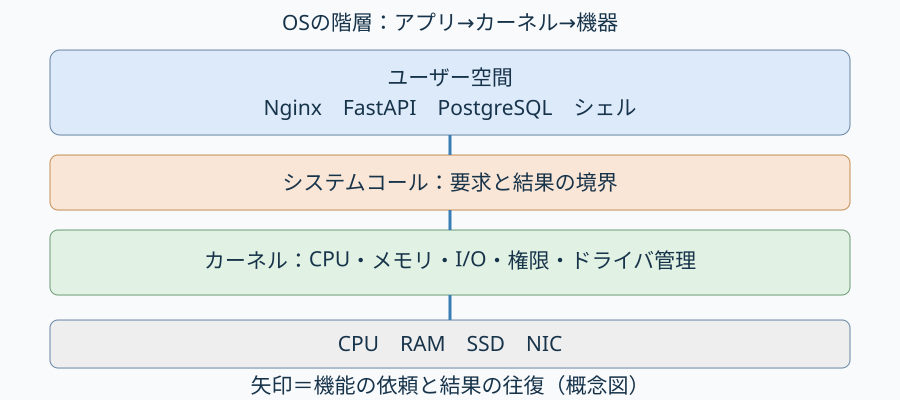
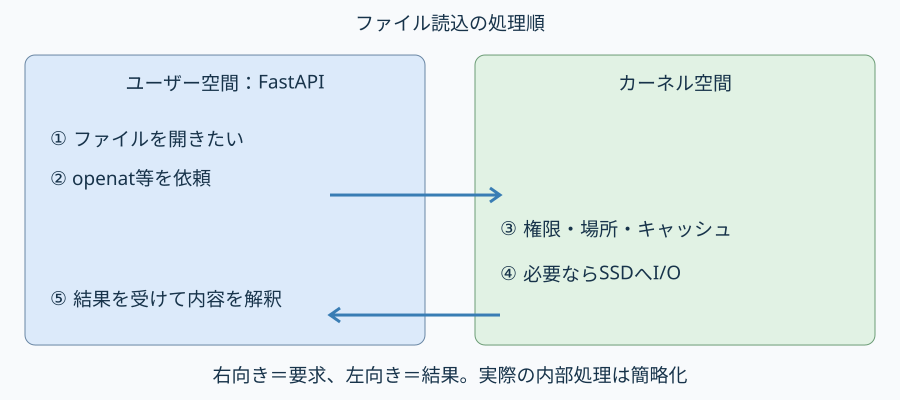
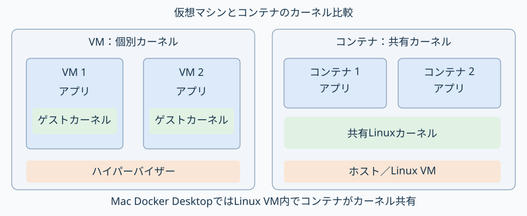

# 第19講 OSの役割・カーネル・ユーザー空間

## 1. 目的と資料

この講義は、前編で学んだCPU・メモリ・SSD・NICが、アプリケーションからどのように使われるのかを理解するためのものです。まず全体像をつかみ、次に一つのファイル読み込みを追い、最後に障害対応へつなげます。

**学ぶ順序**

1. OSが必要な理由と全体構造を理解する。
2. アプリからカーネルへの処理を追う。
3. 権限・ドライバ・ログから障害を切り分ける。
4. VM・コンテナと実務製品に応用する。

**到達目標**：OSとカーネルの違い、ユーザー空間とカーネル空間、システムコール、障害の調査範囲を説明できること。

**学習配分**：A必須＝OS・カーネル・システムコール。B理解補助＝権限・ログ・ドライバ。C発展＝仮想化。

**参照資料**：Linux man-pages syscall(2) https://man7.org/linux/man-pages/man2/syscall.2.html 、proc_pid_status(5) https://man7.org/linux/man-pages/man5/proc_pid_status.5.html 、Linux Kernel Documentation https://www.kernel.org/doc/html/latest/admin-guide/syscall-user-dispatch.html 。システムコールの呼び出し・返り値・errno、/procの項目、特殊機能の背景を原文照合した資料として記録する。製品固有仕様は未照合。コマンドは未実行、ログは架空例。

## 2. OSはなぜ必要か

**最初の疑問：なぜハードウェアだけではアプリを動かせないのでしょうか。** 答えは、複数のアプリが同じ機器を使うための交通整理が必要だからです。

**結論から言うと、OSは複数のアプリが同じハードウェアを安全に利用するための管理者です。**

CPUは命令を実行します。メモリは作業中のデータを保持し、SSDはデータを保存し、NICはネットワークで通信します。

しかし、これらの部品だけでは「どのアプリにCPUを使わせるか」「ほかのアプリのメモリを壊さないようにするか」を決める共通の仕組みがありません。

そこで**OS（Operating System：基本ソフトウェア）**が、CPUの実行順、メモリの保護、ディスクやネットワークへの入出力を管理します。

**具体例：3層Webシステム**

Nginxがリクエストを受け、FastAPIが注文を処理し、PostgreSQLがデータを保存します。この3つが同時に動くための資源管理をOSが担当します。

一方で「注文を受け付けるか」という業務判断はアプリの担当です。**OSは資源を管理し、アプリは業務を処理する**と分けて考えましょう。

## 3. OS・カーネル・ユーザー空間

ここまではOSが必要な理由を説明しました。**次は、OSの中で実際に資源を管理する中心部分**を見ていきます。

**OS全体とカーネルは同じものではありません。**

**カーネル（kernel）**はOSの中核です。CPUの実行順、メモリ、ファイルI/O、プロセス、デバイスを管理します。

OS全体にはカーネルだけでなく、管理コマンド、ライブラリ、起動サービスなども含まれます。「Linux」はカーネルを指す場合と、Linuxを使うOS全体を指す場合があります。

**ユーザー空間**は、Nginx・FastAPI・PostgreSQL・シェルなど通常のアプリが動く領域です。

**カーネル空間**は、カーネルがOSの資源管理を行う領域です。

ここで大切なのは、アプリがハードウェアを好き勝手に操作するのではなく、**カーネルに依頼する境界がある**ということです。

図は上からアプリ、システムコール境界、カーネル、CPU・RAM・SSD・NIC。矢印は機能の依頼と結果の往復を示す。アプリがハードウェアを無制限に直接操作する意味ではない。

## 4. ユーザーモードとカーネルモード

前節ではアプリとカーネルの「領域」を分けました。ここでは、**CPUがその処理を実行するときの「権限」**に注目します。似た言葉ですが、異なる観点です。

**ユーザー空間・カーネル空間は「どこで動くか」、ユーザーモード・カーネルモードは「どの権限で実行するか」です。**

通常のアプリはCPUの**ユーザーモード**で動きます。保護されたメモリや機器を勝手に操作できません。

カーネルは**カーネルモード**で、特権命令や資源管理を実行します。

ここで混同しやすいのがrootです。rootはOS上の強い権限を持つユーザーですが、**rootで起動した通常アプリも、基本的にはユーザーモードで動きます**。

つまり、root権限を持つことと、CPUがカーネルモードで命令を実行することは別の話です。

## 5. 正常処理：設定ファイルを読む

これまでの話は構造の説明でした。ここからは、**FastAPIが設定ファイルを読む一回の処理**を順番に追い、構造が実際にどう使われるかを確認します。

**例：FastAPIが設定ファイルを読む場合**

1. FastAPIが「設定ファイルを開きたい」と要求します。
2. Pythonなどのライブラリが、必要に応じてopenatなどの**システムコール**を呼びます。
3. CPUがカーネル側の処理へ移り、カーネルがファイルの存在・アクセス権・キャッシュを確認します。
4. 必要ならファイルシステムとドライバを介してSSDに読み込みを依頼します。
5. カーネルが結果またはエラーをアプリに返します。
6. FastAPIが読み取った設定を解釈します。

**システムコール（system call）**とは、アプリがカーネルの機能を利用するための正式な入口です。

すべての関数呼び出しがシステムコールになるわけではありません。たとえば文字列の計算はアプリ内だけで完結できます。

LinuxのCライブラリには、失敗時に-1を返し、errnoに理由を記録する関数があります。ただし戻り値はAPIごとに確認します。

図の左右はユーザー空間とカーネル空間。右向きは要求、左向きは結果。システムコールはカーネル機能への正式な入口であり、通常の関数呼び出しは必ずしもカーネルへ移らない。LinuxのCライブラリでは失敗時に-1とerrnoを使う関数があるが、戻り値は各APIの仕様で確認する。

## 6. API・ライブラリ・システムコール

前節で登場したシステムコールを、普段聞く「API」と区別します。**どの層の機能を呼び出すか**を意識すると混乱しません。

**APIは「機能を呼び出す約束」の総称です。**

- **ライブラリ**：便利な関数をまとめた部品。内部でシステムコールを使う場合も、使わない場合もあります。
- **システムコール**：カーネルの機能に入るための呼び出し。
- **Web API**：アプリ同士がHTTPなどで機能を呼び出す約束。

たとえばPythonのopen()は言語APIで、内部でLinuxのopenat()などを利用する場合があります。しかし両者は同一ではありません。

また、ブラウザから呼ぶ /api/orders はWeb APIです。カーネルに直接依頼するシステムコールとは階層が違います。

**区別のポイントは「誰が誰の機能を利用するか」です。**

## 7. OSが管理するもの

ファイル読み込みはOSの仕事の一例です。ここでは、OSがほかに何を管理するのかを一覧で整理します。

| 対象 | OSの役割 | 障害の例 |
|---|---|---|
| CPU | 処理の実行順を調整 | 実行待ち・遅延 |
| メモリ | 仮想メモリを管理・保護 | スワップ・OOM |
| ストレージ | ファイルシステムとI/Oを管理 | 読書き失敗・I/O待ち |
| ネットワーク | ソケット・TCP/IP通信を扱う | 接続失敗・パケット損失 |
| プロセス | 起動・終了・状態を管理 | サービス停止 |
| 権限 | ファイルや操作の可否を判定 | Permission denied |

仮想メモリはプロセスごとに独立したアドレス空間を見せる仕組みで、物理RAMそのものではない。ファイルシステムはファイル名と保存データを対応づける仕組み。ソケットはアプリが通信を利用するOSの窓口。OOMはメモリ不足によりプロセスが終了させられる事象。

## 8. デバイスドライバ

前節の「ストレージ」「ネットワーク」を機器につなぐ部品がドライバです。**OSの共通機能と機器固有の操作の橋渡し**という役割を見ます。

**ドライバはOSと機器の通訳役です。**

OSが「データを送信したい」と要求しても、NICごとに操作方法は異なります。**デバイスドライバ**がOSの共通要求を、その機器に合う操作へ橋渡しします。

Linuxでは多くのドライバがカーネル内で動きますが、すべてのOSが同じ構造ではありません。

**障害例**：NICのドライバが異常で通信できない場合、WebアプリのHTTP設定を直しても解決しません。反対にNICが正常でFastAPIが待受していなければ、アプリの起動状態やポート設定を確認します。

つまり、**通信できないという症状だけで、アプリが悪いともNICが悪いとも決められません。**

## 9. 権限と保護

ここまでは機器を使う仕組みでした。次は、**アプリに何を許可し、何を禁止するか**という保護の仕組みです。

**分離の目的は、アプリがOSやほかのアプリへ無制限に干渉できないようにすることです。**

たとえばファイルを開くとき、OSは実行ユーザーとファイルの権限を確認します。アクセスできなければ Permission denied などのエラーになります。

調査では、ファイルの所有者、パーミッション、ACL（追加のアクセス制御規則）、SELinuxなどを確認します。

原因を調べず chmod 777 で全員にアクセスを許可すると、情報漏えいや不正な書き換えの危険が増えます。必要な権限だけを与えるのが基本です。

なお、ユーザー空間とカーネル空間が分かれていても、アプリやカーネルの脆弱性がなくなるわけではありません。

## 10. 起動処理とのつながり

OSが動き始める前には何があるのでしょうか。第15講で学んだ起動処理を、カーネルとサービスの役割につなぎ直します。

**OSが使えるようになるまでにも順序があります。**

1. UEFIが起動対象を選びます。
2. ブートローダがLinuxカーネルなどを読み込みます。
3. カーネルがCPU・メモリ・デバイスを初期化し、ファイルシステムを使えるようにします。
4. PID 1（多くのLinuxではsystemd）がサービスを起動します。
5. NginxやPostgreSQLが起動し、業務を提供します。

ここから分かるのは、**OSが起動する前の故障と、OS起動後のサービス故障では調査方法が違う**ということです。

UEFIがSSDを認識しないなら起動設定や機器側を調べます。一方Linuxにログインでき、PostgreSQLだけ起動しないなら、systemdのサービス状態やDBログを調べます。

## 11. 障害例A：APだけ停止

ここからは障害切り分けです。まず、**OS全体は動いているが一つのアプリだけが停止した場合**を考えます。

**観測事実**：FastAPIのプロセスが停止し、Nginxが502を返しています。DBは正常です。

**まず確認すること**：FastAPIのサービス状態、待受ポート、アプリの例外ログ、メモリ不足によるOOM終了の有無です。

以下は説明用の架空ログです。

~~~text
nginx: upstream connect() failed (111: Connection refused)
fastapi.service: Main process exited, status=1/FAILURE
~~~

1行目は上流接続先が接続拒否したこと、2行目はサービス主プロセスが失敗終了したことを示す架空ログ。これだけではアプリコード、ポート設定、メモリ不足のどれが原因かは確定できない。カーネル全体の障害とも限らない。

## 12. 障害例B：ドライバ側異常

前節と対比して、今度は**複数のアプリに共通する通信機能**で異常が起きた場合を見ます。

**観測事実**：一つのアプリだけではなく、サーバ全体の通信が切れました。カーネルログにはNICのリセットが繰り返し記録されています。

以下は説明用の架空ログです。

~~~text
kernel: eth0: transmit queue timed out
kernel: eth0: resetting adapter
~~~

送信キューのタイムアウトとアダプタのリセットを示す架空ログ。物理リンク、スイッチ、NIC統計、ドライバ・ファームウェア版、OSログを同時刻で確認する。resetだけでNICの物理故障とは断定しない。カーネルパニックはカーネルが回復困難な異常で停止する状態で、サーバ全体に影響し得る。

## 13. Linuxコマンドの読み方

障害の例を見たところで、**実際にどこを調べるか**をLinuxの読み取りコマンドで確認します。

**以下はLinuxかつsystemdを使う環境を想定した読み取り専用の例です。実行はしていません。**

~~~bash
uname -r
cat /etc/os-release
ps -ef | head
cat /proc/1/status
systemctl status nginx --no-pager
journalctl -k -n 30 --no-pager
ls -l /etc/passwd
~~~

uname -rは稼働カーネルのリリース、/etc/os-releaseはOS配布版、psはプロセス一覧、/proc/1/statusはPID1の状態、systemctlはサービス状態、journalctl -kはカーネルログ、ls -lはファイル権限を確認する。/procはカーネルが情報を見せる仮想ファイルシステム。systemd非採用環境ではsystemctlは使えない。コンテナ内のPID1はホストのPID1と異なることがある。

## 14. /proc/PID/statusの読解

前節のコマンドに出てきた /proc/1/status を、別のプロセスを例にもう少し詳しく読みます。

**ここでは各項目が何を表し、何をまだ断定できないかを確認します。**

以下は架空の出力です。

~~~text
Name:   postgres
State:  S (sleeping)
Pid:    3142
PPid:   1
VmRSS:  204800 kB
Threads: 5
~~~

~~~

架空出力。Nameは名前、Stateは状態、Pidはプロセス識別番号、PPidは親の番号、VmRSSは物理メモリ上に存在する領域の概算、Threadsはスレッド数。StateのSは待機中で、即異常ではない。D（割り込み不可の待機）が長く続く場合はI/O待ちなどを調べる。RSSは共有メモリの扱いに注意し、複数プロセスを単純合計して物理RAM使用量と同一視しない。

## 15. 障害の責任境界と設計

ここまでの知識を、障害の第一調査先を選ぶ判断へまとめます。**症状が出ている層と根本原因の層は同じとは限りません。**

| 症状 | 優先して確認 | 補助確認 |
|---|---|---|
| APIだけ502 | APプロセス・待受 | Nginx・通信経路 |
| Permission denied | OS権限・ACL・SELinux | 実行ユーザー |
| 全通信が停止 | NIC・ドライバ・スイッチ | ルーティング |
| カーネルパニック | カーネル・ドライバ・機器 | 更新履歴 |
| DBが遅くCPUは低い | DB待機・I/O・メモリ | SQL・バックアップ |

最初の調査先は症状で決めるが原因は複数層にまたがる。ログの時刻をそろえ、変更履歴を確認し、変更前に影響範囲・切戻し条件を決める。

## 16. VMとコンテナ

ここからは応用です。これまでの「カーネルを共有するか」という観点を、VMとコンテナの比較に使います。

**VM（仮想マシン）**は仮想ハードウェア上で、VMごとにゲストOSのカーネルを起動します。

**コンテナ**は通常、ホストのLinuxカーネルを共有します。そのうえで、名前空間（見えるプロセスやネットワークを分ける仕組み）やcgroups（CPU・メモリ使用量を管理する仕組み）を使って環境を分離します。

**重要な違いは、アプリの環境を分けることと、カーネルを別々に持つことは同じではない**という点です。

。

図の左はVMごとにゲストカーネルがある。右はコンテナ間でLinuxカーネルを共有。MacのDocker DesktopはLinux VMを介してコンテナを動かすため、LinuxコンテナがmacOSカーネルを直接共有するわけではない。

## 17. Oracle・JP1・Citrixへの対応

ここまでの汎用OSの話が、実務製品の運用でどこに関係するのかを確認します。

**Oracle DB**はOSのプロセスとして動くため、CPU配分・メモリ・ファイルI/Oの影響を受けます。DBが遅い場合はSQL待機とOSのI/O待ちを照合します。

**JP1/AJS**のジョブはOSのプロセス起動・終了・実行ユーザー・環境変数の影響を受けます。ジョブ失敗時にはOS側の権限も調査対象です。

**Citrix**などの仮想デスクトップ基盤では、ゲストOS、ホストのハイパーバイザー、仮想デバイスの責任範囲を分けて調べます。

以上は一般的な運用上の関係であり、各製品の版別仕様は未照合です。

## 18. 自宅3層ラボへの応用

最後に、自宅のNginx・FastAPI・PostgreSQLの3層ラボへ置き換えます。**コンテナが別でも、OSのどこが共通なのか**が確認ポイントです。

**MacのDocker Desktopでは、Linuxコンテナは通常Linux VMのカーネルを共有します。**

Nginx、FastAPI、PostgreSQLを別コンテナにしても、各コンテナが独立したカーネルを持つわけではありません。

コンテナの状態、ログ、資源使用量は次のコマンドで確認できます（未実行）。

~~~bash
docker compose ps
docker compose logs --tail=30
docker stats --no-stream
~~~

psはコンテナ状態、logsはサービスログ、statsは資源使用量の目安。データを消すdocker compose down -vのような操作は演習に含めない。

## 19. 要点と次講

ここまでの流れを「OSの役割→境界→処理→障害→設計」の順で振り返ります。

**今回の結論は五つです。**

1. OSはCPU・メモリ・I/Oなどを管理し、アプリが共通の方法で利用できるようにします。
2. カーネルはOSの中核で、通常のアプリはユーザー空間で動きます。
3. アプリはシステムコールでカーネル機能を利用します。root権限とカーネルモードは別です。
4. 障害はアプリ、OS設定、ドライバ、ハードウェアのどの層にあるかを、症状とログから切り分けます。
5. VMはゲストカーネルを持ち、コンテナは通常Linuxカーネルを共有します。

次講は第20講「プロセス・スレッド・コンテキストスイッチ」。理解度チェックは四択10問・15点で、回答前に正解を示しません。