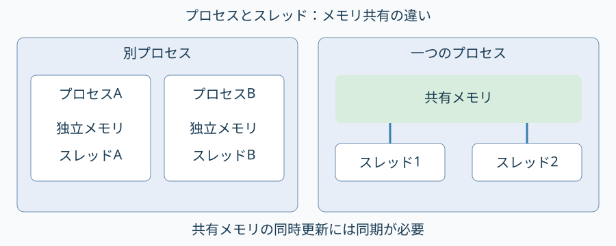
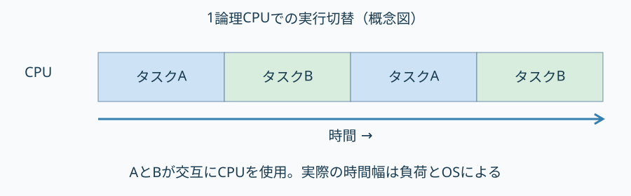

# 第20講 プロセス・スレッド・コンテキストスイッチ

## 1. 目的と前講とのつながり

第19講ではOSが資源を管理することを学びました。今回は、OSが複数のアプリにCPUをどのように配分するかを考えます。

到達目標は①プロセスとスレッドの区別、②並行・並列処理、③コンテキストスイッチ、④CPU待ちとI/O待ちの切り分け、⑤同時実行数の設計判断です。A必須：実行単位と切替。B補助：状態・ログ・コマンド。C発展：コンテナとCPU制限。

## 2. プロセスとは何か

**プロセスは、OSが管理する実行中のプログラムの単位です。**

ディスクにあるPostgreSQLの実行ファイルは、それだけでは動いていません。OSが起動すると、仮想メモリ空間、開いたファイル、識別番号などの実行環境を管理します。

PID（Process ID）はプロセスを識別する番号です。PIDは終了後に再利用されるため、障害調査ではサービス名や起動時刻も確認します。

Nginxが終了してもPostgreSQLが必ず終了するわけではありません。別プロセスとして管理されているからです。

## 3. スレッドとは何か

前節ではプロセスを実行環境の単位と説明しました。**スレッドは、その中で命令を実行する流れです。**

一つのプロセスに複数のスレッドを持たせると、同じアドレス空間やファイルを共有しながら処理できます。ただし、共有データの同時更新には注意が必要です。

別プロセスは通常、独立した仮想アドレス空間を持ち、ソケット・パイプ・共有メモリなどのプロセス間通信（IPC）を使ってデータを交換します。

左は別プロセスの独立メモリ、右は同じプロセスの複数スレッドが共有するメモリです。共有は便利ですが、一方の書き換えがもう一方に影響します。

## 4. CPUが一つでも複数処理が動く理由

スレッドが複数あっても、CPUの実行場所は限られています。**OSのスケジューラが、実行可能なスレッドへCPUを順番に割り当てる**ことで、複数の仕事が進みます。

一つの論理CPUでA→B→Aと短時間で切り替えれば、両方が進んでいるように見えます。これが並行処理（concurrency）です。複数コアで実際に同時実行する並列処理（parallelism）とは区別します。

図は時間が右へ進み、AとBが交互にCPUを使う例です。実際の割当時間はOSの設定や負荷で変わります。

## 5. コンテキストスイッチの中身

前節の「切り替える」とは何でしょうか。**コンテキストスイッチは、CPU上で動くタスクを変更するため、実行状態を保存・復元する処理**です。

例えばスレッドAのレジスタ（CPU内部の高速な記憶場所）の内容などを保存し、Bの状態を復元します。切替には時間がかかり、CPUキャッシュの効率が下がる場合もあります。

ただし切替があるから複数の処理を進められます。**切替回数が多いだけで異常とは言えません。** また、システムコールによるユーザーモードとカーネルモードの遷移は、必ずしも別タスクへのコンテキストスイッチを伴いません。

## 6. 正常処理：Web→AP→DB

ここまでの概念をNginx→FastAPI→PostgreSQLのシステムに当てはめます。製品の内部構造は設定によって異なるため、以下は簡略化した例です。

1. Nginxがブラウザからの通信を受けます。
2. FastAPIが注文を処理し、必要ならDBに問い合わせます。
3. DBがI/Oを待つ間、該当タスクはCPUを使わず待機する場合があります。
4. OSは実行可能な別のタスクにCPUを割り当てられます。
5. DBの結果が届くと処理が再開し、応答が返ります。

**待っている時間とCPUを使っている時間は違います。** ただしCPUを使いながら待つスピン待ちの実装もあります。

## 7. プロセスの状態を読む

前節の「待機」を監視上どう見分けるのでしょうか。Linuxのps等では次の状態が使われます。

| 状態 | 意味 | 注意点 |
|---|---|---|
| R | 実行中または実行可能 | RだけでCPU不足とは断定しない |
| S | 割り込み可能な待機 | 待機は通常処理でも発生 |
| D | 割り込み不可の待機 | I/Oなどを追加調査 |
| Z | 終了後、親の回収待ち | 大量発生なら親を調査 |

実行可能なタスクが多ければCPU待ちが疑われます。D状態が多ければI/O等の待ちを調べます。ただし、状態だけで根本原因は決まりません。

## 8. プロセスの生成と終了

プロセスの一生も確認します。Linuxではfork()で子プロセスを作り、execve()で別プログラムに置き換える仕組みが使われます。実際にはランタイムやアプリが別の方法を使う場合もあります。

PPIDは親プロセスのPIDです。子が終了すると親はwait()系の仕組みで終了状態を回収します。回収前に残るのがゾンビ状態です。

ゾンビは終了済みなので、その一つがCPUを大量消費するわけではありません。ただし大量に増える場合は、親が適切に回収しているか確認します。

## 9. スレッド共有とロック競合

スレッドは同じメモリを共有できる反面、同時更新に注意が必要です。

在庫10個を二つのスレッドが同時に読み、それぞれ1個減らして9を書き戻すと、2個売れたのに在庫9のままになる場合があります。これを競合状態（race condition）と呼びます。

ロックは共有データの更新を順番に制御する仕組みです。しかしロックが長いとほかの処理が待ちます。互いに相手のロック解除を待つデッドロックも起こり得ます。

**スレッド数を増やせば必ず速くなるわけではありません。**

## 10. CPU使用率とロードアベレージ

ここから監視指標へ進みます。CPU使用率は観測期間にCPUがどれだけ使われたかの目安です。サーバ全体では低くても、特定コアだけが飽和する場合があります。

Linuxのロードアベレージは、実行可能なタスクと割り込み不可待機のタスクを主に含む負荷の平均で、通常1・5・15分の値です。CPU使用率そのものではありません。

8論理CPUでロード8でも、それだけで障害とは判断できません。CPUの偏り、D状態、応答時間、過去の正常値を確認します。

## 11. 切替回数が増えると遅くなるか

コンテキストスイッチが増えると状態保存・復元などのオーバーヘッドが増えます。短い仕事を多数のスレッドが取り合うと、切替コストが無視できなくなる場合があります。

一方、I/O完了が頻繁なサービスでは切替が多くても正常です。**切替回数単独で異常と判定しない**ことが重要です。

CPU使用率、実行待ち、スレッド数、応答時間、ロック待ちを同時刻で比較します。

## 12. Linuxでの読み取りコマンド

実際の観測では、まずプロセスとスレッドの状態を見ます。以下は読み取り中心の例で、**未実行**です。pidstat・mpstatはsysstatの導入が必要な場合があります。

~~~bash
ps -eo pid,ppid,stat,nlwp,comm --sort=-nlwp | head
ps -L -p 3142 -o pid,tid,stat,comm
top -H -p 3142
vmstat 1 5
pidstat -w 1 5
mpstat -P ALL 1 5
~~~

PID/PPIDは親子関係、STATは状態、NLWPはスレッド数です。top -Hはスレッド単位、pidstat -wは自発的・非自発的な切替、mpstatはCPUごとの使用率を調べます。

vmstatのrは実行可能なタスク数の目安、bは割り込み不可待機、csは切替回数の目安です。最初の行は起動以来の平均を含む場合があります。3142は架空のPIDです。

## 13. 正常時の数値例

ここからは架空の注文システムの数値を比較します。まず正常時です。

~~~text
10:00 AP cpu=35% threads=24 p95=180ms
10:00 vmstat r=1 b=0 cs=3200/s
10:00 core0=32% core1=38% core2=34% core3=36%
~~~

これは説明用の集約ログで、コマンドの生出力ではありません。p95は応答時間の95パーセンタイルです。CPU使用率は中程度で、実行待ちやコア偏りは目立ちません。ただし業務エラー率も確認しないと正常とは断定できません。

## 14. 障害例A：CPU待ちが増える

次にバッチ開始後の架空ログです。**観測事実と原因仮説を分けます。**

~~~text
22:00 JP1 batch started
22:05 AP cpu=94% threads=180 p95=2200ms
22:05 vmstat r=18 b=0 cs=42000/s
22:05 core0=98% core1=95% core2=92% core3=91%
~~~

CPU高使用率、実行待ちrの増加、スレッド数と切替回数の増加、応答悪化が観測事実です。CPUの取り合いが疑われますが、スレッド増加が原因か結果かは未確定です。

プロセス別CPU、APのワーカー設定、バッチのCPU使用、ロック待ち、変更履歴を確認します。同時実行数調整やバッチ時間変更は、業務締切と切戻し条件を確認してから行います。

## 15. 障害例B：CPUは低いが遅い

前節と対照的に、CPUが空いているのに遅いケースです。

~~~text
22:10 AP cpu=18% threads=24 p95=2600ms
22:10 vmstat r=1 b=22 cs=2800/s
22:10 storage await=65ms
22:10 DB lock_waits=high
~~~

bとawaitが高いのでI/O待ちが疑われます。一方、DBロック待ちも高いため、原因を一つに断定できません。

CPU増設より先にDB待機イベント、ストレージ遅延、SQL、JP1ジョブ履歴を照合します。スレッドを増やすと待ち行列がさらに長くなる場合もあります。

## 16. 設計判断：同時実行数をどう決めるか

ここまでの二つの障害例を設計判断へつなげます。

| 選択肢 | 効果が期待できる条件 | 注意点 |
|---|---|---|
| ワーカー・スレッド増 | I/O待ちが多く余力がある | メモリ増・DB接続競合 |
| 同時実行数制限 | 過負荷で待ち行列が膨張 | 処理時間・締切への影響 |
| CPU増強 | CPUが継続的に飽和 | ロック・I/O待ちには効きにくい |
| SQL・I/O改善 | DB待機が支配的 | 整合性・変更影響 |

**ボトルネック**は全体の処理速度を制限している部分です。CPU、I/O、ロックのどこが支配的かを確認してから対策を選びます。

## 17. Oracle・JP1・Citrixへの応用

汎用OSの知識が製品運用でどう役立つかを確認します。

**Oracle**：DBプロセスがOSのCPUやI/Oを使います。SQL待機とOSの実行待ちを照合します。RACならノード間の負荷も考慮します。

**JP1/AJS**：ジョブの同時実行でCPU・メモリ・I/Oを取り合う場合があります。ジョブ開始・終了時刻とOS指標を比較します。

**Citrix**：セッション数増加でホスト・ゲストのCPU待ちが増える場合があります。ログオン遅延がCPUかストレージかを切り分けます。

各製品の版別マニュアルは今回未照合であり、ここでは一般的な運用観点を述べています。

## 18. 自宅Dockerラボの観測

MacのDocker DesktopではLinuxコンテナがLinux VM側のカーネルを共有します。コンテナ別の資源使用量とサービスログを照合できます。

~~~bash
docker compose ps
docker stats --no-stream
docker compose logs --tail=40
~~~

いずれも読み取り用の例で、未実行です。docker statsのCPU値は表示方法や割当CPUに依存し、macOS全体のCPU使用率とは同一ではありません。コンテナ停止やDB負荷試験はこの講義では行いません。

## 19. 障害対応の調査順序

最後に、実務で使える判断の順序を整理します。

1. 業務影響：p95、エラー率、バッチ締切を確認する。
2. CPUか待機か：CPUコア別使用率、run queue、b、I/O待ちを見る。
3. 対象特定：プロセス・スレッド別CPU、スレッド数、切替回数を調べる。
4. 時系列照合：アプリ・DB・OS・JP1ログを並べる。
5. 仮説検証：CPU飽和、ロック競合、I/O遅延、スレッド過多を比較する。
6. 対策・復旧判定：承認と切戻し条件を確認し、性能と業務結果を検証する。

**一つの監視指標だけで結論を出さない**ことが基本です。

## 20. まとめと次講

今回の結論は五つです。

1. プロセスはOSが管理する実行環境、スレッドはその中の命令実行の流れです。
2. スケジューラがCPUを割り当て、実行可能なタスクを切り替えます。
3. コンテキストスイッチにはコストがありますが、多いだけで異常とは限りません。
4. CPU使用率、実行待ち、I/O待ち、ロック待ちを分けて調べます。
5. スレッド数やCPU増強は、ボトルネックと業務影響を確認してから判断します。

次講は第21講「仮想メモリ・ページング・スワップ」。理解度チェックは四択10問・15点、回答前に正解は示しません。