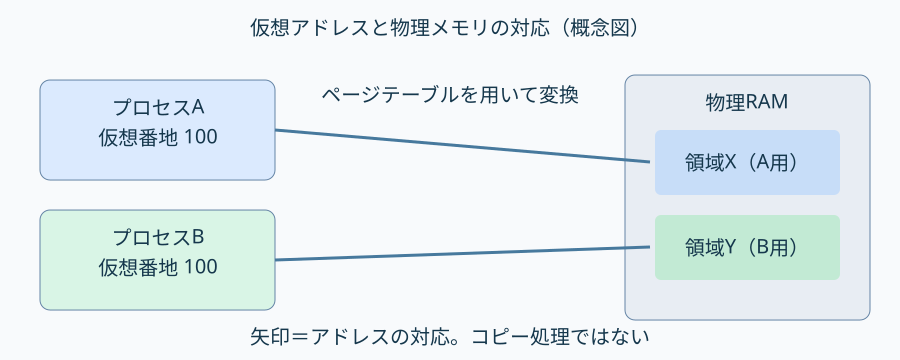
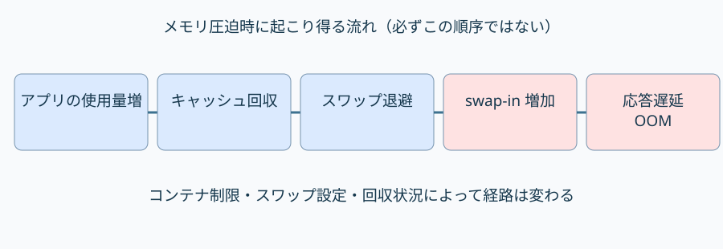

# 第21講 仮想メモリ・ページング・スワップ

**第3編：OS｜全224講中第21講**

**参照・照合状況**：Linuxの /proc/meminfo、/proc/PID/status、vmstat、cgroup v2 memory.events、Docker Desktopの一般的な仕組みに基づく説明です。今回、各公式マニュアルの該当版・ページの外部照合は未実施です。コマンド・ログは実行しておらず、ログ例は架空です。

## 1. 到達目標・前講とのつながり

第20講では、OSがプロセスやスレッドにCPUを割り当てる仕組みを学びました。今回は、**それぞれのプロセスがメモリをどのように使い、足りなくなったとき何が起こるか**を学びます。

到達目標は、①仮想アドレスと物理メモリの違い、②ページングとページフォールト、③ページキャッシュとスワップ、④メモリ圧迫時のログ判断、⑤対策の設計判断です。

A必須：アドレス変換、ページフォールト、スワップ。B補助：RSS、キャッシュ、監視コマンド。C発展：コンテナ制限、NUMA、巨大ページの位置づけ。

## 2. なぜ仮想メモリが必要なのか

NginxとPostgreSQLが同時に動く場面を考えます。両方が「メモリの100番地を使いたい」と考えても、同じ物理メモリを勝手に書き換えたら困ります。

**仮想メモリは、プロセスごとに独立したアドレス空間を見せ、OSが実際のメモリへの対応を管理する仕組みです。** これにより、プロセス間の保護やメモリ管理がしやすくなります。

仮想メモリは「必ずディスクを使う」という意味ではありません。多くの処理は物理RAM上で完結します。

## 3. 仮想アドレスから物理アドレスへ

アプリが扱うアドレスを**仮想アドレス**、RAM上の実際の位置を**物理アドレス**と呼びます。

CPUのMMU（Memory Management Unit、メモリ管理装置）は、OSが用意した**ページテーブル**（仮想と物理の対応表）などを使い、アドレスを変換します。TLB（Translation Lookaside Buffer）は、その変換結果を一時保存する高速な仕組みです。

次の図では、プロセスAとBの同じ仮想アドレスが、別々の物理領域へ対応しています。図の矢印は「参照先への対応」であり、データのコピーを意味しません。

**重要：アプリが仮想アドレスを使うたびにディスクアクセスが起こるわけではありません。**

## 4. ページとは何か

メモリを細かい単位で管理するため、仮想アドレス空間を**ページ**に分けます。物理メモリ側の対応する単位をページフレームと呼びます。

Linuxの一般的な構成では4KiBページが使われることが多いですが、CPUやOS設定により異なります。巨大ページ（huge pages）も存在します。

例えば4KiBページなら、連続した8KiBの領域は少なくとも二つのページにまたがります。ただし、仮想的に連続していても物理RAM上で連続している必要はありません。

## 5. 正常時のメモリアクセス

まず、必要なページが物理メモリに存在する正常例を追います。

1. FastAPIの処理が変数を読み取ろうとします。
2. CPUが仮想アドレスを使ってメモリ参照します。
3. MMUがページテーブル等を参照し、物理アドレスを求めます。
4. RAMから必要なデータが読み出され、処理が続きます。

この流れで必要な対応が既に利用できれば、ページフォールトは発生しません。TLBに変換結果がない**TLBミス**は、ページフォールトと同義ではありません。

## 6. ページフォールトとは何か

ここで「ページがまだ使える状態になっていない」場合を考えます。**ページフォールトは、CPUのメモリ参照をOSが追加処理する必要が生じたときの例外**です。

OSが新しい物理ページを割り当てたり、ファイルから必要なデータを読み込んだりします。アクセス権違反などで処理を継続できない場合もあります。

**ページフォールト＝障害、ではありません。** 新しいメモリ領域を初めて使うときなど、正常な処理でも発生します。

## 7. マイナーフォールトとメジャーフォールト

Linuxの監視では、ページフォールトを主に二種類に分けます。

| 種類 | 何が必要か | 性能への意味 |
|---|---|---|
| マイナー（minor） | ディスクからのページ読み込みを必要としない処理 | 発生しても通常は比較的軽い |
| メジャー（major） | ページをストレージから読み込む必要がある処理 | I/O待ちで遅延しやすい |

マイナーの例は、未割当ページへの初回アクセスや、RAM上にあるページの対応付けです。メジャーの例は、ファイルに対応するページをストレージから読み込む場面です。

ただしメジャーフォールトはスワップだけで発生するわけではありません。**ファイル読み込みでも起こります。**

## 8. スワップとは何か

物理メモリに空きが少なくなった場合、Linuxは利用頻度の低い匿名メモリのページなどを、設定された**スワップ領域**へ退避することがあります。匿名メモリは、ファイルそのものに対応しないアプリの作業用メモリなどです。

退避されたページが再び必要になると、スワップから読み戻します。これを**swap-in**と呼びます。退避は**swap-out**です。

RAMよりストレージは一般に遅いため、swap-inが頻発するとアプリが待たされます。ただし、スワップが少量使われているだけでは性能障害とは限りません。

## 9. ページキャッシュとスワップの違い

ここは混同しやすい部分です。**ページキャッシュはファイルの内容をRAMに保持して、次回の読み込みを速くする仕組み**です。一方、スワップは匿名メモリ等をRAMから退避するための領域です。

| 比較 | ページキャッシュ | スワップ |
|---|---|---|
| 主な対象 | ファイルのデータ | 匿名メモリなど |
| 主な場所 | RAM | スワップ領域（ディスク等） |
| 目的 | ファイルI/Oの効率化 | RAMの空きを確保する選択肢 |
| メモリ不足時 | 再利用可能なキャッシュを回収できる | 退避・再読込でI/Oが発生し得る |

**空きメモリが少なくても、回収可能なキャッシュが十分なら直ちにメモリ不足とは言えません。**

## 10. メモリ圧迫が起こる流れ

FastAPIとPostgreSQLのメモリ使用量が増えた場面を考えます。次の図は原因と結果を単純化したものです。

1. アプリが必要とするメモリが増えます。
2. OSは回収可能なキャッシュなどを減らして空きを確保します。
3. それでも足りなければ、スワップ退避などが増える場合があります。
4. 退避したページを頻繁に読み戻すとI/O待ちが増えます。
5. 応答時間が悪化し、場合によってはOOM（Out Of Memory、メモリ不足）によるプロセス終了が起こります。

この流れは必ず全部発生するわけではありません。スワップ無効、コンテナ制限、メモリ回収の状況によって経路は変わります。

## 11. RSS・VSZ・availableを区別する

メモリ監視でまず覚えたい指標は三つです。

**VSZ/VIRT**はプロセスの仮想アドレス空間の大きさです。予約した領域なども含み、すべてがRAMを占有しているわけではありません。

**RSS**（Resident Set Size）は、プロセスに対応して現在RAM上にあるページ量の目安です。共有ページを含むため、複数プロセスのRSSを単純合算すると二重計上が起こり得ます。

**MemAvailable**はLinuxが追加のアプリ使用にどれほどメモリを使えそうか推定した値です。MemFreeより運用上の判断に役立つ場合が多いですが、あくまで推定です。

## 12. Linuxの確認コマンド

ここからは実務で使う読み取りコマンドです。**以下はLinuxでの実行例であり、今回は実行していません。**

~~~bash
free -h
cat /proc/meminfo
vmstat 1 5
ps -eo pid,comm,rss,vsz --sort=-rss | head
cat /proc/3142/status
journalctl -k --since "30 minutes ago"
~~~

freeのavailableは利用可能メモリの推定値、swap欄はスワップ使用状況です。vmstatのsi/soはswap-in/swap-outの量、rは実行可能タスク、bは割り込み不可待機の目安です。

psのrssとvszは通常KiB単位です。/proc/3142/statusは架空PIDの例です。journalctl -kではOOMなどのカーネルログを探しますが、ログ閲覧には権限が必要な場合があります。

## 13. 正常な監視値の例

次は架空の8GiB RAMサーバの集約ログです。実機のコマンド出力ではありません。

~~~text
10:00 MemTotal=8.0GiB MemFree=0.5GiB
10:00 MemAvailable=3.2GiB Cached=2.8GiB
10:00 SwapUsed=0.2GiB vmstat si=0 so=0
10:00 AP p95=160ms major_faults/s=0
~~~

MemFreeは小さいですが、MemAvailableが3.2GiBあり、swap-in/outは観測期間中ゼロ、応答時間も正常範囲という設定です。

**空きメモリ0.5GiBという一点だけで障害とは判断しません。** ただし正常範囲は環境ごとに基準を持つ必要があります。

## 14. 障害例A：スワップ読み戻しで遅い

次はメモリ使用量が増え、応答が悪化した架空例です。

~~~text
22:00 JP1 batch started
22:05 MemAvailable=120MiB SwapUsed=3.4GiB
22:05 vmstat si=24000 so=8000 (KiB/s)
22:05 major_faults/s=900 AP p95=3100ms
22:05 storage await=48ms
~~~

**観測事実**は、利用可能メモリの減少、swap-in/outの発生、メジャーフォールト増加、ストレージ待ち、AP応答悪化です。

**仮説**は、メモリ圧迫に伴うページの退避・読み戻しが性能を落としていることです。ただし、ファイルI/OやDBの負荷も同時に確認する必要があります。

**追加調査**では、プロセス別RSS、JP1ジョブの開始時刻、DBメモリ設定、コンテナ制限、OOM履歴を照合します。

## 15. 障害例B：スワップなしでもOOM

前節ではスワップが使われました。しかし、スワップを無効にすれば解決するのでしょうか。答えは**必ずしも解決しません**。

~~~text
22:10 container memory.max=1073741824
22:10 container memory.current=1068000000
22:11 memory.events: oom_kill 1
22:11 AP process exited; Nginx returns 502
~~~

これは架空のLinux cgroup v2の例です。memory.maxは上限、memory.currentは現在の使用量、memory.eventsのoom_killはOOMによる強制終了の回数を示します。

コンテナ上限に達すると、ホスト全体に空きRAMがあってもコンテナ内のプロセスがOOM終了する場合があります。Nginxの502はその結果として現れます。

## 16. ページフォールトとキャッシュミスは違う

第19講までにCPUキャッシュを学びました。名前が似ていても、次の三つは別の現象です。

| 現象 | 何が見つからないか | 次に起こること |
|---|---|---|
| CPUキャッシュミス | CPUキャッシュ内のデータ | 下位キャッシュやRAM等を参照 |
| TLBミス | アドレス変換結果 | ページテーブル等を参照 |
| ページフォールト | 現在の変換・アクセス条件では処理を続けられないページ | OSの例外処理へ進む |

CPUキャッシュミスやTLBミスが起きても、ページフォールトが必ず発生するわけではありません。ページフォールトが起きても、ディスクI/Oが必ず発生するわけではありません。

## 17. 設計判断：どの対策を選ぶか

障害を見つけた後は、**何を増やすかより、どこが足りないか**を先に判断します。

| 対策 | 有効になりやすい条件 | トレードオフ |
|---|---|---|
| RAM増設 | ワーキングセットがRAMに収まらない | コスト・停止作業 |
| アプリのメモリ削減 | リークや過剰キャッシュがある | 修正・検証が必要 |
| 同時実行数制限 | バッチ等の同時負荷で圧迫 | 完了時間が延びる |
| コンテナ上限調整 | 上限が実需より小さい | ホスト全体の資源競合 |
| スワップ設定見直し | 退避方針が負荷特性に合わない | OOMリスクやI/Oへの影響 |

**ワーキングセット**は、一定期間に実際によく使うメモリのまとまりです。これがRAMに収まらないと、ページの入れ替えが頻発しやすくなります。

## 18. Oracle・JP1・Citrixでの応用

**Oracle**では、DBのメモリ領域とOSのページキャッシュ、プロセス使用量の関係を意識します。SGA（System Global Area）はDBが共有して使うメモリ領域です。Oracleの巨大ページ利用などは構成と製品版に依存するため、変更前に公式資料を確認します。

**JP1/AJS**では、バッチ同時実行で一時的にメモリ使用量が増えることがあります。開始・終了時刻とMemAvailable、swap-in/out、応答時間を並べて調べます。

**Citrix**では、ユーザーセッション数の増加によるメモリ消費が性能へ影響する場合があります。セッション数、ゲストOSのメモリ圧迫、ホストの資源割当を切り分けます。

この節は一般的な運用原理の説明で、製品版別の仕様は未照合です。

## 19. MacのDockerラボで確かめる

自宅のNginx→FastAPI→PostgreSQL構成でも、**コンテナ別の使用量と上限**を観測できます。

~~~bash
docker compose ps
docker stats --no-stream
docker compose logs --tail=50
~~~

Docker DesktopのLinuxコンテナはLinux VM側で動きます。docker statsの表示はホストmacOSのメモリ表示と直接一致するとは限りません。

この講義では安全のため、メモリを意図的に使い切る負荷試験やOOM誘発は行いません。

## 20. 障害対応の調査順序

これまでの内容を運用手順としてまとめます。

1. **業務影響を確認**：応答時間、502、ジョブ遅延、DB接続失敗を確認します。
2. **メモリ圧迫の有無を確認**：MemAvailable、プロセスRSS、コンテナ上限を調べます。
3. **I/Oと例外を確認**：vmstat si/so、メジャーフォールト、ストレージ待ち、OOMログを調べます。
4. **時間をそろえる**：JP1ジョブ、AP、DB、OSの変化を同じ時間軸で照合します。
5. **仮説を比較**：メモリリーク、過剰同時実行、コンテナ上限、ファイルI/Oを区別します。
6. **対策と復旧判定**：変更承認・切戻し条件を用意し、応答時間と業務処理結果を確認します。

**「メモリ使用率が高い」というだけでスワップ無効化や再起動を選ばない**ことが重要です。

## 21. まとめ・次講への橋渡し

今回の要点は五つです。

1. 仮想メモリはプロセスごとの独立したアドレス空間を実現します。
2. ページングはメモリをページ単位で管理する仕組みです。
3. ページフォールトは正常時にも起こり、メジャーとマイナーを区別します。
4. ページキャッシュとスワップは目的が異なり、空きメモリだけで異常を判断しません。
5. 性能障害ではMemAvailable、swap-in/out、RSS、OOM、業務応答を時系列で確認します。

次の第22講は「ファイルシステム・マウント・アクセス権」です。メモリ上のデータとディスク上のファイルがどのようにつながるかを学びます。
