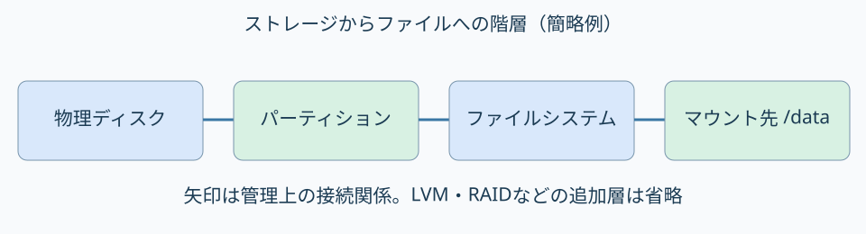
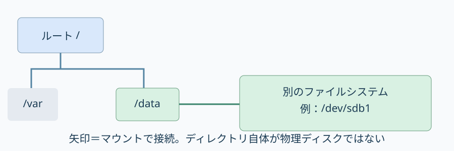

# 第22講 ファイルシステム・マウント・アクセス権

**第3編：OS｜全224講中第22講**

**資料・照合状況**：Linuxの一般的なファイルシステム、mount、findmnt、lsblk、df、chmod、ACL、Dockerの仕組みに基づく説明です。今回は各コマンドの公式マニュアルの版・該当ページと製品版別マニュアルは外部照合していません。以下のコマンドは未実行、ログは架空例です。システム構成・ディストリビューションにより挙動は異なります。

## 1. 到達目標と前講の接続

第21講では、プロセスの仮想アドレスがRAM上のページへ対応し、必要に応じてストレージからページを読み込むことを学びました。では、その**ストレージ上のデータをファイルとして整理する仕組み**は何でしょうか。今回はファイルシステム、マウント、アクセス権を一つの流れとして学びます。

到達目標は①ディスク・パーティション・ファイルシステムの違い、②ディレクトリ・inode・パスの仕組み、③マウントと永続化、④所有者・権限・ACL、⑤障害の切り分けと設計判断です。

A必須：ファイルシステム、マウント、rwx、所有者。B補助：inode、容量・inode枯渇、fstab、ログ。C発展：ACL、SELinux、コンテナマウント、バックアップ整合性。

## 2. なぜファイルシステムが必要なのか

SSDやHDDは、基本的にはデータを記録する装置です。しかし、装置上のどの場所に「orders.csv」があり、誰が読めるかをアプリが毎回自力で管理するのは現実的ではありません。

**ファイルシステムは、データをファイルとディレクトリという名前付きの構造で整理し、保存場所・属性・アクセスを管理する仕組みです。** Linuxではext4やXFSなどが使われます。製品によって性能特性や機能は異なります。

アプリがファイルを開くと、OSはパスをたどり、ファイルのメタデータを確認し、権限を検査したうえで読み書きを行います。メタデータとは、所有者、サイズ、更新時刻など、データ本体以外の管理情報です。

## 3. 物理ディスク・パーティション・ファイルシステム

まず混同しやすい三つを区別します。**ディスク**はデータを記録する装置、**パーティション**はその装置を論理的に区切った領域、**ファイルシステム**は領域内のデータを名前と属性で管理する仕組みです。

図は左から右へ管理対象が具体化する関係を示します。物理ディスクの上にパーティションを作り、その上にファイルシステムを作成し、OSのディレクトリツリーへマウントする構成例です。実際にはLVM、RAID、暗号化、ネットワークストレージなどの層が入ることもあります。

**重要：パーティションを作っただけでは、ファイルを保存できるファイルシステムが用意されたとは限りません。**

## 4. ディレクトリ・パス・inode

Linuxではファイルを「/var/log/app.log」のような**パス**で指定します。先頭の「/」はルートディレクトリで、そこからvar→log→app.logと名前をたどります。

ext4などのUnix系ファイルシステムでは、**inode**がファイルの種類、所有者、権限、サイズ、データの位置などを管理します。ディレクトリは名前とinode番号の対応を持ちます。通常、ファイル名そのものはinodeに保存されません。

同じinodeを複数の名前から参照する**ハードリンク**と、別のパスを指す**シンボリックリンク**があります。ハードリンクは通常ファイルシステムをまたげず、シンボリックリンクは参照先が消えるとリンク切れになります。

## 5. 正常処理：ログファイルの書き込み

Nginxがアクセスログを出す場面で、正常処理を順番に追います。

1. Nginxのプロセスが「/var/log/nginx/access.log」を開こうとします。
2. OSは各ディレクトリをたどり、対象ファイルとメタデータを確認します。
3. プロセスの実効ユーザー・グループ等に基づいてアクセス権を検査します。
4. 書き込みが許可されれば、データはページキャッシュ等を経由して処理され、必要に応じてストレージへ反映されます。
5. 書き込み結果がアプリへ返ります。

**writeが成功したことと、電源断でも失われない形で永続化されたことは同義ではありません。** 必要に応じてfsync等の仕組みやアプリ側の耐障害設計を検討します。

## 6. マウントとは何か

ファイルシステムを作っただけでは、OSの通常のパスから利用できない場合があります。そこで使うのが**マウント**です。

マウントとは、ファイルシステムをLinuxのディレクトリツリー上の位置（マウントポイント）へ接続することです。例えば別ディスクのファイルシステムを「/data」にマウントすると、アプリは「/data/orders.csv」というパスでアクセスできます。

図ではルート「/」の下に「/var」「/data」があります。「/data」だけが別ファイルシステムへつながっています。**マウントポイントはディレクトリの場所であり、ディスク装置そのものではありません。** マウントすると、元のマウントポイントにあった内容が一時的に見えなくなることがあります。

## 7. マウントの確認と再起動後の扱い

実務では、現在のマウント状態と、再起動後にどうマウントするかを分けて確認します。以下はLinuxの読み取り例で、**今回は未実行**です。

~~~bash
findmnt /data
lsblk -f
df -hT /data
cat /etc/fstab
~~~

findmntはマウント元・マウント先など、lsblk -fはブロックデバイスとファイルシステムの関係、df -hTは容量とファイルシステム種別を確認します。/etc/fstabは起動時などのマウント設定を記述するファイルです。

fstabではUUID（ファイルシステム等の識別子）を使うことがあり、デバイス名が変わる影響を抑えられます。設定ミスは起動時のマウント失敗につながるため、編集前にバックアップし、変更は検証環境と承認手順で行います。

## 8. 読み取り・書き込み・実行のrwx

Linuxの基本的なアクセス権は**r（read：読む）、w（write：書く）、x（execute：実行する）**の三つです。ただし、ファイルとディレクトリでは意味が異なります。

| 権限 | 通常ファイル | ディレクトリ |
|---|---|---|
| r | 内容を読む | 名前の一覧を読む |
| w | 内容を変更する | 名前の作成・削除・変更に関係する |
| x | プログラムとして実行する | パスを通過し名前を探索する |

ディレクトリのxは特に重要です。ファイル自体にrがあっても、途中のディレクトリを通過できなければアクセスできません。ディレクトリ内の削除には通常、親ディレクトリのwとxが必要で、対象ファイル自身のwだけでは決まりません。

## 9. 所有者・グループ・その他

権限は通常、**所有者（user）、グループ（group）、その他（other）**の三組で表します。

~~~text
-rw-r----- 1 appuser appgroup 2048 Nov 26 07:00 orders.csv
~~~

最初の「-」は通常ファイル、続く「rw-」は所有者に読み書き、「r--」はグループに読み取り、「---」はその他に権限なし、という意味です。表示の日時・ユーザーは架空です。

数値表記ではr=4、w=2、x=1を足し合わせます。例えば**640**は所有者rw-、グループr--、その他---です。**755**は所有者rwx、グループr-x、その他r-xです。

ただしrootの特権、ACL、SELinuxなどが関係するため、modeの数字だけで全アクセス可否を断定しません。

## 10. Permission deniedの原因を切り分ける

アプリが「Permission denied」を返した場合、すぐchmod 777にするのは適切ではありません。まず**どのユーザーが、どのパスの、どの操作を拒否されたか**を確かめます。

~~~bash
id appuser
namei -l /data/app/orders.csv
ls -ld /data /data/app
ls -l /data/app/orders.csv
getfacl /data/app/orders.csv
~~~

idは所属グループ、namei -lは途中のディレクトリの権限、lsは所有者とmode、getfaclはACL（基本の所有者・グループ・その他に加える詳細な権限設定）を確認します。getfaclは環境によって追加パッケージが必要です。

原因候補は①実行ユーザーの違い、②途中ディレクトリのx不足、③対象ファイルのr/w不足、④ACL、⑤SELinux等の追加制御です。**拒否ログと設定を突き合わせて最小限の権限変更を選びます。**

## 11. umask・ACL・SELinuxの位置づけ

ここまでのrwxだけでは、運用上のすべての権限を説明できません。まず**umask**は、新しく作るファイル・ディレクトリの基本権限から一部の許可を抑える設定です。既存ファイルを直接変更するものではありません。

**ACL（Access Control List）**は、特定のユーザーやグループに追加のアクセス権を設定する仕組みです。通常のmode表示だけでは詳細が分からない場合があります。

**SELinux**は、通常のUnix権限とは別に、プロセスとファイル等の関係をポリシーで制御する仕組みです。Unix権限が許可でもSELinuxが拒否する場合があります。導入・設定はディストリビューションによって異なります。

## 12. 容量不足とinode不足は別の問題

「No space left on device」というエラーは、データを保存するブロック領域の不足だけでなく、**inodeなどの管理資源の不足**でも起こり得ます。

~~~bash
df -h /data
df -i /data
du -sh /data/* 2>/dev/null
~~~

**df -h**はファイルシステムの容量、**df -i**はinodeの使用状況、**du**は指定したパス配下のファイル容量の集計を確認します。duの結果とdfの使用量が一致しないことがあります。削除済みでもプロセスが開いたままのファイル、スナップショット、予約領域などが関係します。

例えば小さなログファイルが大量生成されると、容量に余裕があってもinodeが不足する場合があります。対策前にどちらが枯渇しているか確認します。

## 13. 障害例A：/dataがマウントされていない

ここからは架空の障害ログを読みます。再起動後、FastAPIが注文ファイルを読めず、Nginxが502を返すケースです。

~~~text
07:01 systemd: data.mount failed: special device not found
07:02 fastapi: FileNotFoundError: /data/orders/orders.csv
07:02 nginx: upstream returned 502
~~~

**観測事実**は、マウント失敗、ファイル未発見、APの応答失敗です。**仮説**は、/dataのファイルシステムが未マウントで、APの参照先が見えなくなったことです。

まずfindmnt /data、lsblk -f、/etc/fstab、journalctl -bを確認し、デバイス認識やUUIDの変更を調べます。存在しないデバイスに対して安易にフォーマット操作をしてはいけません。復旧後はAPの読み取りと業務データの整合性を検証します。

## 14. 障害例B：権限変更後に書き込めない

次は、デプロイ後にFastAPIの書き込みが失敗する架空例です。

~~~text
10:00 deploy completed
10:01 appuser: PermissionError: /data/app/orders.csv
10:02 ls -l: -rw-r----- 1 root root ... orders.csv
10:02 namei: /data/app has drwxr-x--- root appgroup
~~~

**観測事実**は、デプロイ直後の拒否、対象ファイルの所有者root:root、ディレクトリの所有者root:appgroupです。

appuserがappgroupに所属するならディレクトリの探索は可能ですが、対象ファイルはグループrootに属し、その他に権限がありません。したがって、ファイルの所有者・グループが拒否原因の有力候補です。ただしACLやSELinuxも確認します。

対策はサービスの実行ユーザーと必要操作を確認し、対象ファイルまたは配置手順の所有者・グループ・権限を必要最小限で修正することです。

## 15. 障害例C：ディスク容量は空いているのに保存失敗

次は小さなファイルが大量に生成されたサーバです。数値は架空です。

~~~text
/data: df -h Use%=61%
/data: df -i IUse%=100%
app: OSError: [Errno 28] No space left on device
~~~

**観測事実**は、データ容量の使用率61%に対し、inodeが100%使用されていることです。**仮説**は、新しいファイルに割り当てるinodeが不足していることです。

まず大量の小ファイルを作った処理、保存期間、ログローテーション、ジョブ履歴を調べます。削除する場合は業務上の保管要件とバックアップを確認し、対象を限定します。容量増設だけではinode不足が解決しない構成もあります。

## 16. マウントオプションと設計判断

ファイルシステムのマウント時には動作を制御する**マウントオプション**を指定できます。例えばroは読み取り専用、rwは読み書き、noexecはそのファイルシステムからの直接実行を制限する設定です。

| 設計案 | 適する条件 | 注意点 |
|---|---|---|
| /dataを別ファイルシステムにする | データ容量や保守を分離したい | マウント依存・容量監視が必要 |
| roでマウントする | 変更不要の配布データ | 更新作業の方法を別途設計 |
| noexecを使う | 不要な実行を抑えたい | スクリプトの呼出方法などに例外がある |
| UUIDでfstab管理 | デバイス名変化に備えたい | UUIDの複製・変更には注意 |

**設計はセキュリティだけでなく、起動依存、復旧時間、容量計画、運用変更の容易さも含めて評価します。**

## 17. Oracle・JP1・Citrixへの応用

**Oracle**では、データファイルやREDOログの配置先がOSのファイルシステムか、ASM（Automatic Storage Management）などの管理方式かで運用確認点が変わります。ASMはOracleがストレージを管理する仕組みで、通常のディレクトリと同じ扱いはできません。

**JP1/AJS**では、ジョブログや一時ファイルの保存先が満杯になると、ジョブ実行・ログ出力に影響する可能性があります。ジョブの実行ユーザーと出力先の所有者・権限を確認します。

**Citrix**では、ユーザープロファイルや共有領域がネットワーク上のファイルサーバにある構成があります。ログオン遅延や保存失敗では、接続性・容量・権限・サーバ側の待機を分けて調べます。

製品固有の版別マニュアルは今回未照合です。ここでは一般的な運用上の考え方を扱っています。

## 18. Dockerラボ：bind mountとvolume

MacのDocker Desktop上でも、Nginx→FastAPI→PostgreSQLのデータ保存先を考えると理解が進みます。

**bind mount**はホスト側の特定パスをコンテナへ見せる方法です。**Docker volume**はDockerが管理する保存領域をコンテナへ接続する方法です。どちらもコンテナを作り直してもデータを残す設計に使えますが、保存先や権限の扱いが異なります。

~~~bash
docker compose ps
docker inspect --format '{{json .Mounts}}' <container_name>
docker volume ls
~~~

コマンドは読み取り例で、未実行です。実際には<container_name>を対象名に置き換えます。データベースのバックアップは、volumeの存在だけで保証されません。整合性を考慮したバックアップと復元試験が必要です。

## 19. 障害対応の調査順序

ここまでを実務の初動にまとめます。**エラー文だけで設定を変更せず、観測と仮説を分ける**ことが基本です。

1. 業務影響を確認：APの502、DB停止、ログ欠落、ジョブ失敗の範囲を確認します。
2. 対象パスを特定：どのユーザーが何の操作を試み、どこで失敗したか調べます。
3. マウントを確認：findmnt、lsblk、fstab、起動ログを照合します。
4. 容量を確認：df -hとdf -iでブロックとinodeを分けます。
5. 権限を確認：id、namei -l、ls -l、ACL、必要ならSELinuxログを確認します。
6. 対策と検証：必要最小限の変更、切戻し、業務データの読み書き・整合性を確認します。

## 20. まとめと次講への接続

今回の要点は五つです。

1. ファイルシステムは、ストレージ上のデータを名前・属性・配置で管理します。
2. マウントは、ファイルシステムをLinuxのディレクトリツリーに接続します。
3. rwxの意味はファイルとディレクトリで異なり、所有者・グループ・ACL等がアクセスを左右します。
4. 保存失敗では、マウント、ブロック容量、inode、権限を切り分けます。
5. 設計変更では最小権限、起動依存、保守性、復旧手順を同時に評価します。

次の第23講は「OSの起動・停止とサービス管理」です。マウントが起動時に失敗した場合、サービスへどう影響するかをさらに深く学びます。
