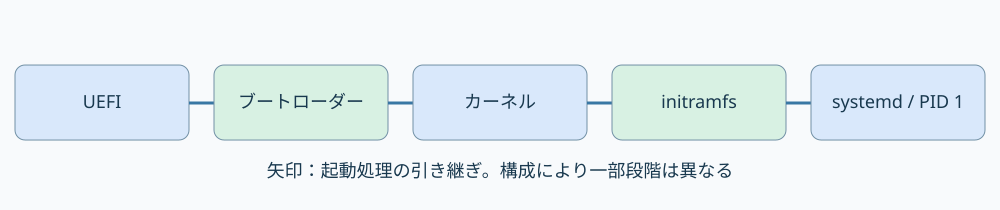
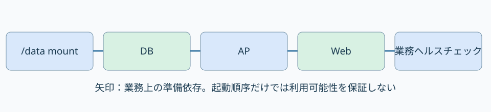

# 第23講 OSの起動・停止とサービス管理（初学者向け改訂版）

**第3編：OS｜全224講中第23講**

**資料・照合状況**：systemd公式マニュアル systemd.unit（https://www.freedesktop.org/software/systemd/man/latest/systemd.unit.html）でAfter/Requires/Wants/RequiresMountsForの説明を照合。OS・製品の版別仕様は未照合。コマンドは未実行、ログは架空例です。

## 1. この講義で知りたいこと：電源を入れたら何が起こる？

第22講では、ディスクを/dataという場所につなぐ「マウント」を学びました。ところで、サーバを再起動したら、誰が/dataをマウントし、誰がデータベースを起動するのでしょうか。

この講義では、**電源を入れる→Linuxが動く→WebやDBが起動する→利用者が使える**という流れを一つずつ追います。途中で「カーネル」「systemd」「プロセス」などの言葉が出ますが、順番に意味を説明します。

## 2. 最初に「プログラム」と「プロセス」を区別する

Nginxの実行ファイルがディスクに保存されているだけでは、Webページは表示できません。**プログラムは実行する命令の集まり、プロセスはそのプログラムを実際に動かしている状態**です。

料理に例えるなら、レシピがプログラム、レシピに従って料理している作業がプロセスです。コンピュータでは、CPUが命令を実行し、カーネルがプロセスを管理します。

まずは「ファイルとして存在すること」と「実際に動いていること」は違う、と覚えてください。

## 3. カーネルは「プログラムを動かす土台」

Linuxのカーネルは、CPUの使用時間をプロセスに割り当て、メモリやディスク、ネットワークを管理します。例えばNginxがWebページのファイルを読み込むとき、カーネルが提供するファイル読み込み機能を使います。

ただし、カーネルは「会社のWebサーバを毎朝起動する」といった業務上の起動管理までは担当しません。**プログラムが動けるようにすることと、どのプログラムを起動するか決めることは別の仕事**だからです。

## 4. systemdは「サービスの起動を管理するプロセス」

サーバではNginxやDBなど、いくつものプログラムを起動する必要があります。これらをいつ起動・停止するか管理する代表的なプログラムがsystemdです。

**systemd自身も、カーネルの上で動くプロセスです。** 一般的なsystemd採用Linuxでは、起動後にPID 1という番号で動きます。PIDとはプロセスを識別する番号です。

管理者がNginxの起動を指示すると、systemdが設定を確認して起動処理を進めます。カーネルはNginxのプロセスの実行を支え、Nginx自身がHTTP要求を処理します。

**カーネル＝動かす土台、systemd＝サービスを起動・停止する管理役、Nginx＝Webの仕事をするアプリ**です。systemdもNginxもカーネルの機能を使って動きます。

## 5. 電源投入からsystemdが動くまで

では、そのsystemdはどうやって動き始めるのでしょうか。一般的なLinuxの起動は次の順です。

1. 電源投入後、UEFIなどのファームウェア（機器を起動するためのプログラム）が起動先を選びます。
2. GRUBなどのブートローダー（OSを読み込むプログラム）がLinuxカーネルを読み込みます。
3. カーネルがCPU、メモリ、ディスクなどを使う準備をします。
4. 必要ならinitramfs（起動時だけ使う一時的な環境）でディスクを認識し、本来のルートファイルシステムへ切り替えます。
5. systemdが起動し、ログインやネットワークなどのサービスを管理します。

図の矢印は「次の段階へ処理を引き継ぐ」という意味です。ブートローダーで止まった場合、まだNginxの起動処理には到達していません。どの段階で止まったかを確認するのが障害調査の出発点です。

## 6. systemdが管理する「unit」とは

systemdは管理対象をunit（ユニット）と呼びます。**unitは「何をどのように管理するかをまとめた設定単位」**です。

| 種類 | 何を管理する？ | 例 |
|---|---|---|
| service | Nginxなどのプログラム | nginx.service |
| mount | ディスクのマウント | data.mount |
| target | 複数のunitをまとめた起動目標 | multi-user.target |
| timer | 時刻や周期に応じた処理 | logrotate.timer |

例えば、前講で学んだ/dataのマウントもsystemdの管理対象にできます。つまり、**必要なディスクを準備してからDBを動かす**という流れを扱えるわけです。

## 7. Web→AP→DBはどの順番で使えるようになる？

架空の3層システムを考えます。DBは/dataにデータを保存しています。

1. /dataをマウントします。ここが失敗するとDBはデータを読めません。
2. DBを起動します。ただし起動直後は接続を受け付けられない場合があります。
3. AP（業務アプリ）がDBに接続し、業務処理を始めます。
4. Webが利用者からの要求を受け付け、APへ渡します。
5. ヘルスチェック（実際に利用できるかの確認）で、業務APIの応答を確かめます。

図の矢印は「前のものが使えないと後ろが困る」という業務上の関係です。**起動したことと、実際に使えることは違います。**

## 8. まずは「今動いている？」を調べる

Nginxが動かないと聞いたら、最初に現在の状態を確認します。以下は未実行の例です。

~~~bash
systemctl status nginx.service
~~~

出力の中に「Active: active (running)」があれば、systemdは実行中と認識しています。「Active: failed」なら起動失敗や異常終了などが疑われます。ただし、activeでもWebページが正常に表示できるとは限りません。

次に、自動起動の設定を調べるには以下を使います。

~~~bash
systemctl is-enabled nginx.service
~~~

**activeは「今動いている？」、enabledは「OS起動時に起動対象となる設定？」**という別の質問です。enabledでも起動失敗することはあります。

## 9. サービスを起動・停止する指示

状態を確認し、影響と承認を確認した後に操作します。以下は未実行の構文例です。

~~~bash
sudo systemctl start nginx.service
sudo systemctl stop nginx.service
sudo systemctl restart nginx.service
sudo systemctl enable nginx.service
sudo systemctl disable nginx.service
~~~

startは今起動、stopは今停止、restartは今再起動です。enableは通常、次回のOS起動時に起動対象となるよう設定し、disableはその設定を解除します。**enableは今すぐ起動することではなく、disableは今すぐ停止することでもありません。**

本番でrestartすると、接続中の利用者へ影響する場合があります。コマンドを知っていることと、安全に実行できることは別です。

## 10. ログは「何が起きたかの記録」

サービスがfailedなら、次は理由を探します。ログとは、プログラムやOSが記録した出来事です。未実行の確認例を示します。

~~~bash
journalctl -u nginx.service -b --no-pager
~~~

「-u nginx.service」はNginxの記録に絞る指定、「-b」は今回のOS起動後の記録を見る指定です。失敗した時刻と、その直前の出来事を確認します。

ログに「connection refused」とあれば接続を拒否された事実は分かります。しかし、接続先が停止中だったのか、まだ準備中だったのかまでは、その一行だけでは決まりません。**ログは原因を考える材料であり、原因そのものとは限りません。**

## 11. AfterとRequiresは何が違う？

APはDBが使えないと仕事ができません。このような「Aを使うためにBが必要」という関係を依存関係と呼びます。

| 設定 | 意味 | 注意 |
|---|---|---|
| After= | 指定したunitの起動処理より後に進む | 指定先を起動する指示ではない |
| Requires= | 指定先も必要なので起動を要求する | 単独では起動順序を決めない |
| Wants= | 指定先にも起動を要求する弱い依存 | 指定先の失敗と必ずしも連動しない |
| RequiresMountsFor= | 指定した場所に必要なマウントを要求し順序付ける | /dataなど対象パスを確認 |

例えばAfter=database.serviceを指定しても、DBがSQL接続を受け付けられるまで待つとは限りません。**起動の順序と、業務上の準備完了は別に確認する**必要があります。

## 12. 障害A：fstabのUUID不一致

SSD交換後の再起動でDB・AP・Webに障害が広がった架空例です。

~~~text
07:00 data.mount: Mount process exited, status=32
07:01 database.service: Failed to start; /data unavailable
07:02 api.service: database connection failed
07:03 nginx: upstream returned 502
~~~

観測事実は/dataのマウント失敗、DB起動失敗、AP接続失敗、502です。仮説はUUIDの不一致やデバイス認識不良です。lsblk -fでUUID、findmntでマウント、fstabで設定、journalctl -bで失敗時刻を照合します。データがあるディスクを安易にフォーマットしてはいけません。

## 13. 障害B：DBがactiveでも接続不可

架空ログです。

~~~text
08:10 database.service: Started
08:10 api.service: connection refused at 127.0.0.1:5432
08:11 database: ready to accept connections
~~~

観測事実はDBのsystemd上の起動と、実際の接続受付開始に時間差があることです。After=で順序を指定しても業務準備完了を保証しません。DBの準備完了通知、APの接続リトライ（一定間隔で再試行）、ヘルスチェックなどを検討します。再試行間隔やタイムアウトも設計対象です。

## 14. 障害C：enabledなのにinactive

再起動後にis-enabledがenabledでもis-activeがinactiveになる場合があります。enabledは起動時の有効化、activeは現在の稼働状態です。依存失敗、起動条件、unitの起動対象への組込み、ログ、正常終了する短時間の処理かどうかを確認します。daemon-reloadはunit定義を読み直す操作で、通常はアプリの再起動ではありません。

## 15. 安全な停止・再起動

計画停止では、新規リクエストを抑止し、処理中の仕事を完了させ、APを停止し、DBを整合的に停止する順序を検討します。起動時はストレージ、DB、AP、Webの順に実際の利用可能性を確認します。事前に影響通知、JP1ジョブ抑止、バックアップ、データ整合性、切戻し条件を確認します。systemctl stopの成功だけで業務処理の完了は保証されません。OS全体のrebootは業務影響を伴うため変更管理が必要です。

## 16. 自動再起動と監視設計

Restart=on-failureは異常終了後の再起動を試みますが、設定ミスやDB停止の根本原因は解決しません。起動を短時間に繰り返すと開始回数制限に達することがあります。

| 設計 | 利点 | 注意 |
|---|---|---|
| Restart=on-failure | 異常終了からの復帰 | 永続的な設定不備は残る |
| 起動レート制限 | 再起動ループ抑制 | 復旧後の状態確認が必要 |
| ヘルスチェック | 業務機能の利用可否確認 | activeとは別に判定 |
| 依存関係設定 | 起動順序を管理 | 外部DBの準備完了は別 |

監視では、プロセス稼働、ポート接続、業務API応答を区別します。

## 17. Oracle・JP1・Citrixへの応用

OracleではOS、ストレージ、リスナー、DB起動、SQL接続確認を別段階として扱います。Oracle Restartなどの構成では製品側のリソース管理を優先し、systemdだけで勝手に起動順序を変えません。JP1/AJSでは管理サービスだけでなくジョブ実行先、保存先、再実行時の重複処理を確認します。Citrixではサービス稼働とユーザーのログオン成功は別であり、認証・プロファイル保存先・ネットワーク依存を確認します。製品版別の手順は今回未照合です。

## 18. Docker Composeとの違い

MacのDocker Desktop上のNginx→FastAPI→PostgreSQLでは、ホストOSのsystemdとコンテナの起動管理を区別します。Composeのdepends_onはコンテナ間の依存を扱いますが、単純な起動順序だけではDBの準備完了を保証しません。ヘルスチェックとservice_healthy条件などを検討します。

~~~bash
docker compose ps
docker compose logs --tail=50 api
docker compose logs --tail=50 db
~~~

コマンドは未実行の読み取り例です。Dockerの再起動ポリシーとsystemdのRestart=は別の仕組みです。

## 19. 障害対応の実務フロー

1. 業務影響、発生時刻、直前の変更を確認します。
2. systemctl --failed、status、journalctl -bで失敗unitを探します。
3. ストレージ・マウント・ネットワーク・権限・ポート・依存先を確認します。
4. アプリログとOSログの時刻を照合して仮説を絞ります。
5. 切戻しを準備して最小限の対策を実施します。
6. activeだけでなく業務API、DB接続、ジョブ結果を確認します。

## 20. まとめと次講

起動はファームウェア→ブートローダー→カーネル→初期ユーザー空間→サービス管理へ進みます。systemdはserviceやmountなどのunitを管理します。Afterは順序、Requiresは依存要求であり、activeとenabledは別です。プロセス起動と業務利用可能も別です。停止・復旧ではデータ整合性と切戻しを確認します。次の第24講は「Linuxのディレクトリ構造と基本コマンド」です。
