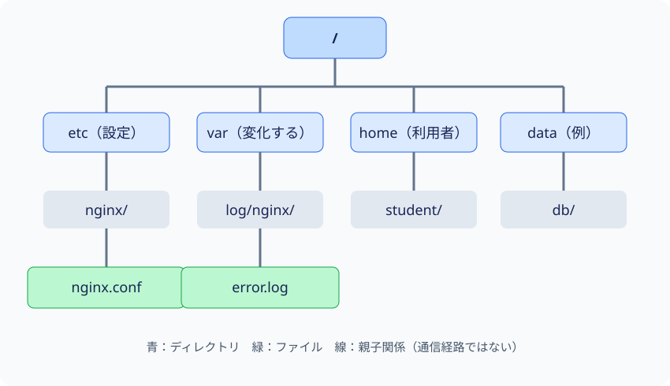

# 第24講 Linuxのディレクトリ構造と基本コマンド

**第3編 OS｜全224講中第24講**

**到達目標**：Linuxのディレクトリ構造を理解し、絶対・相対パスを区別して安全にファイルを調査できる。操作の影響を判断できる。

**資料・照合状況**：Linuxの標準的なファイル配置、GNU coreutilsの一般的なコマンド、Filesystem Hierarchy Standardに基づく説明。公式仕様の特定版・該当ページおよび製品別マニュアルは今回未照合。すべてのコマンドは未実行。例示ログ・環境は架空。

**重要度**：A必須＝ディレクトリ・パス・pwd/ls/cd・閲覧・探索・権限、B理解補助＝コピー・移動・マウント・容量、C発展＝設計と製品への応用。

## 1. なぜディレクトリを学ぶのか

前講ではsystemdがサービスを起動すると学びました。ところでNginxの設定ファイルや起動ログは、どこに置かれているのでしょうか。Linuxでは、ファイルの置き場所を知ることが障害調査の第一歩です。今回の目標は、①目的のファイルを探す、②場所を移動する、③中身を安全に読む、④変更前に危険性を判断する、の四つです。

## 2. ファイルとディレクトリを先に区別する

**ファイル**はデータや設定を保存するものです。**ディレクトリ**はファイルや別のディレクトリを整理する入れ物です。Windowsのフォルダーとほぼ同じイメージです。例えば`/etc/nginx/nginx.conf`はNginxの設定ファイルです。`/etc`と`/etc/nginx`はディレクトリ、最後の`nginx.conf`がファイルです。`/`はLinuxのディレクトリ構造の一番上にある**ルートディレクトリ**で、すべての絶対パスの出発点です。

## 3. パスとは住所のこと

ファイルの場所を示す文字列を**パス**と呼びます。`/var/log/nginx/error.log`は、`/`から`var`、`log`、`nginx`の順にたどって`error.log`へ到達する住所です。最初が`/`なら**絶対パス**で、今どこにいても同じ場所を示します。`logs/app.log`のように`/`から始まらないものは**相対パス**で、今いるディレクトリによって指す場所が変わります。Linuxでは`/`がディレクトリの区切り文字です。Windowsのドライブ文字とは違い、マウントしたディスクも一つのディレクトリの木につながります。

## 4. 現在地と移動：pwd・ls・cd

Linuxのコマンド操作では、今いるディレクトリを**カレントディレクトリ**と呼びます。まず`pwd`（print working directory）で現在地を確認します。次に`ls`（list）で中身を一覧表示し、`cd`（change directory）で移動します。

```bash
pwd
ls
cd /var/log
pwd
ls
```

例えば最初の`pwd`が`/home/student`、移動後が`/var/log`なら、場所が変わったことが分かります。`ls`は表示するだけで、ファイルを変更しません。`cd /var/log`は絶対パスで移動します。

## 5. 特殊な記号：.・..・~

`.`は**今いるディレクトリ**、`..`は**一つ上のディレクトリ**、`~`は通常**自分のホームディレクトリ**を表します。ホームディレクトリとは、利用者ごとに用意される作業場所です。例えば`/home/student/work`にいるなら`cd ..`で`/home/student`に戻ります。`cd ~`でホームに移動できます。`cd`だけでも通常はホームに移動します。

```bash
cd /var/log
cd ..
pwd
cd ~
pwd
```

最初の`pwd`は通常`/var`、二回目は自分のホームになります。相対パスを使うときは現在地を誤認しないことが重要です。

## 6. Linuxの代表的なディレクトリ

Linuxではファイルの役割ごとに置き場所が大まかに分かれています。すべての環境が完全に同じではありませんが、まず次を覚えます。

| 場所 | 何がある？ | 現場での例 |
|---|---|---|
| `/etc` | 主にシステム・サービスの設定 | `/etc/ssh/sshd_config` |
| `/var/log` | 主にログ | `/var/log`以下のサービスログ |
| `/home` | 一般ユーザーの作業領域 | `/home/student` |
| `/root` | rootユーザーのホーム | 管理者用の作業ファイル |
| `/usr` | アプリや共通のプログラム・データ | `/usr/bin` |
| `/bin`・`/sbin` | 基本コマンド（`/usr`へのリンクの場合あり） | `ls`など |
| `/tmp` | 一時ファイル | 一時的な作業データ |
| `/var` | 変化するデータ | ログ、キャッシュ、スプール |
| `/dev` | デバイスを表すファイル | `/dev/sda`など |
| `/proc` | カーネルが見せるプロセス等の情報 | `/proc/meminfo` |
| `/sys` | カーネルが見せる機器等の情報 | `/sys/class` |
| `/run` | 起動中の一時的な実行状態 | PIDファイル等 |
| `/mnt`・`/media` | ファイルシステムを接続する場所の例 | 外部ディスク |

**`/etc`は設定、`/var/log`はログ、`/home`は自分の作業場所**という三つから覚えましょう。

## 7. ディレクトリの木を図で読む

次の図は実際のLinuxを単純化したものです。上の`/`から枝分かれします。`/etc/nginx/nginx.conf`は`/`→`etc`→`nginx`→`nginx.conf`の順にたどります。`/var/log/nginx/error.log`は`/`→`var`→`log`→`nginx`→`error.log`です。図の横の線は親子関係であり、データが流れる方向ではありません。



この図で`/data`は業務データ用に作った例です。Linux標準で必ず存在する場所ではありません。

## 8. ファイルを読む：cat・less・head・tail

設定やログを調べるとき、最初は**書き換えずに読む**ことが大切です。`cat`は内容を一度に表示します。`less`は長いファイルをページ送りで読みます（終了は`q`）。`head`は先頭、`tail`は末尾を表示します。

```bash
cat /etc/os-release
less /etc/os-release
head -n 5 /etc/os-release
tail -n 20 /var/log/example.log
```

`/etc/os-release`にはOSの識別情報が入ります。最後の`example.log`は架空の例で、実際に存在するとは限りません。`tail -n 20`は末尾20行を読む指定です。**ファイルがない場合のエラーは、OSが壊れたという意味ではなく、指定先が存在しない可能性があります。**

## 9. ファイルの種類と隠しファイル：ls -l・ls -a

`ls -l`は名前だけでなく、種類・権限・所有者・サイズ・更新日時などを表示します。例えば`-rw-r--r--`の先頭`-`は通常ファイル、`drwxr-xr-x`の先頭`d`はディレクトリです。残りの`rwx`は読み・書き・実行などの権限で、前講までの知識につながります。

`ls -a`は名前が`.`で始まる**隠しファイル**も表示します。隠しファイルは秘密情報という意味ではなく、通常の一覧で省略されるという意味です。

```bash
ls -l /etc
ls -a ~
```

`ls -l`で表示される時刻やサイズは状況を調べる手掛かりですが、変更の理由までは分かりません。

## 10. 探す：findとgrep

どこにファイルがあるか分からないときは`find`を使います。**ファイル名で探す**操作です。例えば`find /etc -name 'sshd_config'`は`/etc`以下で指定名を探します。アクセス権がない場所ではPermission deniedが出ることがあります。

一方`grep`は、**ファイルの中から文字列を探す**操作です。

```bash
find /etc -name 'sshd_config'
grep -n 'NAME=' /etc/os-release
```

`grep -n`は一致した行の行番号も表示します。`find`は場所、`grep`は中身、という違いを覚えてください。ログを大量に検索するときは対象範囲を絞り、機微情報の扱いに注意します。

## 11. 作る・コピーする：mkdir・cp

検証用の自分のホームディレクトリで練習します。`mkdir`はディレクトリを作る、`cp`はファイルをコピーするコマンドです。

```bash
mkdir -p ~/infra-lab/logs
cp /etc/os-release ~/infra-lab/os-release.copy
ls -l ~/infra-lab
```

`-p`は途中のディレクトリも必要に応じて作る指定です。コピー元はそのまま残り、コピー先に別のファイルができます。ただし**コピー先に同名ファイルがあると上書きする場合がある**ため、業務ファイルで試さないでください。

## 12. 移動・名前変更・削除：mv・rm

`mv`はファイルの場所や名前を変えます。`rm`はファイルを削除します。どちらも業務環境では影響が大きいため、まず自分の練習用ファイルで確認します。

```bash
mv ~/infra-lab/os-release.copy ~/infra-lab/os-info.txt
ls -l ~/infra-lab
```

`mv`の後は旧名がなくなり、新名が表示されます。`rm`は削除操作なので、この講義では実行例を提示するだけにとどめます。

```bash
# 実行しない説明用の構文
rm ~/infra-lab/os-info.txt
```

特に`rm -r`はディレクトリ内を再帰的に削除し、一般にゴミ箱へ移動しません。**絶対パス・対象・バックアップを確認するまで実行しない**ことが原則です。

## 13. マウントとの関係：/dataは別ディスクでも同じ木の中

前講のマウントを思い出しましょう。例えばデータ用ディスクを`/data`にマウントすると、利用者やアプリからは`/data/db`という普通のディレクトリのように見えます。しかし実際の保存先は別のディスクかもしれません。

```bash
findmnt /data
df -h /data
```

`findmnt`はその場所にどのファイルシステムがマウントされているか、`df -h`はその場所を含むファイルシステムの容量・空き状況を調べます。`/data`というディレクトリが存在することだけでは、意図したディスクがマウントされている証拠にはなりません。**マウント失敗時に空のマウントポイントへ書き込んでしまう**事故を防ぐため、必ず実際のマウントを確認します。

## 14. パスの権限とエラーを切り分ける

ファイルが存在しても、権限がなければ読めません。Linuxではファイル自身の読み取り権限だけでなく、そこへ至るディレクトリの**探索権限（x）**も必要です。

`No such file or directory`は指定先が見つからない場合など、`Permission denied`は権限不足などの場合に出ます。どちらも原因を一つに断定するメッセージではありません。

```bash
pwd
ls -ld /var /var/log
ls -l /etc/os-release
```

`ls -ld`はディレクトリそのものの情報を見る指定です。まずパスの誤記、現在地、存在、権限を分けて確認します。むやみに`sudo`で回避すると本来の権限問題を隠すため、必要性を確認します。

## 15. 障害例：設定ファイルが見つからない

架空の例です。運用担当者が`cat etc/nginx/nginx.conf`を実行し、`No such file or directory`が出ました。現在地は`/home/operator`です。

ここで`etc/nginx/nginx.conf`は相対パスなので、実際には`/home/operator/etc/nginx/nginx.conf`を探します。意図した設定が`/etc/nginx/nginx.conf`なら、先頭の`/`が必要です。

1. `pwd`で現在地を確認する。
2. `ls -l /etc/nginx/nginx.conf`で絶対パスを確認する。
3. ファイルが存在すれば、`less /etc/nginx/nginx.conf`で読む。
4. それでも見つからなければ、インストール先や設定ファイルの実際の場所を調べる。

**エラーが出たらすぐにファイルを作るのではなく、まず指定した住所が正しいかを確認します。**

## 16. 障害例：ログが増えてディスクがいっぱい

Webサービスが書き込むログが増え、`/var`を含むファイルシステムの空き容量が減ったとします。ログが書けなくなると、サービスの動作にも影響する可能性があります。

```bash
df -h /var/log
du -sh /var/log/*
```

`df`はファイルシステム全体の使用量、`du`は指定したディレクトリやファイルが使う容量を調べます。`du -sh /var/log/*`はアクセス可能な直下の項目を集計する例です。結果が一致しない場合もあり、削除済みだが開かれたファイルなど追加確認が必要です。

対策としてはログローテーション（古いログを切り替え・保管する仕組み）や保存期間の見直しを検討します。**ログを無断削除すると障害調査に必要な証拠を失う**ため、保存要件を確認します。

## 17. 実務製品へのつなぎ方

Oracleではデータファイル、設定、診断ログの場所がそれぞれ異なり得ます。`/data`が使えるか、DBがどのパスを参照しているかを確認します。Oracleの実際の配置は構成・版に依存します。

JP1では、ジョブが参照する入力ファイルや出力先のパスを間違えると、サービスが動いていてもジョブは失敗します。実行ユーザー、カレントディレクトリ、絶対パス、権限を確認します。

Citrixでも、ユーザープロファイルやログの保存場所、アクセス権が問題になることがあります。製品版ごとの標準パスを決めつけず、実際の設定を調べます。

## 18. 設計判断：どこに置けば運用しやすいか

設定、業務データ、ログ、一時ファイルを同じ場所に無計画に置くと、障害調査や容量管理が難しくなります。一般に設定は`/etc`、変化するログは`/var/log`、利用者の作業は`/home`など、役割に沿って配置します。ただし製品の標準構成やセキュリティ要件が優先です。

業務データを専用の`/data`に置く設計では、容量監視やバックアップを分離しやすくなります。一方、マウント失敗が業務停止につながるため、起動時の依存関係とマウント確認が必要です。ログ用領域を分ける場合も、容量上限・保管期間・監視を合わせて設計します。

## 19. まとめと次の確認

今回の中心は五つです。①`/`はディレクトリ構造の頂点、②絶対パスは`/`から始まり相対パスは現在地に依存、③`pwd`・`ls`・`cd`で現在地と移動を確認、④`cat`・`less`・`find`・`grep`で安全に調べる、⑤削除・上書き・マウントは実務影響を判断する。

第23講のsystemdがNginxを起動する際も、設定ファイルやログのパスが重要です。次の講義では、この基礎を使ってLinuxの操作をさらに深めます。
